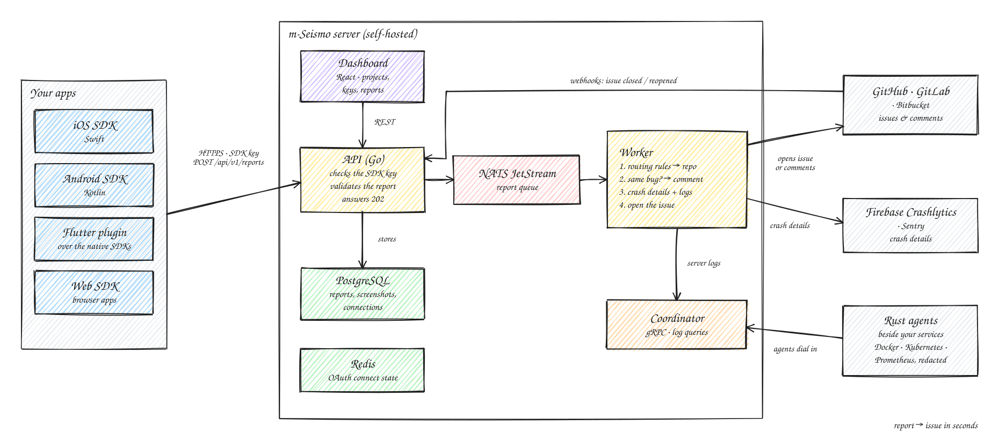

# m-Seismo

**Turn in-app bug reports and crashes into complete tracker issues.**

A tester shakes the phone, describes the problem and sends. Seconds later, an
issue is open on GitHub, GitLab or Bitbucket. It holds the screenshot, the
device and the app version, the steps that led to the bug, and the app's logs
and network requests. When Firebase Crashlytics or Sentry is connected, it
also holds the matching crash.

m-Seismo is open source and built by the [MicroClub](https://github.com/MicroClub-USTHB)
of USTHB. It runs on your own server.

[](https://github.com/MicroClub-USTHB/m-Seismo/releases)
[](LICENSE)
[](https://github.com/MicroClub-USTHB/m-Seismo/actions/workflows/ci.yml)

---

## Contents

- [Why m-Seismo](#why-m-seismo)
- [Features](#features)
- [How it works](#how-it-works)
- [Repository layout](#repository-layout)
- [Getting started](#getting-started)
- [Adding the SDK to your app](#adding-the-sdk-to-your-app)
- [Connecting trackers and crash providers](#connecting-trackers-and-crash-providers)
- [Running in production](#running-in-production)
- [Development](#development)
- [Documentation](#documentation)
- [Contributing](#contributing)
- [License](#license)

## Why m-Seismo

Bug reports from mobile and web apps usually arrive incomplete. A blurry
screenshot in a chat, "it doesn't work", no app version, no device, no idea
what the user did before. Developers spend more time collecting context than
fixing the bug.

m-Seismo captures that context at the moment of the bug, on the device, and
files the issue for you:

- **Testers and users** report with a shake, a screenshot or a button, and
  can draw on the screenshot to point at the problem.
- **Developers** get one well-formed issue per bug in the repository they
  already use, with everything needed to reproduce it.
- **Crashes** are reported on their own at the next launch. The same crash
  seen again is grouped under its first issue.

## Features

### In the app (SDKs)

- **Triggers:** shake the device, take a screenshot, or open the report
  screen from your own "Report a bug" button.
- **Report screen:** an annotated screenshot (pen and black-out marker for
  private data), then a short form: title, description, category, severity.
- **Automatic context:**
  - device, OS, locale, network and orientation;
  - app version and environment;
  - breadcrumbs (screens, lifecycle, taps) and logs;
  - network requests;
  - feature flags and experiments.
- **Crash capture:** uncaught crashes are saved on the device and sent at
  the next launch.
- **Reliable delivery:** reports wait offline and are retried with the same
  bytes, so a report is never sent twice.
- **Privacy:**
  - emails, phone numbers and tokens are redacted;
  - secure screens are never captured;
  - redaction lists are configurable.

### On the server

- **Issues on GitHub, GitLab or Bitbucket:**
  - each app connects its own account (GitHub App or OAuth);
  - routing rules send each report to the right repository;
  - issue templates.
- **One issue per bug:** reports of the same crash add a "Seen again"
  comment with counts and affected versions instead of a new issue.
- **Crash providers:**
  - **Firebase Crashlytics:** each report is matched to its crash, and the
    issue gets the symbolicated trace and a link to the Firebase console;
  - **Sentry:** the issue gets the Sentry event and a link to it.
- **Server context:** a Rust agent collects your services' logs and metrics
  around the time of the report (Docker, Kubernetes, Prometheus), redacted,
  over outbound-only connections.
- **Dashboard:**
  - projects, apps and SDK keys;
  - a setup wizard;
  - a report list with delivery status and retry.
- **Operations:**
  - issue status follows the tracker through webhooks;
  - report retention and deletion;
  - private, expiring screenshot links.

### Supported platforms

| Platform | Package | Location |
|---|---|---|
| iOS 13+ | Swift Package `MSeismo` | [`sdks/ios`](sdks/ios) |
| Android 7.0+ (API 24) | Kotlin library | [`sdks/android`](sdks/android) |
| Flutter (iOS and Android) | `m_seismo` plugin over the native SDKs | [`sdks/flutter`](sdks/flutter) |
| Web | `@m-seismo/web` | [`sdks/web`](sdks/web) |
| Web apps using Sentry | small ES module | [`sdks/web-sentry`](sdks/web-sentry) |

A React Native SDK is planned.

## How it works



<sub>Edit the diagram: open [`docs/system-design.excalidraw`](docs/system-design.excalidraw) on [excalidraw.com](https://excalidraw.com).</sub>

1. The **SDK** builds a report that follows the shared
   [report schema](spec/report.schema.json) and sends it to
   `POST /api/v1/reports` with the app's SDK key.
2. The **API** validates the report, stores it and its screenshot in
   PostgreSQL, answers `202 Accepted` and queues it on NATS JetStream.
3. The **worker** picks the repository with the project's routing rules. It
   checks whether the same bug already has an open issue. It fetches crash
   details from Crashlytics or Sentry, and server logs through the agents.
   Then it opens the issue or comments on the existing one.
4. The **dashboard** shows each report and whether it was delivered, and
   lets owners retry failed deliveries.

## Repository layout

| Path | What it is |
|---|---|
| [`backend/`](backend) | Go service: API, worker, tracker and crash-provider integrations |
| [`frontend/`](frontend) | Dashboard: React, TanStack Router and Query, Tailwind |
| [`agent/`](agent) | Rust agent and coordinator for server logs and metrics |
| [`sdks/`](sdks) | iOS, Android, Flutter and web SDKs |
| [`spec/`](spec) | Contracts shared by every component: report schema, ingestion API, agent protocol |
| [`deploy/`](deploy) | Docker Compose files for local development and servers |
| [`PRD.md`](PRD.md) | Product requirements |

## Getting started

### Requirements

- Docker with Compose v2
- `make`
- To work on the components:
  - Go 1.27+;
  - Rust (version pinned in `agent/rust-toolchain.toml`) with `protoc`;
  - Node.js 20+;
  - Xcode, Android SDK or Flutter for the SDKs.

### Run the server locally

```sh
git clone https://github.com/MicroClub-USTHB/m-Seismo.git
cd m-Seismo
cp deploy/.env.example deploy/.env   # then fill in what you need
make dev-up                          # Postgres, Redis, NATS, migrations and the backend
curl localhost:8080/healthz          # → 200
```

The first owner account is created at startup from `SEISMO_SUPERADMIN_EMAIL`
and `SEISMO_SUPERADMIN_PASSWORD` in `deploy/.env`.

### Run the dashboard

```sh
cd frontend
npm install
VITE_API_BASE_URL=http://localhost:8080/api/v1 npm run dev
```

Sign in with the owner account and follow the setup wizard:

1. **Apps:** create one app per build (web, iOS or Android).
2. **Repository:** connect a tracker and pick the default repository.
3. **Log sources:** optionally connect Crashlytics or Sentry.
4. **Categorization:** optionally add routing rules.
5. **Keys and test:** create the SDK key that goes into your app.

## Adding the SDK to your app

Every SDK needs two things from the dashboard: the server URL and the app's
SDK key (`msk_…`). The key only allows sending reports, so it is safe to ship
inside an app.

**iOS** (Swift Package Manager: add the package from `sdks/ios`)

```swift
import MSeismo

MSeismo.shared.configure(
    Configuration(
        baseURL: URL(string: "https://seismo.example.com")!,
        sdkKey: "msk_…",
        environment: "production",
        screenshotEnabled: true
    )
)
```

**Android** (add the `sdks/android/mseismo` module)

```kotlin
class MyApp : Application() {
    override fun onCreate() {
        super.onCreate()
        MSeismo.configure(this, Configuration(
            endpoint = "https://seismo.example.com",
            appKey = "msk_…",
            environment = "production",
        ))
    }
}
```

**Flutter**

```yaml
dependencies:
  m_seismo:
    path: path/to/m-Seismo/sdks/flutter
```

```dart
await MSeismo.instance.configure(MSeismoConfig(
  baseUrl: 'https://seismo.example.com',
  sdkKey: 'msk_…',
  environment: 'production',
  release: '1.0.0',
  shakeEnabled: true,
  screenshotEnabled: true,
));
await MSeismo.instance.checkForPendingCrash();
```

**Web**

```js
import { init, openReportForm } from '@m-seismo/web';

init({ endpoint: 'https://seismo.example.com/api/v1/reports', appVersion: '1.0.0' });
openReportForm(); // or let users press Ctrl+Enter
```

Each SDK's README covers the platform setup (permissions, Info.plist entries)
and the full API. The README files are in [`sdks/ios`](sdks/ios),
[`sdks/android`](sdks/android), [`sdks/flutter`](sdks/flutter) and
[`sdks/web`](sdks/web).

## Connecting trackers and crash providers

| Integration | What you set up | Guide |
|---|---|---|
| GitHub | One GitHub App for the deployment; each app installs it on its repositories | [backend/docs/github.md](backend/docs/github.md) |
| GitLab, Bitbucket | Each app registers its own OAuth application | [backend/docs/gitlab-bitbucket.md](backend/docs/gitlab-bitbucket.md) |
| Firebase Crashlytics | One Google OAuth client for the deployment; each project connects a Google account and picks its Firebase apps | [backend/docs/crashlytics.md](backend/docs/crashlytics.md) |
| Sentry | Each app connects its Sentry organization and project | [backend/docs/crash-providers.md](backend/docs/crash-providers.md) |

To link reports to Crashlytics crashes, the app writes its m-Seismo
installation ID into Crashlytics as the custom key `seismo_installation_id`.
The Crashlytics guide shows how on each platform.

## Running in production

`deploy/compose.server.yml` goes on top of the development stack for a
server reachable from the internet:

- Postgres is not published;
- the API listens on `127.0.0.1` behind your TLS reverse proxy;
- the backend refuses to start without production secrets.

```sh
make server-up
```

Every setting is documented in [`backend/.env.example`](backend/.env.example).
The required ones are:

- the database URL;
- the JWT secret and the encryption keys;
- the public URL.

See [deploy/README.md](deploy/README.md) for the full guide.

## Development

Run from the repository root:

| Command | What it does |
|---|---|
| `make check` | Format check, lint, build and test the backend and the agent |
| `make fmt` / `make lint` | Format or lint the Go and Rust code |
| `make backend-test` / `make test-integration` | Backend unit tests, or integration tests with real Postgres, Redis and NATS (Docker) |
| `make agent-test` | Agent tests |
| `make flutter-check` | Format check, analyze and test the Flutter plugin |
| `make dev-up` / `make dev-logs` / `make dev-down` | Start, follow and stop the local stack |
| `make api-test` | Run the API test scripts against the local stack |
| `make sqlc-generate` | Regenerate the database code after changing SQL |

The SDKs build with their own tools:

- iOS: `swift test` in `sdks/ios`;
- Android: `./gradlew :mseismo:testDebugUnitTest` in `sdks/android`;
- web: `npm test` in `sdks/web`.

CI runs all of this on every pull request.

## Documentation

- [Backend documentation](backend/docs/README.md):
  - architecture and data model;
  - worker, routing and deduplication;
  - integrations;
  - API usage and testing.
- [Ingestion API](spec/ingestion.md) and [report schema](spec/report.schema.json):
  the contract every SDK follows.
- [Agent protocol](spec/agent-protocol.md) and the [agent README](agent/README.md).
- [Deployment](deploy/README.md).
- [Releases and changelog](https://github.com/MicroClub-USTHB/m-Seismo/releases).

## Contributing

Contributions are welcome: bug reports, fixes, new integrations and SDKs.

1. Open an issue to discuss larger changes first.
2. Branch from `dev`, and open your pull request against `dev`. `main` only
   receives releases.
3. Write commits and the PR title as [Conventional Commits](https://www.conventionalcommits.org/)
   (`feat(worker): …`, `fix(android): …`).
4. Run `make check` and the tests of what you changed. CI must be green.

To report a security problem, please contact the maintainers privately
instead of opening a public issue.

## License

m-Seismo is released under the [MIT License](LICENSE).
