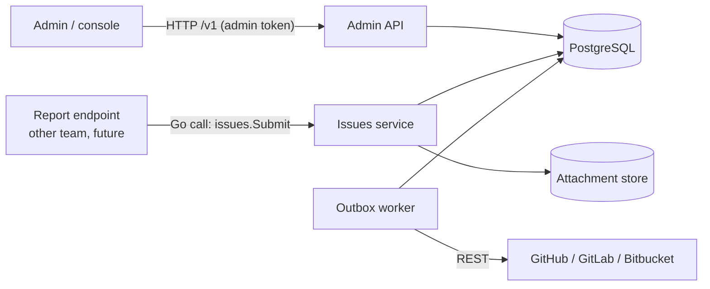

# 1. Overview

## What the backend does

m-Seismo turns bug reports from our mobile apps into complete issues in a git
hosting service. The product scope is defined in [`PRD.md`](../../PRD.md).
This backend is the server-side core of that product. It has two jobs:

1. **Admin API (HTTP).** It manages the configuration that decides where
   issues go:
   - **users**: the accounts that own everything else;
   - **projects**: a group of apps that report bugs together;
   - **apps**: one mobile app (platform, bundle id, environment) inside a
     project;
   - **git connections** *(planned)*: a user's link to GitHub, GitLab or
     Bitbucket;
   - **repository links** *(planned)*: which repositories of a connection a
     project files issues in, and which one is the default.

2. **Issues service (Go only, no HTTP)** *(planned)*. A library inside the
   backend process that takes a bug (title, description, attachments,
   fingerprint, metadata) and turns it into exactly one issue in the right
   repository, with rate limiting, deduplication, idempotency, attachment
   storage and retries.

   The service exposes **no endpoint**. A report endpoint, owned by another
   team, will call it in-process. We define the Go contract that endpoint
   uses: see [7. Issues service](07-issues-service.md).

## What the backend is not

- It is **not** the report-ingestion API. Mobile SDKs never talk to the admin
  API, and the issues service has no HTTP surface.
- It is **not** an authentication system. Authentication is deferred for v1.
  A single shared admin token protects the API in the meantime (see
  [4. HTTP API](04-http-api.md#authentication)).
- It does **not** store reporter identities. The PRD requires reporters to be
  anonymous (FR-24). "Users" in this backend are the people who configure
  m-Seismo, not the people who report bugs.

## Relationship to the PRD

The PRD is the product scope. This backend follows these decisions, which the
product owner made for this branch:

| Topic | PRD | This backend | Why |
| --- | --- | --- | --- |
| Issue trackers | GitHub only in v1; GitLab and Jira in v2 | GitHub, GitLab and Bitbucket behind one adapter interface | Explicit request; the adapter keeps each provider isolated |
| GitHub access | "installed on the GitHub organisation with the smallest set of permissions" | GitHub App (installation tokens) | Matches the PRD; no long-lived tokens stored |
| Report ingestion | Project key, instant acknowledgement | Not built here; the issues service is designed so a caller can acknowledge fast (async outbox) | The report endpoint belongs to another team |
| Admin console | v1.x | Admin REST API now, console later | The API is what the console will call |
| Deduplication, never doubled (FR-34, FR-54/55) | Required | Enforced by database constraints in the issues service | Correct under concurrency and retries |
| Private, expiring attachments (FR-48) | Required | Attachment store with presigned URLs | GitHub's API cannot attach files to issues |

Where this backend departs from the PRD (for example Bitbucket support, or
a "project" being a group of apps rather than a key holder), PRD section 22
applies: the conflict is named here, and the PRD is updated only after the
product owner decides.

## Status

| Phase | Content | Status |
| --- | --- | --- |
| 0 | Foundations: config, logging, database, migrations, router, errors, health, tests | Done |
| 1 | Users CRUD + audit | Done |
| 2 | Projects + apps CRUD | Done |
| 3 | Git connections (GitHub App, GitLab, Bitbucket), secrets | Planned |
| 4 | Project ↔ repository linking, default repo, app override | Planned |
| 5 | Issues service | Planned |
| 6 | Webhooks, retention, metrics, OAuth | Later |

The details, and everything known to be missing, are in
[10. Roadmap and gaps](10-roadmap-and-gaps.md).
