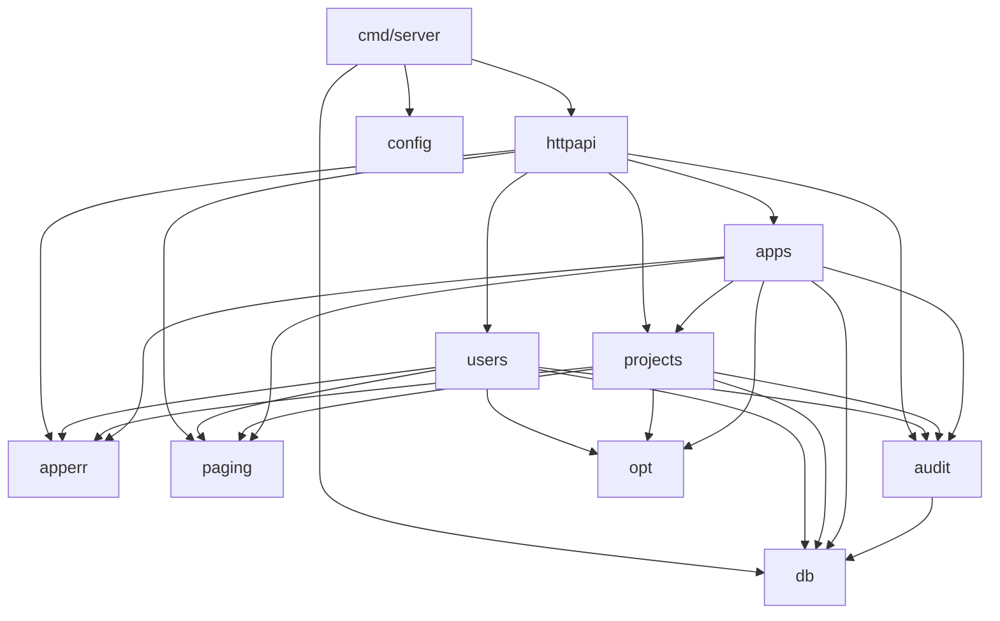
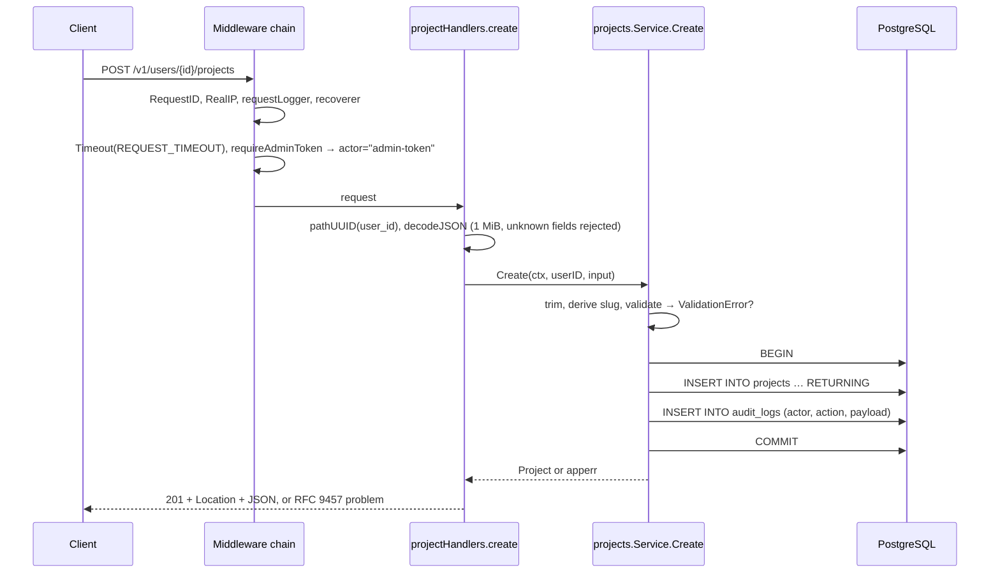

# 2. Architecture

## Shape of the system

The backend is **one Go binary** (`cmd/server`) backed by **one PostgreSQL
database**. There is no message broker, cache or second service. Work that
must survive restarts, such as publishing issues to GitHub, will use
PostgreSQL itself as a durable queue (the *outbox*, see
[7. Issues service](07-issues-service.md)).

Why a single binary and database:

- **Self-hostable** (PRD NFR-08). Each team runs its own copy, and every
  extra piece of infrastructure is something they have to operate.
- **Transactions.** Audit rows, idempotency records, issue upserts and outbox
  jobs commit atomically with the change that caused them. With a separate
  broker, a crash between "write to DB" and "publish to queue" loses or
  duplicates work.
- **Scale target.** The PRD asks for 100 reports per second (NFR-07), which
  PostgreSQL handles easily for this kind of load.

The binary can still be scaled horizontally: HTTP handlers are stateless, and
the outbox worker will claim jobs with `FOR UPDATE SKIP LOCKED`, so several
instances never process the same job. The one exception is the planned
in-memory rate limiter, which is per instance; see
[10. Roadmap and gaps](10-roadmap-and-gaps.md).

## Package layout

```
backend/
├── cmd/server/            entry point: wiring, signals, graceful shutdown, `migrate` subcommand
└── internal/
    ├── config/            environment → Config, validated at startup
    ├── db/                pgx pool, embedded goose migrations, InTx, Postgres error helpers
    │   └── migrations/    numbered SQL files (00001_*.sql …)
    ├── httpapi/           chi router, middleware, problem responses, one handler file per resource
    ├── users/             users domain service (SQL lives here too)
    ├── projects/          projects domain service
    ├── apps/              apps domain service
    ├── audit/             Record(ctx, querier, entry) + actor in context
    ├── apperr/            domain errors: NotFound, Conflict, ValidationError
    ├── opt/               opt.Field[T]: absent / null / value, for PATCH bodies
    ├── paging/            keyset cursors and page trimming
    └── testutil/          migrated throwaway database per test
```

Planned packages: `secrets/` (credential encryption), `connections/`,
`repositories/`, `vcs/` (provider adapters) and `issues/` (the issues service
and its worker).

### Package by feature, not by layer

The first draft of the plan used `handler/`, `service/`, `repository/` and
`model/` folders. That layout spreads one feature over four packages and
pushes everything to be exported. Instead, each domain package (`users`,
`projects`, `apps`) holds its types, validation, business rules and SQL
together. The HTTP layer is separate because it is a different concern:
transport, not domain.

For a feature of this size, a separate repository interface would add
indirection without value. The services are tested against a real database
(see [9. Testing](09-testing.md)), so there is nothing to mock. If a domain
grows complex enough to need it, the SQL can move behind an interface in that
package without touching the others.

### Dependency rules



- Domain packages never import `httpapi`. They return `apperr` errors, and
  `httpapi` decides the status codes.
- `httpapi` never runs SQL; it only calls services.
- A domain package may depend on another only to check ownership. For
  example, `apps` calls `projects.Exists` to scope apps to the owning user.
- `cmd/server` is the only place that builds concrete dependencies and passes
  them in.

## Request lifecycle

A `POST /v1/users/{user_id}/projects` request goes through these steps:



1. **Middleware** assigns a request id, resolves the client IP, logs the
   request when it finishes, and turns panics into a 500 problem. Under
   `/v1`, it also sets a deadline on the request context and checks the
   bearer token.
2. **Handler** parses path ids and decodes the JSON body strictly. Malformed
   input gets a 400 or 404 before any service code runs.
3. **Service** normalises the input (trims spaces, applies defaults) and
   validates it, collecting *every* field error at once. Then it opens a
   transaction, runs the change and the audit insert, and commits.
4. **Errors** come back as typed `apperr` values. Database errors are turned
   into domain errors at the service boundary: a unique violation becomes
   `Conflict`, a missing row becomes `NotFound`. The handler maps them to
   problem responses.

## Key design decisions

### PostgreSQL enforces the rules that matter

Whenever a rule can be expressed as a constraint (unique email, unique slug
per user, valid platform, valid slug format), it is a constraint, *and* it
is also validated in Go:

- **Go validation** gives good error messages and reports every field at once.
- **The constraint** is the guarantee. It holds under concurrent requests and
  against any future code path that forgets to validate.

The issues service relies on this most. Deduplication will be a partial
unique index, not a "check then insert" in Go, because the check-then-insert
pattern breaks under concurrency.

### Audit inside the transaction

The plan first suggested a middleware that writes audit rows for every
`POST`, `PATCH` or `DELETE`. Middleware cannot know the entity id, the owning
user or what changed, and it could log a change that was rolled back. Instead,
each service calls `audit.Record` with the same transaction as the change, so
an audit row exists **if and only if** the change was committed.

### Ownership scoping in SQL

Every nested resource is read and written through its owner:
`… WHERE p.user_id = $1 AND a.project_id = $2 AND a.app_id = $3`. Guessing
an id that belongs to someone else returns `404`, not the resource, and not
`403` (which would reveal that the id exists). This matters more once real
per-user authentication replaces the shared admin token.

### Hand-written SQL with pgx (deviation from the plan)

The plan proposed `sqlc` for generated, typed queries. The code currently
uses hand-written SQL with `pgx/v5` directly:

- no code-generation tool to install and keep in sync (sqlc was not available
  in the dev environment);
- each service has only a handful of queries, and each one is covered by
  integration tests against real PostgreSQL;
- the `CASE WHEN $set THEN $value ELSE column END` pattern used for partial
  updates is awkward to express in sqlc anyway.

To revisit if the number of queries grows a lot. See
[10. Roadmap and gaps](10-roadmap-and-gaps.md#deviations-from-the-plan).

### Errors follow RFC 9457

All error responses use `application/problem+json` as defined in
[RFC 9457](https://www.rfc-editor.org/rfc/rfc9457), which replaces RFC 7807.
Each one includes the request id so a user's error report can be matched to
the server log. Details are in [4. HTTP API](04-http-api.md#errors).

### No `error_logs` table

The first plan stored errors in an `error_logs` table. That fails exactly when
it is needed most: when the database is the thing that is broken. Errors are
written as structured JSON logs (`log/slog`) to stdout, where the platform's
log pipeline collects them. Metrics will come later. This also matches PRD
NFR-10: m-Seismo must never report its own failures through itself.
