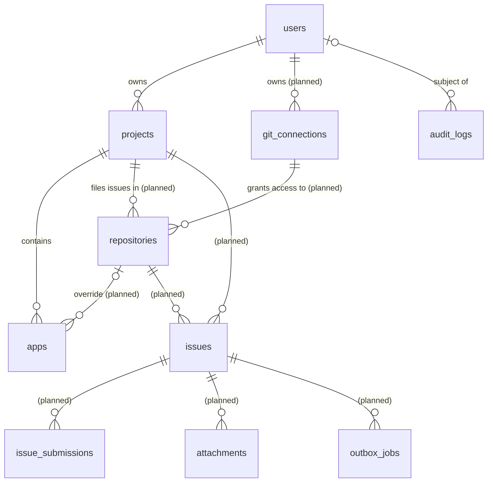

# 3. Data model

All tables live in one PostgreSQL database (version 13 or later, for the
built-in `gen_random_uuid()`; tests run on 17). The schema is created by
versioned migrations in
[`internal/db/migrations`](../internal/db/migrations).

## Entity relationships

## Conventions

| Convention | Rule | Reason |
| --- | --- | --- |
| Primary keys | `uuid DEFAULT gen_random_uuid()` | Built in since PG 13, so no `uuid-ossp` extension is needed; ids are not guessable |
| Timestamps | `created_at`, `updated_at` as `timestamptz NOT NULL DEFAULT now()` | Always time-zone aware |
| `updated_at` | Kept current by the `set_updated_at()` trigger | Correct even for updates made outside the services |
| Text | `text` + `CHECK (length(...) …)` | Limits live in one place and can change without rewriting the table |
| Enumerations | `text` + `CHECK (x IN (...))` | Easier to evolve than Postgres `ENUM` types |
| Foreign keys | Always indexed (leading column of an index) | Fast cascades and joins |
| Constraint names | Explicit where the services match on them (`users_email_key`, `projects_user_slug_key`, `apps_project_bundle_env_key`) | `mapErr` turns those exact names into `409 Conflict` |

## Implemented tables

### `users` (migration 00001)

| Column | Type | Notes |
| --- | --- | --- |
| `user_id` | uuid PK | |
| `name` | text NOT NULL | 1–255 characters |
| `email` | text NULL | ≤ 320 characters; optional |
| `created_at`, `updated_at` | timestamptz | |

- `users_email_key`: **unique index on `lower(email)`**. Email uniqueness is
  case-insensitive, while the email is stored as the user typed it. Several
  users may have no email, because unique indexes ignore NULLs.
- `users_created_at_idx (created_at, user_id)` backs keyset pagination.

### `audit_logs` (migration 00001)

| Column | Type | Notes |
| --- | --- | --- |
| `log_id` | uuid PK | |
| `user_id` | uuid NULL → `users` **ON DELETE SET NULL** | The user the change belongs to |
| `actor` | text NOT NULL | Who did it. Currently always `admin-token` for API calls, `system` otherwise |
| `action` | text NOT NULL | `user.create`, `project.update`, `app.delete`, … |
| `entity_type` | text NOT NULL | `user`, `project`, `app` |
| `entity_id` | uuid NULL | Id of the changed row |
| `payload` | jsonb NULL | Full row on create; only the changed fields on update; none on delete |
| `created_at` | timestamptz | |

Indexes: `(user_id, created_at)` for "what happened to this user", and
`(entity_type, entity_id)` for "history of this row".

`ON DELETE SET NULL` keeps the audit trail when a user is deleted. The rows
stay, keyed by `entity_id`, but lose their link to the deleted user. A
`user.delete` row is written with `user_id = NULL` because the user row is
gone by the time the transaction commits.

### `projects` (migration 00002)

| Column | Type | Notes |
| --- | --- | --- |
| `project_id` | uuid PK | |
| `user_id` | uuid NOT NULL → `users` **ON DELETE CASCADE** | Owner |
| `name` | text NOT NULL | 1–255 characters |
| `slug` | text NOT NULL | `^[a-z0-9]+(-[a-z0-9]+)*$`, ≤ 100 characters; derived from the name when not given |
| `settings` | jsonb NOT NULL DEFAULT `{}` | Must be a JSON object. Per-project overrides (below) |
| `created_at`, `updated_at` | timestamptz | |

- `projects_user_slug_key UNIQUE (user_id, slug)`: slugs are unique per user,
  not globally.
- `projects_user_created_idx (user_id, created_at, project_id)` backs the
  per-user list and pagination, and indexes the FK.

`settings` holds optional overrides of service-wide defaults. Go type
`projects.Settings`:

| Key | Meaning | Used by |
| --- | --- | --- |
| `rate_limit_per_minute` | Max submissions per minute for the whole project | Issues service (planned) |
| `rate_limit_per_installation_per_minute` | Max submissions per minute per app installation | Issues service (planned) |
| `attachment_max_bytes` | Max size of one attachment | Issues service (planned) |

An absent key means "use the configured default". The keys are validated
(must be positive) but **not yet used**, because their consumer is the issues
service.

### `apps` (migration 00002)

| Column | Type | Notes |
| --- | --- | --- |
| `app_id` | uuid PK | |
| `project_id` | uuid NOT NULL → `projects` **ON DELETE CASCADE** | |
| `name` | text NOT NULL | 1–255 characters |
| `platform` | text NOT NULL | `ios`, `android`, `flutter`, `react_native` |
| `bundle_id` | text NOT NULL | 1–255 characters (e.g. `dev.microclub.app`) |
| `environment` | text NOT NULL DEFAULT `production` | `^[a-z0-9][a-z0-9_-]{0,49}$` |
| `created_at`, `updated_at` | timestamptz | |

- `apps_project_bundle_env_key UNIQUE (project_id, bundle_id, environment)`:
  the same bundle can exist once per environment (`production`, `staging`, …)
  in a project.
- `apps_project_created_idx (project_id, created_at, app_id)` backs pagination
  and indexes the FK.

Apps are not linked to users directly. Ownership is always
`apps → projects → users`.

### Cascades

Deleting a **user** deletes its projects; deleting a **project** deletes its
apps (and, once implemented, its repository links). Audit rows are kept. Once
the planned tables exist, deleting a git connection will be **restricted**
while repositories still use it, so issues never point to a repository whose
credentials are gone. See [6. Git connections](06-git-connections.md).

## Planned tables

These are designed but not yet migrated. Full rationale is in
[6. Git connections](06-git-connections.md) and
[7. Issues service](07-issues-service.md).

| Table | Purpose | Key constraints |
| --- | --- | --- |
| `git_connections` | A user's credentials for one provider account: GitHub App installation, GitLab token, Bitbucket token | unique `(user_id, provider, base_url, account_login)`; `encrypted_credentials` sealed with AES-256-GCM |
| `repositories` | A repository linked to a project through a connection | unique `(project_id, connection_id, full_name)`; partial unique `(project_id) WHERE is_default` (exactly one default) |
| `apps.repository_id` | Optional per-app repository override | FK → `repositories`, `ON DELETE SET NULL` |
| `issues` | One tracked bug in one repository | partial unique `(repository_id, fingerprint) WHERE status = 'open'`; `occurrence_count NOT NULL` |
| `issue_submissions` | Idempotency records | `idempotency_key` primary key |
| `attachments` | Metadata of stored files | FK → `issues`; `sha256`, `size_bytes` |
| `outbox_jobs` | Durable queue of provider calls | index `(status, next_attempt_at)` |

## Migrations

- Tool: [`pressly/goose` v3](https://github.com/pressly/goose), used as a
  library. The SQL files are embedded into the binary with `go:embed`, so the
  binary carries its own schema.
- Files are named `NNNNN_description.sql`. Each has a `-- +goose Up` and a
  `-- +goose Down` section. Statements containing `;` inside a body
  (functions) are wrapped in `-- +goose StatementBegin/End`.
- Applied with `server migrate`, or automatically at start-up when
  `MIGRATE_ON_START=true`. Goose records applied versions in
  `goose_db_version`.
- **Never edit a migration that has been merged.** Add a new one.
- Migrations are tested on every test run: each test creates an empty
  database and runs all of them (see [9. Testing](09-testing.md)).
