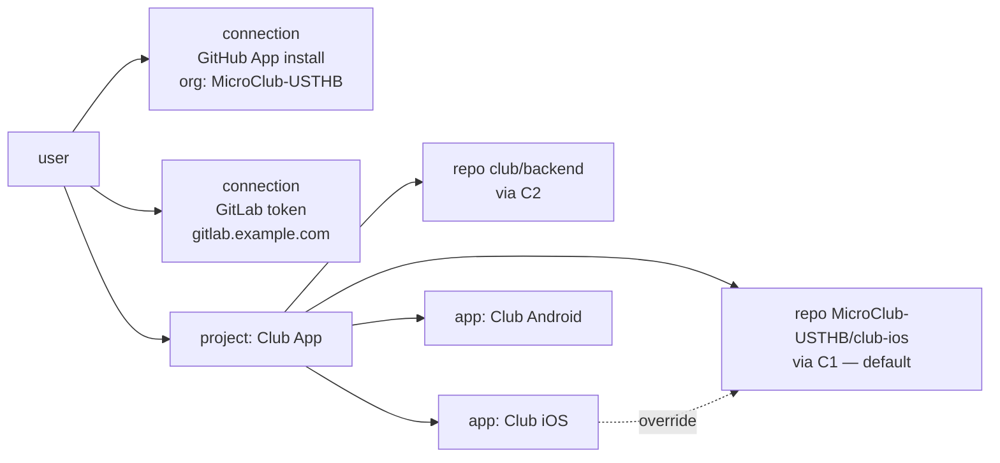
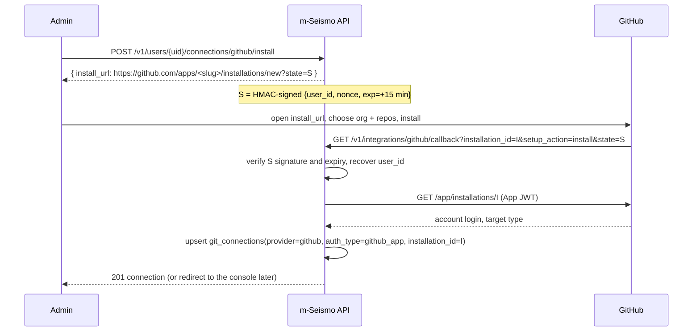

# 6. Git connections and repository links *(planned: phases 3–4)*

Nothing in this document is implemented yet. It is the agreed design for
phases 3 and 4, written in enough detail to build from. Update it as the
code lands.

## Goal

A user links m-Seismo to their git hosting accounts, then picks which
repositories each project files issues in:



When the issues service files an issue for an app, it uses the app's
**override** repository if one is set, otherwise the project's **default**
repository.

## Concepts

| Concept | What it is | Why separate |
| --- | --- | --- |
| **Connection** | Credentials for one account on one provider instance | One GitHub App installation or one GitLab token covers many repositories. Rotating credentials touches one row |
| **Repository** | One remote repository, linked to one project through one connection | A project can file in several repositories, possibly on different providers |
| **Default repository** | Exactly one repository per project, flagged `is_default` | Every issue needs a destination (PRD FR-59: no project without a default) |
| **App override** | `apps.repository_id`, optional | Lets each app file in its own repository (PRD FR-58) |

## Schema (migrations 00003, 00004)

```sql
CREATE TABLE git_connections (
    connection_id          uuid PRIMARY KEY DEFAULT gen_random_uuid(),
    user_id                uuid NOT NULL REFERENCES users ON DELETE CASCADE,
    provider               text NOT NULL CHECK (provider IN ('github','gitlab','bitbucket')),
    auth_type              text NOT NULL CHECK (auth_type IN ('github_app','access_token','oauth')),
    base_url               text NOT NULL,          -- https://api.github.com, https://gitlab.example.com, …
    account_login          text NOT NULL,          -- org / group / workspace the credentials belong to
    display_name           text,
    github_installation_id bigint,                 -- github_app only
    encrypted_credentials  bytea,                  -- access_token / oauth only
    key_id                 text,                   -- which encryption key sealed it
    expires_at             timestamptz,            -- token expiry when the provider reports one
    last_validated_at      timestamptz,
    created_at, updated_at …,
    UNIQUE (user_id, provider, base_url, account_login),
    CHECK ((auth_type = 'github_app') = (github_installation_id IS NOT NULL)),
    CHECK ((auth_type = 'github_app') OR encrypted_credentials IS NOT NULL)
);

CREATE TABLE repositories (
    repository_id    uuid PRIMARY KEY DEFAULT gen_random_uuid(),
    project_id       uuid NOT NULL REFERENCES projects ON DELETE CASCADE,
    connection_id    uuid NOT NULL REFERENCES git_connections ON DELETE RESTRICT,
    provider_repo_id text NOT NULL,   -- stable provider id; survives renames
    full_name        text NOT NULL,   -- owner/repo, group/subgroup/repo, workspace/repo
    is_default       boolean NOT NULL DEFAULT false,
    created_at, updated_at …,
    UNIQUE (project_id, connection_id, provider_repo_id)
);
CREATE UNIQUE INDEX repositories_one_default ON repositories (project_id) WHERE is_default;

ALTER TABLE apps ADD COLUMN repository_id uuid REFERENCES repositories ON DELETE SET NULL;
```

Design notes:

- **`ON DELETE RESTRICT` from repositories to connections.** A connection
  that repositories still use cannot be deleted; the API returns `409` and
  lists them. Otherwise issues would silently lose their destination.
- **`provider_repo_id`, not just the name.** Repositories get renamed and
  transferred. The numeric or UUID id stays the same, so the link keeps
  working. `full_name` is refreshed when the provider reports a new one.
- **Partial unique index for the default.** The database guarantees *at most
  one* default per project. The service guarantees *at least one* whenever
  the project has repositories: linking the first repository makes it the
  default, and unlinking the default is refused while other repositories
  exist (`409`: pick a new default first).
- **App override must belong to the same project.** This is checked in the
  service, in the same transaction.

## Credential encryption: `internal/secrets`

Tokens for GitLab and Bitbucket are stored encrypted. GitHub App
connections store no secret, only the installation id.

- **Algorithm:** AES-256-GCM (Go standard library), with a random 96-bit
  nonce per seal. Stored format: `nonce ‖ ciphertext ‖ tag`.
- **Key:** `SECRETS_KEY` (base64, 32 bytes) from the environment, never in
  the database. `SECRETS_KEY_ID` names it, and each row records the `key_id`
  that sealed it.
- **Associated data = `connection_id`.** Binding the ciphertext to its row
  means a token copied into another row will not decrypt.
- **Rotation:** start with the new key as primary and the old key listed in
  `SECRETS_OLD_KEYS` (`id:base64,…`). Reads try the key named by `key_id`. A
  background re-seal (or the next credential update) moves rows to the new
  key. Once no row uses the old `key_id`, remove the old key.
- **Never logged, never returned, never audited.** API responses show
  `has_credentials: true` and `expires_at`. Audit payloads say
  `"credentials": "rotated"`.

## Provider adapters: `internal/vcs`

One interface, one package per provider, and a registry keyed by provider
name:

```go
type Provider interface {
    Kind() Kind
    // Validate checks the credentials and returns the account they belong to.
    Validate(ctx context.Context, c Connection) (Account, error)
    ListRepositories(ctx context.Context, c Connection, page Page) ([]RemoteRepo, Page, error)
    GetRepository(ctx context.Context, c Connection, fullName string) (RemoteRepo, error)
    CreateIssue(ctx context.Context, c Connection, repo RepoRef, in IssueInput) (ExternalIssue, error)
    AddComment(ctx context.Context, c Connection, repo RepoRef, issue ExternalIssue, body string) error
}
```

`Connection` carries decrypted credentials only for the duration of the call.
Adapters return **typed errors**, so callers decide what to do without
parsing provider messages:

| Error | Meaning | Caller reaction |
| --- | --- | --- |
| `ErrUnauthorized` | Credentials revoked or expired | API: `422` on connect. Worker: stop retrying, mark the connection invalid |
| `ErrNotFound` | Repository gone or no access | API: `422`. Worker: fail the job |
| `*RateLimitedError{RetryAfter}` | Provider rate limit | Worker: retry after `RetryAfter` |
| `ErrIssuesDisabled` | Repository has issues turned off | API: refuse the link. Worker: fail the job |
| other (5xx, network) | Transient | Worker: retry with backoff |

### GitHub: GitHub App

Chosen because the PRD asks for the smallest permissions, installed on the
organisation, and because it needs **no long-lived secret per user**.

- **App permissions:** Issues *read & write*, Metadata *read*. Nothing else.
- **Configuration:** `GITHUB_APP_ID`, `GITHUB_APP_SLUG`,
  `GITHUB_APP_PRIVATE_KEY_PATH` (PEM), `GITHUB_WEBHOOK_SECRET` (phase 6).
- **Libraries:** `google/go-github` for the REST API, and
  `bradleyfalzon/ghinstallation/v2` to sign App JWTs and mint and cache
  installation tokens (valid 1 hour, refreshed automatically).

Installation flow:



- The callback is the **one `/v1` route that cannot use the admin token**,
  because GitHub's redirect cannot send it. It is protected by the signed,
  short-lived `state` instead.
- **Known risk:** `state` proves which *m-Seismo* user started the flow, but
  not that the person completing it controls installation `I`. Someone holding
  a valid `state` could attach someone else's installation id. Mitigation to
  build with it: turn on *"Request user authorization (OAuth) during
  installation"* in the App settings, exchange the returned `code`, and check
  that the authorising GitHub user can access installation `I`
  (`GET /user/installations`).
- If the installation is later suspended or uninstalled, token minting fails
  with `ErrUnauthorized`. Phase 6 adds the `installation` webhook to mark the
  connection inactive immediately.

### GitLab: access token (OAuth later)

- **Credential:** a project or group access token (or a personal access
  token) with the `api` scope. `read_api` is not enough to create issues.
  Role: Reporter or higher on the target projects.
- **Self-managed instances:** `base_url` holds the instance URL, for example
  `https://gitlab.example.com`; `https://gitlab.com` by default.
- **Validation on connect:** `GET /api/v4/personal_access_tokens/self`
  returns the scopes and expiry. It fails if `api` is missing and stores
  `expires_at`. GitLab tokens always expire (at most one year on recent
  versions), so the API surfaces upcoming expiry.
- **Library:** `gitlab.com/gitlab-org/api/client-go`.
- **Repository id:** the numeric project id. `full_name` is the
  `path_with_namespace`.
- **OAuth later:** add `auth_type = 'oauth'`, with the refresh token in
  `encrypted_credentials`. No schema change is needed.

### Bitbucket Cloud: access token

- **Credential:** a repository, project or workspace **access token**
  (Bearer). Do **not** build on app passwords: Atlassian is retiring them in
  favour of API tokens and access tokens.
- **Scopes:** `issue:write` (plus `repository` to list and read
  repositories).
- **Client:** a thin `net/http` client. There is no maintained official Go
  SDK, and only about five endpoints are needed.
- **Repository id:** the repository `uuid`. `full_name` is
  `workspace/repo_slug`.
- **Watch out:** Bitbucket's built-in issue tracker is **off by default** and
  many teams use Jira instead. Linking checks `has_issues` and refuses
  repositories without it (`ErrIssuesDisabled`).
- Bitbucket Data Center / Server is **not** covered. Its API is different.

## API behaviour

### Connections

`POST /v1/users/{uid}/connections` (GitLab or Bitbucket):

```json
{ "provider": "gitlab", "base_url": "https://gitlab.example.com", "token": "glpat-…", "display_name": "Club GitLab" }
```

1. Validate the input, including `base_url`: it must be `https://`, and it
   must not point at private or link-local addresses unless
   `ALLOW_PRIVATE_GIT_HOSTS=true`. This is SSRF protection: we make requests
   to a URL the client chose.
2. Call `Validate` on the provider. On failure → `422` with the provider's
   reason (e.g. "token lacks api scope"). Nothing is stored.
3. In a transaction: insert the connection with the encrypted token, and
   write an audit row (no secret).
4. Respond `201` without the token.

`PATCH` accepts a new `token` (re-validated, re-encrypted) or a new
`display_name`. `DELETE` returns `409` while repositories use the connection.

`GET …/connections/{cid}/remote-repositories?cursor=` lists what the
credentials can reach, so the console can show a picker. Nothing is stored.

### Repository links

`POST /v1/users/{uid}/projects/{pid}/repositories`:

```json
{ "connection_id": "…", "full_name": "MicroClub-USTHB/club-ios", "is_default": true }
```

1. The project and the connection must both belong to `uid`; otherwise `404`.
2. `GetRepository` on the provider confirms access and issues enabled, and
   returns `provider_repo_id`.
3. In one transaction:
   - if `is_default`, or this is the project's first repository, clear the
     current default and set this one;
   - insert, and audit.

`PATCH …/repositories/{rid}` with `{"is_default": true}` moves the default
atomically: one transaction unsets the old default and sets the new one.

`DELETE …/repositories/{rid}`:

- refused with `409` if it is the default while other repositories exist;
- apps that override to it fall back to the default (`ON DELETE SET NULL`).

## Tests to write with it

- Secrets: round trip; wrong associated data fails; a tampered byte fails; an
  old key still decrypts after rotation.
- Adapters: `httptest` servers that replay recorded provider responses,
  including 401, 404, 429 with `Retry-After`, and issues disabled.
- GitHub callback: expired state, tampered state, unknown installation.
- Links: first link becomes default; exactly one default under concurrent
  `PATCH`es; deleting the default is refused; deleting a used connection is
  refused; another user's connection gives 404.
