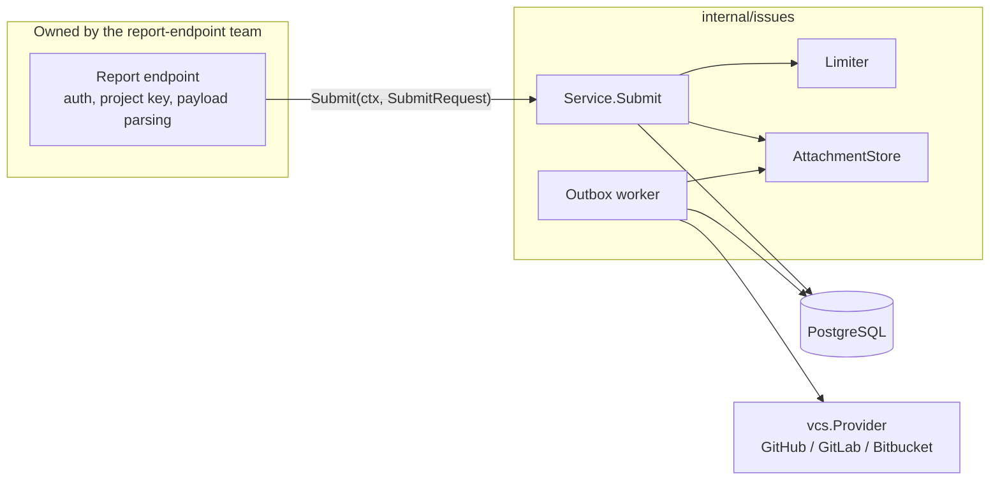
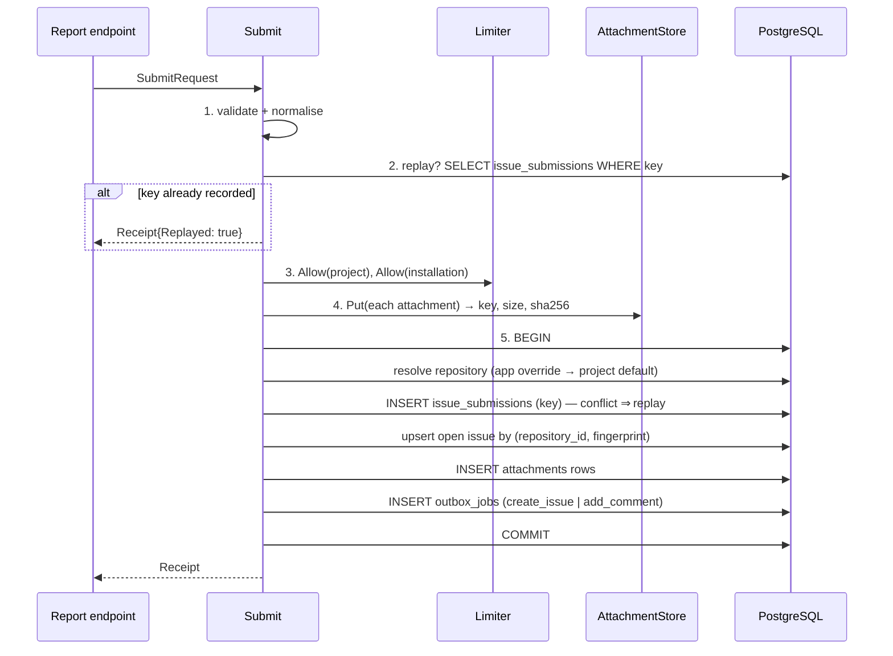

# 7. Issues service *(planned: phase 5)*

Nothing in this document is implemented yet. It is the agreed design and the
**contract** for the team building the report endpoint.

## Scope and boundary

The issues service is a Go package, `internal/issues`, that runs inside the
backend process. It has **no HTTP endpoint**, and no HTTP route is added for
attachments either.



| The report endpoint (theirs) | The issues service (ours) |
| --- | --- |
| HTTP, authentication, project keys | Validation and normalisation of issue content |
| Parsing the SDK payload | Rate limiting per project and per installation |
| Choosing an idempotency key (e.g. the report id) | Idempotency: the same key gives the same result |
| Computing fingerprint inputs | Fingerprint hashing and deduplication |
| Mapping our errors to its HTTP responses | Storing attachments, signed expiring links |
| | Choosing the repository (app override → project default) |
| | Durable, retried publishing to the provider |

## Go contract

```go
package issues

type SubmitRequest struct {
    // IdempotencyKey identifies one submission. Re-submitting the same key
    // returns the first result and changes nothing. Required, ≤ 200 chars.
    IdempotencyKey string

    ProjectID uuid.UUID
    AppID     uuid.UUID
    // InstallationID is the anonymous per-install identifier (PRD FR-24),
    // used for per-installation rate limiting and distinct-install counts.
    InstallationID string

    Title       string // required; trimmed; ≤ MaxTitleLength (else truncated with "…")
    Description string // optional; ≤ MaxDescriptionBytes
    Severity    string // "low" | "medium" | "high" | "critical"; default "medium"
    Category    string // free text, ≤ 100

    // FingerprintParts are hashed to group reports of the same bug, e.g.
    // [normalised top stack frames, error type, screen, app version].
    // Empty means "never group": the key is used as the fingerprint.
    FingerprintParts []string

    Attachments []AttachmentInput
    Labels      []string          // added to the provider issue
    Metadata    map[string]string // rendered as a table in the issue body
}

type AttachmentInput struct {
    Name        string
    ContentType string
    Body        io.Reader // streamed; Submit reads it fully or fails
}

type Receipt struct {
    IssueID      uuid.UUID
    Deduplicated bool // joined an existing open issue
    Replayed     bool // same IdempotencyKey seen before; nothing changed
}

func (s *Service) Submit(ctx context.Context, r SubmitRequest) (Receipt, error)
```

Errors the caller must handle:

| Error | Meaning | Suggested HTTP mapping (theirs) |
| --- | --- | --- |
| `*apperr.ValidationError` | Bad input, every field listed | 422 |
| `apperr.ErrNotFound` | Unknown project or app, or app not in project | 404 |
| `*issues.RateLimitedError{RetryAfter}` | Over a limit | 429 + `Retry-After` |
| `issues.ErrNoRepository` | Project has no default repository and the app has no override | 409 or 503: misconfigured project |
| `issues.ErrAttachmentTooLarge` / `ErrAttachmentType` | Attachment rejected | 413 / 415 |
| other | Internal | 500 |

`Submit` returns once the submission is **durably recorded**: within
milliseconds, with no provider call in the path. The provider issue is
created later by the worker. This is what allows the PRD's half-second
acknowledgement (FR-32).

## What `Submit` does, step by step



1. **Validate and normalise.** Trim strings, apply defaults, enforce limits,
   reject unknown severities. Every error is reported at once (as in the
   admin API).
2. **Fast replay check.** A key seen before returns its stored receipt
   immediately. A retry must neither cost rate-limit budget nor upload
   attachments again.
3. **Rate limit** (below).
4. **Store attachments** *before* the transaction, so no long upload holds a
   database transaction open. If the transaction then fails, the blobs are
   orphans; a periodic sweep deletes blobs with no `attachments` row older
   than one hour.
5. **One transaction** does all the bookkeeping. The idempotency insert
   comes first. If two concurrent calls race with the same key, one wins and
   the other hits the primary key, rolls back and returns the winner's
   receipt.

## Deduplication

- `fingerprint = hex(sha256(join(normalised parts, "\x1f")))`. The unit
  separator stops `["ab","c"]` and `["a","bc"]` from colliding.
- Uniqueness is enforced by the database:

  ```sql
  CREATE UNIQUE INDEX issues_open_fingerprint
      ON issues (repository_id, fingerprint) WHERE status = 'open';
  ```

- Upsert:

  ```sql
  INSERT INTO issues (…, fingerprint, occurrence_count, first_seen_at, last_seen_at)
  VALUES (…, $fp, 1, now(), now())
  ON CONFLICT (repository_id, fingerprint) WHERE status = 'open'
  DO UPDATE SET occurrence_count = issues.occurrence_count + 1,
                last_seen_at     = now()
  RETURNING issue_id, (xmax = 0) AS inserted;
  ```

  `inserted = true` enqueues `create_issue`; otherwise it enqueues
  `add_comment` with the new report's context (PRD FR-55). Ten concurrent
  reports of the same bug give **one** issue with `occurrence_count = 10`
  (PRD scenario 20.4). No "check, then insert" in Go, which would race.
- Scope is **per repository**: the same bug filed in two different
  repositories (e.g. two apps with different overrides) gives two issues.
- A **closed** issue does not match, so a recurrence opens a new issue.
  Regression detection (reopen and tag, FR-57) is v1.x.
- `occurrence_count` is never writable through any API.
- Planned: distinct installations and affected versions (FR-56), kept in
  `issue_occurrences(issue_id, installation_id, app_version)` and aggregated
  into the issue body when comments are posted.

## Idempotency

```sql
CREATE TABLE issue_submissions (
    idempotency_key text PRIMARY KEY,
    project_id      uuid NOT NULL,
    issue_id        uuid NOT NULL REFERENCES issues ON DELETE CASCADE,
    deduplicated    boolean NOT NULL,
    created_at      timestamptz NOT NULL DEFAULT now()
);
```

- Written in the same transaction as the issue. Either both exist or
  neither does, so "delivered twice → one issue" (FR-34) holds even if the
  process dies mid-request.
- The key is scoped by `project_id` in lookups, so two projects cannot
  collide on a key.
- Rows older than the retention period (default 7 days, beyond any SDK
  retry window) are purged.

## Rate limiting

```go
type Limiter interface {
    // Allow consumes one token for key, or reports when to retry.
    Allow(ctx context.Context, key string, limit Rate) (ok bool, retryAfter time.Duration, err error)
}
```

- Two buckets per submission: `project:<id>` and
  `install:<project>:<installation>`. Both must allow it. A flood from one
  installation is refused while everyone else in the project still gets
  through (PRD FR-35, scenario 20.6).
- Limits come from `projects.settings` when set, otherwise from
  configuration (`RATE_LIMIT_PER_PROJECT`, `RATE_LIMIT_PER_INSTALLATION`, per
  minute, with burst = limit).
- **First implementation:** in memory, using a token bucket per key
  (`golang.org/x/time/rate`), with idle buckets evicted. Correct for **one
  instance**. With N instances, the effective limit is up to N×.
- **Next:** a PostgreSQL-backed limiter (fixed window, `INSERT … ON
  CONFLICT DO UPDATE SET n = n + 1 RETURNING n`) for multi-instance
  deployments. The interface does not change.
- The limiter **fails open** on internal errors: a rate-limiter bug must not
  stop all reporting. The failure is logged.

## Attachments

GitHub's REST API cannot attach files to an issue, so m-Seismo stores files
itself and puts **links** in the issue body.

```go
type AttachmentStore interface {
    Put(ctx context.Context, key string, contentType string, r io.Reader) (size int64, sha256 string, err error)
    SignedURL(ctx context.Context, key string, ttl time.Duration) (string, error)
    Delete(ctx context.Context, key string) error
}
```

| Implementation | Use | `SignedURL` |
| --- | --- | --- |
| `s3` (S3, MinIO, R2, …) | Production | A presigned GET URL, valid `ATTACHMENT_URL_TTL`. The bucket stays private |
| `local` (disk) | Development only | A `file://` path; not shareable |

- Keys: `projects/<project_id>/<attachment_id>/<sanitised name>`.
- Enforced while streaming, so a large body is cut off early:
  `ATTACHMENT_MAX_BYTES` (or the project override), an allow-list of content
  types (images, `text/plain`, `application/json`, `application/zip`), and a
  maximum number per submission.
- **Link expiry vs. issues that live for years:** a presigned link in a
  GitHub issue stops working after the TTL (FR-48 wants expiring links). For
  now the TTL is long (e.g. 7 days, the S3 maximum for SigV4). A durable
  answer needs a small redirecting endpoint that re-signs links on demand,
  which is out of scope by decision. See [10](10-roadmap-and-gaps.md).

## Outbox and publishing

Provider calls are slow, rate-limited and sometimes down. They never happen
inside `Submit`. Instead, `Submit` writes a job, and a worker carries it out.

```sql
CREATE TABLE outbox_jobs (
    job_id          uuid PRIMARY KEY DEFAULT gen_random_uuid(),
    kind            text NOT NULL CHECK (kind IN ('create_issue','add_comment')),
    issue_id        uuid NOT NULL REFERENCES issues ON DELETE CASCADE,
    payload         jsonb NOT NULL,
    status          text NOT NULL DEFAULT 'pending' CHECK (status IN ('pending','running','done','failed')),
    attempts        int  NOT NULL DEFAULT 0,
    next_attempt_at timestamptz NOT NULL DEFAULT now(),
    locked_until    timestamptz,
    last_error      text,
    created_at, updated_at …
);
CREATE INDEX outbox_due ON outbox_jobs (next_attempt_at) WHERE status IN ('pending','running');
```

Worker loop (`WORKER_CONCURRENCY` goroutines, started by `cmd/server`, and
stopped on shutdown after the current job):

1. **Claim** a due job:

   ```sql
   UPDATE outbox_jobs SET status='running', attempts=attempts+1, locked_until=now()+'2 min'
   WHERE job_id = (
     SELECT job_id FROM outbox_jobs
     WHERE (status='pending' AND next_attempt_at <= now())
        OR (status='running' AND locked_until < now())    -- crashed worker
     ORDER BY next_attempt_at
     FOR UPDATE SKIP LOCKED LIMIT 1)
   RETURNING …;
   ```

   `SKIP LOCKED` lets many workers and instances poll the same table without
   ever claiming the same job.
2. **Ordering:** an `add_comment` job waits until its issue has an
   `external_id`, i.e. its `create_issue` job is done. If not, it is
   re-queued shortly.
3. **Render** the body from a `text/template`:
   - title, description, severity and category;
   - metadata table;
   - attachment links, signed at render time;
   - occurrence counters;
   - a hidden marker `<!-- m-seismo:issue:<issue_id> -->`.
4. **Call** the adapter (`CreateIssue` / `AddComment`). Save
   `external_id`, `external_number` and `external_url` on the issue, and mark
   the job `done`.
5. **On error:** classify it with the typed adapter errors (see
   [6](06-git-connections.md#provider-adapters-internalvcs)).
   - Transient: set `next_attempt_at` with exponential backoff and jitter,
     capped at 1 h, or use the provider's `Retry-After`.
   - Permanent, or more than `PUBLISH_MAX_ATTEMPTS`: mark `failed` with
     `last_error`.
   - A failed job is **kept, never dropped** (FR-62). Manual retry comes with
     the console.

**Exactly-once on the provider side.** The worker can crash after GitHub
created the issue but before the database recorded it. On retry, a naive
worker would create a duplicate. To prevent this, before `CreateIssue` the
worker searches the repository for the hidden marker (GitHub issue search,
GitLab `search=`, Bitbucket `q=`). If found, it adopts that issue instead of
creating another.

## Configuration

| Variable | Default | Meaning |
| --- | --- | --- |
| `ISSUE_MAX_TITLE_LENGTH` | 256 | Titles are truncated beyond this |
| `ISSUE_MAX_DESCRIPTION_BYTES` | 65536 | Longer is a validation error |
| `RATE_LIMIT_PER_PROJECT` | 600 / min | Default project bucket |
| `RATE_LIMIT_PER_INSTALLATION` | 30 / min | Default installation bucket |
| `ATTACHMENT_STORE` | `local` | `local` or `s3` |
| `ATTACHMENT_LOCAL_DIR` | `./data/attachments` | For `local` |
| `ATTACHMENT_S3_BUCKET`, `_REGION`, `_ENDPOINT` | — | For `s3`. `_ENDPOINT` is for MinIO / R2 |
| `ATTACHMENT_MAX_BYTES` | 10 MiB | Per file |
| `ATTACHMENT_MAX_COUNT` | 10 | Per submission |
| `ATTACHMENT_URL_TTL` | 168h | Presigned link lifetime |
| `WORKER_CONCURRENCY` | 4 | Publishing goroutines per instance |
| `PUBLISH_MAX_ATTEMPTS` | 12 | Before a job is marked failed |

## Tests to write with it

- Same key twice → `Replayed`, one issue, one job, limiter charged once.
- 10 concurrent submissions, same fingerprint → one issue, count 10, one
  `create_issue` and 9 `add_comment` jobs.
- Fingerprint scoped per repository; a closed issue is not matched.
- Limiter: an installation over its limit is refused while another
  installation passes; `RetryAfter` set.
- Attachments: over size, wrong type, and an orphan blob swept after a
  failed transaction.
- Worker against an `httptest` provider: 429 then success honours
  `Retry-After`; 401 fails permanently; crash between create and record gets
  adopted through the marker; `add_comment` waits for `create_issue`.
