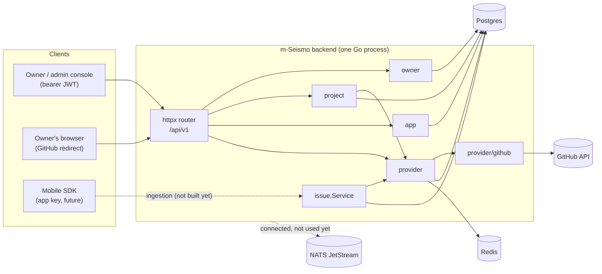
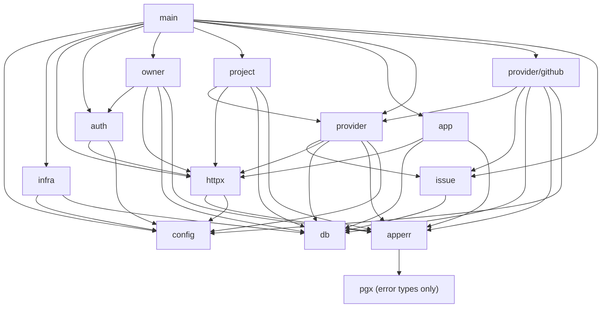

# Architecture

This page explains how the backend fits together. It covers the layers, how
packages depend on each other, how the process is wired at startup, what
happens during a request, and the conventions every package follows.

- [Big picture](#big-picture)
- [Domain model in one paragraph](#domain-model-in-one-paragraph)
- [Layers](#layers)
- [Package dependency graph](#package-dependency-graph)
- [Startup and dependency injection (fx)](#startup-and-dependency-injection-fx)
- [Life of an HTTP request](#life-of-an-http-request)
- [Error model](#error-model)
- [Authentication model](#authentication-model)
- [Multi-tenancy: owner scoping](#multi-tenancy-owner-scoping)
- [Tracker plug-in model](#tracker-plug-in-model)
- [Conventions](#conventions)

---

## Big picture



The backend is one Go binary, wired with [uber-go/fx](https://github.com/uber-go/fx).
It exposes a JSON REST API under `/api/v1` with these resources:

| Resource | Who calls it | Purpose |
|---|---|---|
| owners | admin console | sign up, log in, manage your own account |
| projects | admin console | group repositories that receive issues |
| apps | admin console | the mobile apps that report bugs, their SDK keys, and which projects they report into |
| providers | admin console and browser | link a tracker account (a GitHub App installation) and browse its repositories |

`issue.Service` is a **service, not a route**. It opens tracker issues for an
app. The worker calls it for every accepted report (see
[worker.md](worker.md)), and `POST /apps/{id}/test-issue` calls it directly.

---

## Domain model in one paragraph

An **owner** has many **projects**, many **apps** and many **provider
connections**. A provider connection is one tracker account the owner granted
access to, such as one GitHub App installation on `octo-org`. A project
targets one or more **repositories**. Each repository is reached through one
of the owner's connections, so one project can mix GitHub, GitLab and
Bitbucket. Exactly one of a project's repositories is its **default**. An app
is a *source* of issues. It links to any number of projects (many-to-many)
and authenticates with **app keys**. When an app reports a bug,
`issue.Service.OpenForApp` opens an issue in the default repository of every
project the app is linked to, and records each one as an **issue** row.

See [data-model.md](data-model.md) for the tables.

---

## Layers

```
┌────────────────────────────────────────────────────────────────────┐
│ main.go                  composes fx modules                       │
├────────────────────────────────────────────────────────────────────┤
│ handler.go (per package) HTTP: decode → call service → encode      │  transport
├────────────────────────────────────────────────────────────────────┤
│ service.go (per package) validation, ownership checks, transactions│  domain
│ issue.Service            cross-tracker issue opening               │
├────────────────────────────────────────────────────────────────────┤
│ provider.Registry        tracker-agnostic lookup                   │  integration
│ provider/github          the only code that talks to GitHub        │
├────────────────────────────────────────────────────────────────────┤
│ internal/db (sqlc)       generated, type-safe SQL                  │  persistence
│ internal/infra           pgx pool, Redis, NATS                     │
├────────────────────────────────────────────────────────────────────┤
│ internal/config          viper: defaults → file → SEISMO_* env     │  config
└────────────────────────────────────────────────────────────────────┘
        apperr — error kinds shared by every layer, no dependencies on them
```

Rules the layers follow:

1. **Handlers hold no business logic.** A handler parses path parameters and
   the body, takes the owner ID from the request context, calls one service
   method, and writes the result or the error. Validation lives in services.
2. **Services never import `net/http`.** They return `apperr` errors, and
   `httpx.Error` turns those into status codes. That keeps services callable
   from places other than HTTP, such as a NATS consumer or a CLI.
3. **Only `internal/provider/<tracker>` imports a vendor SDK.** Nothing else
   imports `go-github` or `ghinstallation`.
4. **Generated code is never edited.** `internal/db` comes from
   `db/queries/*.sql` and `db/schema.sql`.

---

## Package dependency graph

An arrow means "imports". Test files are not shown.



Two points are deliberate:

- **`issue` does not import `provider`.** `provider` already imports `issue`
  for the `issue.Opener` type, so the reverse import would be a cycle.
  Instead `issue` declares the small interface it needs, `issue.OpenerSource`,
  and `provider.Registry` satisfies it. fx connects the two in
  `provider.Module` with `func(r *Registry) issue.OpenerSource { return r }`.
- **`auth` imports `httpx`, not the reverse.** `httpx` declares
  `TokenVerifier`, `auth.Issuer` implements it, and `auth.Module` provides the
  `Issuer` as that interface. The HTTP layer therefore never depends on the
  JWT library.

---

## Startup and dependency injection (fx)

`main.go` exposes `Options()`, the full module list, so the binary,
`TestGraph` and the e2e test all build the same graph:

```go
fx.Options(
    config.Module,   // *config.Config
    infra.Module,    // *pgxpool.Pool, *db.Queries, db.Querier, *redis.Client, *nats.Conn, jetstream.JetStream
    httpx.Module,    // http.Handler (router), *http.Server, httpx.AuthMiddleware
    auth.Module,     // *auth.Issuer, httpx.TokenVerifier
    owner.Module,    // *owner.Service, owner.Handler → group "routes"
    project.Module,  // *project.Service, project.Handler → group "routes"
    app.Module,      // *app.Service, app.Handler → group "routes"
    provider.Module, // *provider.Registry, issue.OpenerSource, provider.StateStore, *provider.Service, provider.Handler → group "routes"
    github.Module,   // []provider.Provider → group "providers" (empty when GitHub is not configured)
    issue.Module,    // *issue.Service
)
```

Two **fx value groups** let packages register themselves without a central
list:

| Group | Element type | Producer helper | Consumer |
|---|---|---|---|
| `routes` | `httpx.Routes` (`Mount(chi.Router)`) | `httpx.AsRoutes(NewHandler)` | `httpx.NewRouter`, which mounts each one under `/api/v1` |
| `providers` | `provider.Provider` | `provider.AsProvider(FromConfig)` (flattened slice) | `provider.NewRegistry` |

The `providers` group is *flattened*: `github.FromConfig` returns a
`[]provider.Provider`, and when `github.app_id` is unset that slice is empty.
The server then runs without GitHub. `GET /providers` returns an empty list,
and `connect` returns 404 "provider github is not available".

Lifecycle hooks:

- `infra.NewPostgresPool` and `infra.NewRedisClient` ping their server at
  construction. If Postgres or Redis is down, the app fails to start.
- `httpx.NewServer` registers `OnStart`, which calls `net.Listen` and then
  serves in a goroutine. A port conflict therefore fails startup instead of
  failing silently later. It also registers `OnStop`, which calls
  `srv.Shutdown(ctx)` to drain in-flight requests.
- `httpx.Module` contains `fx.Invoke(func(*http.Server) {})`. This forces the
  server, and so the whole route graph, to be constructed, because fx builds
  only what something asks for.

`fx.ValidateApp(Options())` in `main_test.go` checks that every dependency
has a provider, without running any constructor.

---

## Life of an HTTP request

Example: `POST /api/v1/projects/{id}/repositories`.

```mermaid
sequenceDiagram
    autonumber
    participant C as Client
    participant MW as chi middleware
    participant A as AuthMiddleware
    participant H as project.Handler
    participant S as project.Service
    participant P as provider.Service
    participant G as provider/github
    participant DB as Postgres

    C->>MW: POST /api/v1/projects/{id}/repositories<br/>Authorization: Bearer …
    MW->>MW: RequestID, RealIP, Logger, Recoverer
    MW->>A: route matched (/projects group uses h.require)
    A->>A: auth.Issuer.Verify(token) → ownerID
    A->>H: ctx carries ownerID
    H->>H: UUIDParam("projectID"), Decode(body)
    H->>S: LinkRepository(ctx, ownerID, projectID, in)
    S->>DB: GetProject(id, owner_id) — 404 if not the owner's
    S->>P: VerifyRepository(owner, connection, "octo/app")
    P->>DB: GetProviderConnection(id, owner_id)
    P->>G: HasRepository(installationID, "octo/app")
    G-->>P: true / false
    P-->>S: Connection or apperr.Invalid
    S->>DB: BEGIN; List…; ClearDefault…; LinkProjectRepository; COMMIT
    S-->>H: Repository DTO or error
    H-->>C: 201 JSON  /  httpx.Error → 4xx/5xx {"error": "…"}
```

Middleware order, from `httpx.NewRouter`:

1. `middleware.RequestID` gives each request an ID, which is attached to logs
   of internal errors.
2. `middleware.RealIP` reads `X-Forwarded-For` and `X-Real-IP`.
3. `middleware.Logger` writes one access-log line per request.
4. `middleware.Recoverer` turns a panic into a 500 instead of crashing the
   process.
5. Per route group: `httpx.AuthMiddleware` on everything except register,
   login and the provider callback.

---

## Error model

There are three pieces: `apperr` defines *what went wrong*, services *return*
it, and `httpx.Error` *maps* it.

| `apperr` kind | Constructor | HTTP status | Typical cause |
|---|---|---|---|
| `KindNotFound` | `apperr.NotFound(msg)` | 404 | missing row, another owner's row, malformed UUID in the path |
| `KindConflict` | `apperr.Conflict(msg)` | 409 | duplicate email, slug, repository link or installation |
| `KindInvalid` | `apperr.Invalid(msg)` | 422 | validation failure, bad JSON, unreachable repository |
| `KindUnauthorized` | `apperr.Unauthorized(msg)` | 401 | missing or invalid token, wrong password, bad app key |
| `KindRateLimited` | `apperr.RateLimited(msg, wait)`, or any error with a `RetryAfter() time.Duration` method such as `*issue.RateLimitError` | 429 + `Retry-After` | m-Seismo throttle, GitHub rate limit |
| `KindInternal` | any other error | 500 | everything else; logged, and the details are hidden |

`apperr.Classify` also recognises raw database errors, so a service can
return a query error unchanged:

- `pgx.ErrNoRows`, even wrapped, becomes `KindNotFound` with the message "not found".
- Postgres `23505` (unique violation) becomes `KindConflict` with "already exists".
- Postgres `23503` (foreign-key violation) becomes `KindInvalid`.

Services usually replace the generic message with a specific one, for example
"a project with this slug already exists".

Every error response body has the same shape:

```json
{ "error": "a project with this slug already exists" }
```

For 500 responses the body is always `{"error":"internal error"}`. The real
error is logged with `slog` along with the method, path and request ID.

---

## Authentication model

There are two separate credentials.

| Credential | Who holds it | Format | Verified by | Grants |
|---|---|---|---|---|
| **Owner JWT** | admin console | HS256 JWT, `sub` = owner UUID, `iss` = `m-seismo`, expiry required | `auth.Issuer.Verify` in `httpx.AuthMiddleware` | full management of that owner's resources |
| **App key** | mobile SDK | `msk_` + 43 base64url chars (32 random bytes) | `app.Service.Authenticate` (SHA-256 lookup) | (future) submit reports for that app only |

- Passwords are hashed with bcrypt at the default cost. The length must be
  8–72 bytes, because bcrypt ignores anything after 72.
- A login for an unknown email still runs one bcrypt comparison against a
  dummy hash. Without that, the response time would reveal which emails have
  accounts.
- Changing the email or password requires `current_password`. Otherwise a
  stolen token could take over the account.
- App keys are stored only as SHA-256 hashes, with the first 12 characters
  kept for display. Key entropy is 256 bits, so a fast hash is enough; bcrypt
  is for low-entropy passwords.
- The GitHub connect flow uses its own credential, a one-time **state**
  stored in Redis. It is described in [github.md](github.md).

---

## Multi-tenancy: owner scoping

Every resource belongs, directly or indirectly, to one owner. Isolation is
enforced **in SQL**, not by checking after fetching:

```sql
-- name: GetProject :one
SELECT * FROM projects WHERE id = $1 AND owner_id = $2;
```

The pattern is:

- **Direct resources** (projects, apps, provider connections) have
  owner-scoped `Get`, `Update` and `Delete` queries. When the owner doesn't
  match, the query returns no row, which becomes 404. It is the same response
  as an ID that doesn't exist, so callers learn nothing about other owners.
- **Child resources** (project repositories, app keys, app↔project links):
  the service first loads the parent with the owner-scoped query, then runs
  the child query filtered by parent ID. An example is
  `UnlinkProjectRepository ... WHERE id = $1 AND project_id = $2`.
- **Cross-resource links** check both sides. `app.Service.LinkProject` loads
  the app *and* the project as the same owner. `project.Service.LinkRepository`
  checks that the connection belongs to the owner, through
  `provider.Service.VerifyRepository`.
- **The GitHub callback has no JWT.** The owner comes from the server-side
  state stored when that owner called `connect`.

---

## Tracker plug-in model

Every tracker implements one interface (`internal/provider/provider.go`):

```go
type Provider interface {
    Tracker() db.Tracker
    InstallURL(state string) string
    CompleteInstall(ctx, query url.Values) (Account, error)
    ListRepositories(ctx, externalID string) ([]Repository, error)
    HasRepository(ctx, externalID, repository string) (bool, error)
    Opener(ctx, externalID string) (issue.Opener, error)
}
```

`externalID` is the tracker's own identifier for a connection. For GitHub it
is the App installation ID. Everything outside the tracker package treats it
as an opaque string. Adding GitLab means adding `internal/provider/gitlab`
and one line in `main.go`. See [extending.md](extending.md).

---

## Conventions

| Topic | Convention |
|---|---|
| Package layout | one package per resource: `service.go` (domain), `handler.go` (HTTP and fx `Module`), `*_test.go` |
| DTOs | services return their own JSON structs (`owner.Owner`, `project.Repository`, …), never `db.*` rows. This keeps `password_hash` and `key_hash` from leaking. |
| IDs | `github.com/google/uuid.UUID` everywhere, through sqlc overrides; `*uuid.UUID` for nullable columns |
| Times | `time.Time`, or `*time.Time` for nullable columns; JSON in RFC 3339 |
| PATCH | request fields are pointers; `nil` means "leave unchanged" |
| Request bodies | `httpx.Decode`: 1 MiB limit, unknown fields rejected, trailing data rejected |
| Path IDs | `httpx.UUIDParam`: a malformed UUID gives 404, the same as a missing one |
| Status codes | 201 create, 200 read or update, 204 delete or link or set-default, 302 provider callback |
| Logging | `log/slog` (default handler) for application logs; chi's `Logger` for access logs |
| Transactions | `pgx.BeginFunc(ctx, pool, func(tx) { q := queries.WithTx(tx) … })`, used where several writes must succeed or fail together |
| Config keys | every key has a default in `config/defaults.go`, even when that default is empty. This lists every setting in one place and keeps the keys known to viper. The env var name is `SEISMO_` + the key in upper case with `.` replaced by `_`; for example `github.app_id` becomes `SEISMO_GITHUB_APP_ID`. |
