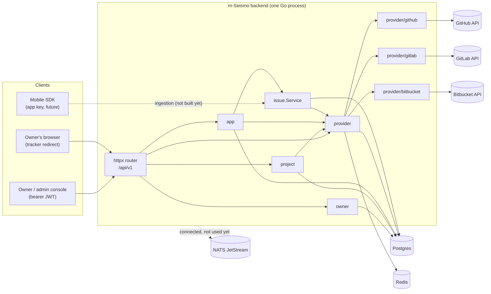
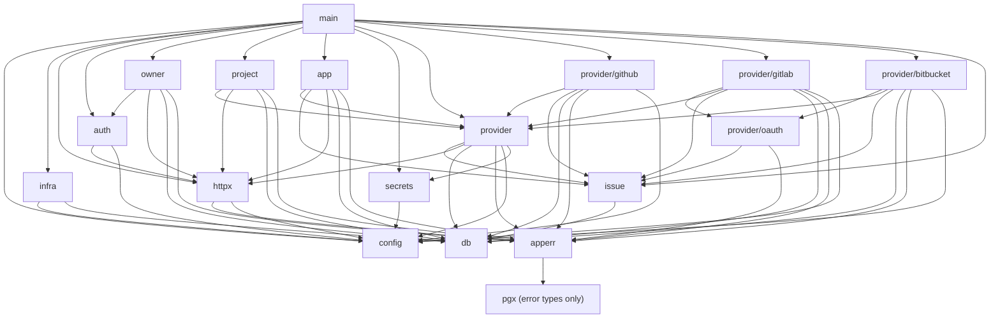
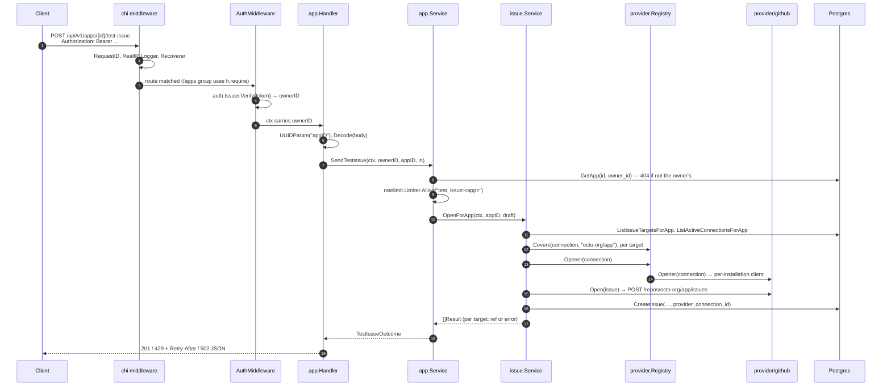

# Architecture

This page explains how the backend fits together. It covers the layers, how
packages depend on each other, how the process is wired at startup, what
happens during a request, and the conventions every package follows.

- [Big picture](#big-picture)
- [Domain model in one paragraph](#domain-model-in-one-paragraph)
- [Layers](#layers)
- [Package dependency graph](#package-dependency-graph)
- [Startup and dependency injection (fx)](#startup-and-dependency-injection-fx)
- [Life of an HTTP request](#life-of-an-http-request)
- [Error model](#error-model)
- [Authentication model](#authentication-model)
- [Multi-tenancy: owner scoping](#multi-tenancy-owner-scoping)
- [Tracker plug-in model](#tracker-plug-in-model)
- [Conventions](#conventions)

---

## Big picture



The backend is one Go binary, wired with [uber-go/fx](https://github.com/uber-go/fx).
It exposes a JSON REST API under `/api/v1` with these resources:

| Resource | Who calls it | Purpose |
|---|---|---|
| owners | admin console | sign up, log in, manage your own account |
| projects | admin console | say where code lives: the tracker repositories that receive issues |
| apps | admin console | the mobile apps that report bugs: their SDK keys, their own tracker connections (credentials), and which projects they report into |
| providers | admin console and browser | the configured trackers, the connect-flow callback, and an owner-wide list of connections |

`issue.Service` is a **service, not a route**. It opens tracker issues for an
app. The worker calls it for every accepted report (see
[worker.md](worker.md)), and `POST /apps/{id}/test-issue` calls it directly.

---

## Domain model in one paragraph

An **owner** has many **projects** and many **apps**.

- A **project** says where code lives: one or more **repositories**, each
  named by tracker and full name (`github` + `octo-org/app`), so one project
  can mix GitHub, GitLab and Bitbucket. Exactly one of a project's
  repositories is its **default**. Projects hold no credentials.
- An **app** is a *source* of issues. It authenticates with **app keys**,
  links to any number of projects (many-to-many), and has its own **provider
  connections**: the tracker accounts it was granted, such as one GitHub App
  installation on `octo-org`.

When an app reports a bug, `issue.Service.OpenForApp` takes the default
repository of every linked project and picks the app's connection on that
repository's tracker that covers it. It opens the issue through that
connection and records it as an **issue** row, together with the connection
used. Two apps reporting into the same project therefore use their own
credentials. Apps of one owner may share a tracker account, each with its own
connection row; two owners never can.

See [data-model.md](data-model.md) for the tables.

---

## Layers

```
┌────────────────────────────────────────────────────────────────────┐
│ main.go                  composes fx modules                       │
├────────────────────────────────────────────────────────────────────┤
│ handler.go (per package) HTTP: decode → call service → encode      │  transport
├────────────────────────────────────────────────────────────────────┤
│ service.go (per package) validation, ownership checks, transactions│  domain
│ issue.Service            cross-tracker issue opening               │
├────────────────────────────────────────────────────────────────────┤
│ provider.Registry        tracker-agnostic lookup                   │  integration
│ provider/github          the only code that talks to GitHub        │
│ provider/gitlab, …/bitbucket  same for GitLab and Bitbucket        │
│ provider/oauth           OAuth flow, token refresh, REST client    │
├────────────────────────────────────────────────────────────────────┤
│ internal/db (sqlc)       generated, type-safe SQL                  │  persistence
│ internal/infra           pgx pool, Redis, NATS                     │
│ internal/secrets         AES-256-GCM for stored OAuth tokens       │
├────────────────────────────────────────────────────────────────────┤
│ internal/config          viper: defaults → file → SEISMO_* env     │  config
└────────────────────────────────────────────────────────────────────┘
        apperr — error kinds shared by every layer, no dependencies on them
```

Rules the layers follow:

1. **Handlers hold no business logic.** A handler parses path parameters and
   the body, takes the owner ID from the request context, calls one service
   method, and writes the result or the error. Validation lives in services.
2. **Services never import `net/http`.** They return `apperr` errors, and
   `httpx.Error` turns those into status codes. That keeps services callable
   from places other than HTTP, such as a NATS consumer or a CLI.
3. **Only `internal/provider/<tracker>` talks to a tracker.** Nothing else
   imports `go-github` or `ghinstallation`, or knows GitLab or Bitbucket
   URLs. GitLab and Bitbucket use no SDK: they share the small REST and
   OAuth client in `internal/provider/oauth`.
4. **Generated code is never edited.** `internal/db` comes from
   `db/queries/*.sql` and `db/schema.sql`.

---

## Package dependency graph

An arrow means "imports". Test files are not shown.



Two points are deliberate:

- **`issue` does not import `provider`.** `provider` already imports `issue`
  for the `issue.Opener` and `issue.Connection` types, so the reverse import
  would be a cycle. Instead `issue` declares the small interface it needs,
  `issue.OpenerSource` (`Opener` and `Covers`), and `provider.Registry`
  satisfies it. fx connects the two in `provider.Module` with
  `func(r *Registry) issue.OpenerSource { return r }`.
- **The per-app connection routes live in `app`.** They sit under
  `/apps/{appID}/…`, and chi can mount `/apps` only once, so `app.Handler`
  mounts them and calls `provider.Service`. `provider.Handler` keeps
  `/providers`: the tracker list, the callback and the owner-wide list.
- **`auth` imports `httpx`, not the reverse.** `httpx` declares
  `TokenVerifier`, `auth.Issuer` implements it, and `auth.Module` provides the
  `Issuer` as that interface. The HTTP layer therefore never depends on the
  JWT library.

---

## Startup and dependency injection (fx)

`main.go` exposes `Options()`, the full module list, so the binary,
`TestGraph` and the e2e test all build the same graph:

```go
fx.Options(
    config.Module,   // *config.Config
    infra.Module,    // *pgxpool.Pool, *db.Queries, db.Querier, *redis.Client, *nats.Conn, jetstream.JetStream
    httpx.Module,    // http.Handler (router), *http.Server, httpx.AuthMiddleware
    auth.Module,     // *auth.Issuer, httpx.TokenVerifier
    owner.Module,    // *owner.Service, owner.Handler → group "routes"
    project.Module,  // *project.Service, project.Handler → group "routes"
    app.Module,      // *app.Service, app.Handler (incl. /apps/{id}/connections…) → group "routes"
    secrets.Module,  // *secrets.Cipher (secrets.encryption_key)
    provider.Module, // *provider.Registry, issue.OpenerSource, provider.StateStore, provider.SecretStore, *provider.Service, provider.Handler → group "routes"
    github.Module,   // []provider.Provider → group "providers" (empty when GitHub is not configured)
    gitlab.Module,   // same, empty when gitlab.client_id is unset
    bitbucket.Module, // same, empty when bitbucket.client_id is unset
    issue.Module,    // *issue.Service
)
```

Two **fx value groups** let packages register themselves without a central
list:

| Group | Element type | Producer helper | Consumer |
|---|---|---|---|
| `routes` | `httpx.Routes` (`Mount(chi.Router)`) | `httpx.AsRoutes(NewHandler)` | `httpx.NewRouter`, which mounts each one under `/api/v1` |
| `providers` | `provider.Provider` | `provider.AsProvider(FromConfig)` (flattened slice) | `provider.NewRegistry` |

The `providers` group is *flattened*: each tracker's `FromConfig` returns a
`[]provider.Provider`, and that slice is empty when the tracker is not
configured (`github.app_id`, `gitlab.client_id` or `bitbucket.client_id`
unset). The server then runs without that tracker: `GET /providers` doesn't
list it, and `GET /apps/{id}/connect/<tracker>` and linking a repository on
it return 404 "provider <tracker> is not available".

Lifecycle hooks:

- `infra.NewPostgresPool` and `infra.NewRedisClient` ping their server at
  construction. If Postgres or Redis is down, the app fails to start.
- `httpx.NewServer` registers `OnStart`, which calls `net.Listen` and then
  serves in a goroutine. A port conflict therefore fails startup instead of
  failing silently later. It also registers `OnStop`, which calls
  `srv.Shutdown(ctx)` to drain in-flight requests.
- `httpx.Module` contains `fx.Invoke(func(*http.Server) {})`. This forces the
  server, and so the whole route graph, to be constructed, because fx builds
  only what something asks for.

`fx.ValidateApp(Options())` in `main_test.go` checks that every dependency
has a provider, without running any constructor.

---

## Life of an HTTP request

Example: `POST /api/v1/apps/{id}/test-issue`, which runs the issue service
through the app's own connections.



Middleware order, from `httpx.NewRouter`:

1. `middleware.RequestID` gives each request an ID, which is attached to logs
   of internal errors.
2. `middleware.RealIP` reads `X-Forwarded-For` and `X-Real-IP`.
3. `middleware.Logger` writes one access-log line per request.
4. `middleware.Recoverer` turns a panic into a 500 instead of crashing the
   process.
5. Per route group: `httpx.AuthMiddleware` on everything except register,
   login and the provider callback.

---

## Error model

There are three pieces: `apperr` defines *what went wrong*, services *return*
it, and `httpx.Error` *maps* it.

| `apperr` kind | Constructor | HTTP status | Typical cause |
|---|---|---|---|
| `KindNotFound` | `apperr.NotFound(msg)` | 404 | missing row, another owner's row, malformed UUID in the path |
| `KindConflict` | `apperr.Conflict(msg)` | 409 | duplicate email, slug or repository link; a tracker account another owner holds |
| `KindInvalid` | `apperr.Invalid(msg)` | 422 | validation failure, bad JSON, malformed repository name |
| `KindUnauthorized` | `apperr.Unauthorized(msg)` | 401 | missing or invalid token, wrong password, bad app key |
| `KindRateLimited` | `apperr.RateLimited(msg, wait)`, or any error with a `RetryAfter() time.Duration` method such as `*issue.RateLimitError` | 429 + `Retry-After` | m-Seismo throttle, GitHub rate limit |
| `KindInternal` | any other error | 500 | everything else; logged, and the details are hidden |

`apperr.Classify` also recognises raw database errors, so a service can
return a query error unchanged:

- `pgx.ErrNoRows`, even wrapped, becomes `KindNotFound` with the message "not found".
- Postgres `23505` (unique violation) and `23P01` (exclusion violation)
  become `KindConflict` with "already exists".
- Postgres `23503` (foreign-key violation) becomes `KindInvalid`.

Services usually replace the generic message with a specific one, for example
"a project with this slug already exists".

Every error response body has the same shape:

```json
{ "error": "a project with this slug already exists" }
```

For 500 responses the body is always `{"error":"internal error"}`. The real
error is logged with `slog` along with the method, path and request ID.

---

## Authentication model

There are two separate credentials.

| Credential | Who holds it | Format | Verified by | Grants |
|---|---|---|---|---|
| **Owner JWT** | admin console | HS256 JWT, `sub` = owner UUID, `iss` = `m-seismo`, expiry required | `auth.Issuer.Verify` in `httpx.AuthMiddleware` | full management of that owner's resources |
| **App key** | mobile SDK | `msk_` + 43 base64url chars (32 random bytes) | `app.Service.Authenticate` (SHA-256 lookup) | (future) submit reports for that app only |

- Passwords are hashed with bcrypt at the default cost. The length must be
  8–72 bytes, because bcrypt ignores anything after 72.
- A login for an unknown email still runs one bcrypt comparison against a
  dummy hash. Without that, the response time would reveal which emails have
  accounts.
- Changing the email or password requires `current_password`. Otherwise a
  stolen token could take over the account.
- App keys are stored only as SHA-256 hashes, with the first 12 characters
  kept for display. Key entropy is 256 bits, so a fast hash is enough; bcrypt
  is for low-entropy passwords.
- Every connect flow uses its own credential, a one-time **state**
  stored in Redis. It is described in [github.md](github.md).
- GitLab and Bitbucket connections hold an **OAuth token per app
  connection**, encrypted with AES-256-GCM under `secrets.encryption_key`
  and bound to the connection ID. It is never returned by the API (see
  [gitlab-bitbucket.md](gitlab-bitbucket.md#token-storage-and-encryption)).

---

## Multi-tenancy: owner scoping

Every resource belongs, directly or indirectly, to one owner. Isolation is
enforced **in SQL**, not by checking after fetching:

```sql
-- name: GetProject :one
SELECT * FROM projects WHERE id = $1 AND owner_id = $2;
```

The pattern is:

- **Direct resources** (projects, apps) have owner-scoped `Get`, `Update`
  and `Delete` queries. When the owner doesn't
  match, the query returns no row, which becomes 404. It is the same response
  as an ID that doesn't exist, so callers learn nothing about other owners.
- **Child resources** (project repositories, app keys, app↔project links):
  the service first loads the parent with the owner-scoped query, then runs
  the child query filtered by parent ID. An example is
  `UnlinkProjectRepository ... WHERE id = $1 AND project_id = $2`.
- **Provider connections** belong to an app and carry a denormalised
  `owner_id`, so their queries filter on both:
  `GetAppConnection ... WHERE id = $1 AND app_id = $2 AND owner_id = $3`. A
  composite foreign key `(app_id, owner_id) → apps (id, owner_id)` keeps the
  two consistent.
- **Cross-resource links** check both sides. `app.Service.LinkProject` loads
  the app *and* the project as the same owner.
  `provider.Service.AttachConnection` loads the target app and the source
  connection as the same owner.
- **The issue service only uses the app's own connections.** It reads
  `ListActiveConnectionsForApp(app_id)`. `OpenInRepository` also requires the
  app to be linked to the repository's project: `GetIssueTarget` joins
  `app_projects`.
- **A tracker account belongs to one owner.** The exclusion constraint
  `provider_connections_one_owner_per_account` rejects a second owner who
  connects the same GitHub installation, even after a valid OAuth check.
- **The GitHub callback has no JWT.** The owner and the app come from the
  server-side state stored when that owner called
  `GET /apps/{id}/connect/{tracker}`.

---

## Tracker plug-in model

Every tracker implements one interface (`internal/provider/provider.go`):

```go
type Provider interface {
    Tracker() db.Tracker
    InstallURL(state string) string
    CompleteInstall(ctx, query url.Values) (Account, error)
    ListRepositories(ctx, c issue.Connection) ([]Repository, error)
    HasRepository(ctx, c issue.Connection, repository string) (bool, error)
    ValidateRepository(repository string) error
    Covers(c issue.Connection, repository string) bool
    Opener(ctx, c issue.Connection) (issue.Opener, error)
}
```

`issue.Connection` is one app connection: its m-Seismo `ID`, `Tracker`,
`ExternalID` (the tracker's identifier; for GitHub, the App installation ID)
and `AccountLogin`.

- Providers receive the whole value, so a tracker that stores per-connection
  secrets, such as GitLab or Bitbucket OAuth tokens, can look them up by
  `ID`.
- `Covers` lets the issue service choose among an app's connections without
  calling the tracker.

Three trackers implement it: `provider/github` (GitHub App installations),
`provider/gitlab` and `provider/bitbucket` (OAuth tokens per app connection,
on top of `provider/oauth`). Adding another means adding
`internal/provider/<tracker>` and one line in `main.go`. See
[extending.md](extending.md).

---

## Conventions

| Topic | Convention |
|---|---|
| Package layout | one package per resource: `service.go` (domain), `handler.go` (HTTP and fx `Module`), `*_test.go` |
| DTOs | services return their own JSON structs (`owner.Owner`, `project.Repository`, …), never `db.*` rows. This keeps `password_hash` and `key_hash` from leaking. |
| IDs | `github.com/google/uuid.UUID` everywhere, through sqlc overrides; `*uuid.UUID` for nullable columns |
| Times | `time.Time`, or `*time.Time` for nullable columns; JSON in RFC 3339 |
| PATCH | request fields are pointers; `nil` means "leave unchanged" |
| Request bodies | `httpx.Decode`: 1 MiB limit, unknown fields rejected, trailing data rejected |
| Path IDs | `httpx.UUIDParam`: a malformed UUID gives 404, the same as a missing one |
| Status codes | 201 create, 200 read or update, 204 delete or link or set-default, 302 provider callback |
| Logging | `log/slog` (default handler) for application logs; chi's `Logger` for access logs |
| Transactions | `pgx.BeginFunc(ctx, pool, func(tx) { q := queries.WithTx(tx) … })`, used where several writes must succeed or fail together |
| Config keys | every key has a default in `config/defaults.go`, even when that default is empty. This lists every setting in one place and keeps the keys known to viper. The env var name is `SEISMO_` + the key in upper case with `.` replaced by `_`; for example `github.app_id` becomes `SEISMO_GITHUB_APP_ID`. |
