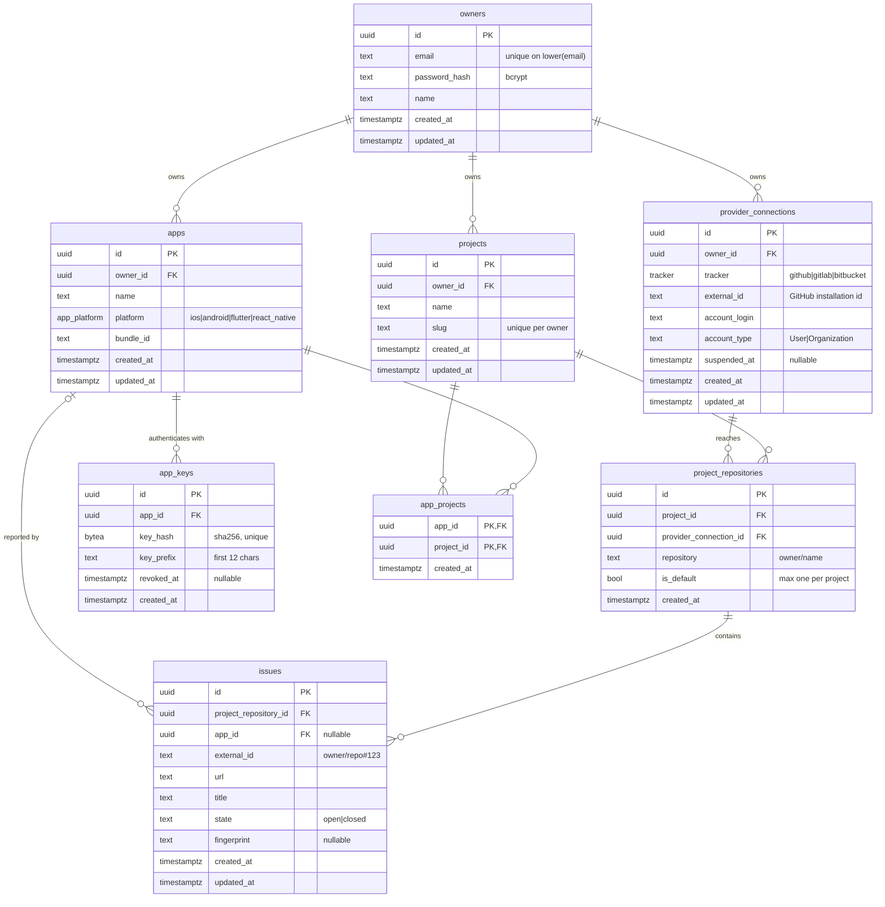

# Data model

This page covers the Postgres schema behind owners, projects, apps, provider
connections and issues. It explains each table and constraint, the migration
that introduced them, and how sqlc turns the queries into Go.

- [Entity–relationship diagram](#entityrelationship-diagram)
- [Tables](#tables)
- [Invariants and how they are enforced](#invariants-and-how-they-are-enforced)
- [Delete behaviour (cascades)](#delete-behaviour-cascades)
- [The migration](#the-migration)
- [sqlc configuration](#sqlc-configuration)
- [Query catalogue](#query-catalogue)
- [Workflow: changing the schema](#workflow-changing-the-schema)

---

## Entity–relationship diagram



Enums:

| Type | Values | Used by |
|---|---|---|
| `tracker` | `github`, `gitlab`, `bitbucket` | `provider_connections.tracker` |
| `app_platform` | `ios`, `android`, `flutter`, `react_native` | `apps.platform` |

All primary keys are `uuid DEFAULT gen_random_uuid()` from the `pgcrypto`
extension, which the first migration enables.

---

## Tables

### `owners`

An account that manages everything else. One owner can be a person or a
shared team login. There are no organisations or roles yet.

| Column | Notes |
|---|---|
| `email` | Stored lower-cased by `owner.Service`. A **unique expression index** `owners_email_lower_key ON (lower(email))` also blocks case-variant duplicates written by anything else. |
| `password_hash` | bcrypt. Never leaves the `owner` package; the `owner.Owner` DTO doesn't include it. |
| `name` | Display name, 1–200 characters after trimming. |

### `projects`

A group of repositories that receive issues. This is the PRD's "project",
except that SDK keys now belong to apps.

| Column | Notes |
|---|---|
| `owner_id` | `NOT NULL`, `ON DELETE CASCADE`. |
| `slug` | `UNIQUE (owner_id, slug)`. Two owners can both have `ios-app`. It was globally unique before this migration. Format `^[a-z0-9]+(?:-[a-z0-9]+)*$`, at most 64 characters, derived from the name if not given. |

The old `default_repository text` column was **dropped**. The default is now
the `project_repositories` row with `is_default = true`, which has a real
foreign key to a connection.

### `provider_connections`

The owner's link to a tracker account. On GitHub, one row means one GitHub
App installation on a user or organisation.

| Column | Notes |
|---|---|
| `tracker` | Which `provider.Provider` handles it. |
| `external_id` | The tracker's ID for the grant (GitHub: installation ID, as text). `UNIQUE (tracker, external_id)`, so one installation belongs to exactly one owner. |
| `account_login`, `account_type` | Cached from the tracker for display (`octo-org`, `Organization`). Refreshed on every re-install. |
| `suspended_at` | When set, the connection is skipped by issue targeting and rejected by repository operations. **Nothing sets it yet**; GitHub webhooks for suspend and uninstall are a follow-up. |

No token is stored. GitHub access uses installation tokens, minted on demand
from the App's private key (see [github.md](github.md)).

### `project_repositories`

The repositories a project sends issues to.

| Column | Notes |
|---|---|
| `provider_connection_id` | `NOT NULL`, `ON DELETE CASCADE`. The connection that can reach this repository. The tracker is the connection's tracker. The old `tracker` column was dropped so the two can't disagree. |
| `repository` | Tracker full name, e.g. `octo-org/app`. Checked against the tracker before insert. |
| `is_default` | Partial unique index `project_repositories_one_default_per_project ON (project_id) WHERE is_default`: **at most one default per project**. |

Also `UNIQUE (project_id, provider_connection_id, repository)`, so the same
repository can't be linked twice through the same connection.

### `apps`

A mobile app that reports bugs, the "source of issues".

| Column | Notes |
|---|---|
| `platform` | `app_platform` enum. Validated in Go as well, for a clean 422 instead of a Postgres error. |
| `bundle_id` | iOS bundle identifier or Android application ID, at most 255 characters. Informational for now; ingestion could later check that it matches the reporting app. |

### `app_keys`

SDK credentials. This table replaces `project_keys`.

| Column | Notes |
|---|---|
| `key_hash` | `sha256(secret)`, `UNIQUE`. Lookup is by hash (`GetActiveAppKeyByHash`). |
| `key_prefix` | First 12 characters of the secret (`msk_` + 8), so an admin can tell keys apart. |
| `revoked_at` | Set by `RevokeAppKey`. A revoked key stops working at once because the lookup filters `revoked_at IS NULL` (FR-04). |

### `app_projects`

The many-to-many link between apps and projects. Composite primary key
`(app_id, project_id)`; `LinkAppProject` uses `ON CONFLICT DO NOTHING`, so
linking twice is harmless. There's a secondary index on `project_id` for
"which apps feed this project".

### `issues`

A record of every issue m-Seismo opened on a tracker. This is the base for
deduplication (FR-54/55) and two-way status (FR-51).

| Column | Notes |
|---|---|
| `project_repository_id` | Where it was opened. `ON DELETE CASCADE`: unlinking a repository forgets its issues. They stay on the tracker. |
| `app_id` | Which app reported it. `ON DELETE SET NULL`: deleting an app keeps the history. Nullable also for issues opened through `OpenInRepository` without an app. |
| `external_id` | The tracker's issue reference as produced by the provider's `Opener`. GitHub: `owner/name#123`. |
| `state` | `CHECK (state IN ('open','closed'))`, default `open`. `SetIssueState` exists for the future status sync. |
| `fingerprint` | Optional grouping key. Index `(project_repository_id, fingerprint)` serves `GetOpenIssueByFingerprint`. |

---

## Invariants and how they are enforced

| Invariant | Enforced by |
|---|---|
| Email unique, case-insensitive | `owners_email_lower_key` + lower-casing in `owner.normaliseEmail` |
| Slug unique per owner | `projects_owner_id_slug_key` |
| One default repository per project | partial unique index + `ClearDefault` → `Link`/`SetDefault` in one transaction |
| The first linked repository is the default (FR-59: a project needs a default) | `project.Service.LinkRepository` sets `is_default` when the project has no repositories |
| An installation belongs to one owner | `UNIQUE (tracker, external_id)` + the `WHERE provider_connections.owner_id = excluded.owner_id` guard on upsert |
| A repository is linked through a connection that can reach it | `provider.Service.VerifyRepository` → `Provider.HasRepository` before insert |
| App and project in a link have the same owner | `app.Service.LinkProject` loads both with owner-scoped queries |
| Only active keys authenticate | `GetActiveAppKeyByHash ... AND revoked_at IS NULL` |
| Suspended connections are never used | `GetIssueTarget` / `ListIssueTargetsForApp` filter `pc.suspended_at IS NULL`; `provider.Service.connection` rejects them |

---

## Delete behaviour (cascades)

```
DELETE owner
 ├─ projects               CASCADE
 │   ├─ project_repositories CASCADE
 │   │   └─ issues           CASCADE
 │   └─ app_projects        CASCADE
 ├─ apps                   CASCADE
 │   ├─ app_keys            CASCADE
 │   ├─ app_projects        CASCADE
 │   └─ issues.app_id       SET NULL  (rows already gone via repositories above)
 └─ provider_connections   CASCADE
     └─ project_repositories CASCADE → issues CASCADE

DELETE provider_connection → its project_repositories and their issues are removed;
                             projects that used it may be left with no default repository.
DELETE project_repository  → its issues are removed; if it was the default, the project has none
                             until another is set with PUT …/default.
DELETE app                 → keys and links removed; issues keep app_id = NULL.
```

Deleting rows in m-Seismo never deletes anything on GitHub.

---

## The migration

File: `db/migrations/20261017120000_owners_apps_providers.sql` (dbmate
format: `-- migrate:up` / `-- migrate:down`).

**Up**, in order:

1. Create `owners` and its `lower(email)` unique index.
2. `projects`: add `owner_id NOT NULL` with an FK; replace the global slug
   unique with a per-owner unique; drop `default_repository`.
3. Create `provider_connections`.
4. `project_repositories`: add `provider_connection_id NOT NULL` with an FK;
   drop `tracker`; add the `(project_id, provider_connection_id, repository)`
   unique and an index on the connection ID.
5. Create the `app_platform` enum, then `apps`, `app_keys` and `app_projects`.
6. Drop `project_keys`.
7. Create `issues`.

> **Existing data:** step 2 and step 4 add `NOT NULL` columns without
> defaults, so they fail if `projects` or `project_repositories` already have
> rows. There was no production data when this was written. Recreate local
> databases (`make db-down` twice, then `make db-up`).

**Down** reverses each step. It recreates `project_keys` (empty), restores
`project_repositories.tracker` from the connection before dropping the
connection column, and restores the global slug unique. That last step fails
if two owners share a slug.

`db/schema.sql` is the pg_dump-style snapshot sqlc reads. dbmate rewrites it
on `make db-up` and `make db-down`. In this change it was updated by hand to
match the migration, because no database was available when it was written.
The next `make db-up` regenerates it, and the diff should be empty or only
cosmetic.

---

## sqlc configuration

`sqlc.yaml` generates package `db` into `internal/db` using `pgx/v5`.
Changes from the original:

```yaml
emit_pointers_for_null_types: true          # nullable text → *string (instead of pgtype.Text)
overrides:
  - db_type: "uuid"                    go_type: github.com/google/uuid.UUID
  - db_type: "uuid", nullable: true    go_type: *uuid.UUID
  - db_type: "pg_catalog.timestamptz"  go_type: time.Time
  - db_type: "pg_catalog.timestamptz", nullable: true → *time.Time
```

Why: the generated structs then use plain Go types (`uuid.UUID`,
`time.Time`, `*string`) instead of `pgtype.UUID` and `pgtype.Timestamptz`.
Services can use them and build DTOs without conversion helpers. pgx v5 scans
`uuid.UUID` through its `sql.Scanner` implementation.

> The timestamp override must name `pg_catalog.timestamptz`. sqlc resolves
> `timestamp with time zone` from `schema.sql` to that qualified name, and a
> plain `timestamptz` override is silently ignored.

`emit_interface: true` generates `db.Querier`, which services depend on so
tests can pass fakes. `project.Service` takes the concrete `*db.Queries`
instead, because it needs `WithTx` for transactions.

---

## Query catalogue

All queries are in `db/queries/`. The *Scoped by* column shows what keeps one
owner's data from another (see
[architecture.md#multi-tenancy-owner-scoping](architecture.md#multi-tenancy-owner-scoping)).

### `owners.sql`

| Query | Kind | Scoped by | Used by |
|---|---|---|---|
| `CreateOwner` | `:one` | — | `owner.Service.Register` |
| `GetOwnerByID` | `:one` | id from JWT | `owner.Service.Get/Update` |
| `GetOwnerByEmail` | `:one` | `lower(email) = lower(@email)` | `owner.Service.Login` |
| `UpdateOwner` | `:one` | id from JWT | `owner.Service.Update` (sets every column, so the service merges the PATCH first) |
| `DeleteOwner` | `:execrows` | id from JWT | `owner.Service.Delete` |

### `projects.sql`

| Query | Kind | Scoped by |
|---|---|---|
| `CreateProject` | `:one` | `owner_id` value |
| `GetProject` | `:one` | `id AND owner_id` |
| `ListProjects` | `:many` | `owner_id`, newest first |
| `UpdateProject` | `:one` | `id AND owner_id` |
| `DeleteProject` | `:execrows` | `id AND owner_id` (0 rows → 404) |

### `project_repositories.sql`

| Query | Kind | Notes |
|---|---|---|
| `LinkProjectRepository` | `:one` | insert; the service runs it in a transaction |
| `GetProjectRepository` | `:one` | `id AND project_id` (currently unused) |
| `ListProjectRepositories` | `:many` | joins the connection for `tracker` and `account_login` |
| `ClearDefaultProjectRepository` | `:exec` | sets `is_default = false` for the project |
| `SetDefaultProjectRepository` | `:execrows` | `id AND project_id` |
| `UnlinkProjectRepository` | `:execrows` | `id AND project_id` |
| `GetIssueTarget` | `:one` | repository + connection (`tracker`, `external_id`) for one repo; skips suspended connections. Used by `issue.Service.OpenInRepository` |
| `ListIssueTargetsForApp` | `:many` | `app_projects` → the **default** `project_repositories` → active `provider_connections`. Used by `issue.Service.OpenForApp` |

### `provider_connections.sql`

| Query | Kind | Notes |
|---|---|---|
| `UpsertProviderConnection` | `:one` | `ON CONFLICT (tracker, external_id) DO UPDATE … WHERE provider_connections.owner_id = excluded.owner_id`. A re-install by the same owner refreshes the login and type and clears `suspended_at`. If **another** owner holds the row, the `WHERE` fails, nothing is returned, and the service turns `pgx.ErrNoRows` into 409. |
| `GetProviderConnection` | `:one` | `id AND owner_id` |
| `ListProviderConnections` | `:many` | `owner_id` |
| `DeleteProviderConnection` | `:execrows` | `id AND owner_id` |

### `apps.sql`

| Query | Kind | Notes |
|---|---|---|
| `CreateApp` / `GetApp` / `ListApps` / `UpdateApp` / `DeleteApp` | | owner-scoped like projects |
| `CreateAppKey` | `:one` | stores the hash and prefix |
| `ListAppKeys` | `:many` | includes revoked keys |
| `RevokeAppKey` | `:execrows` | `id AND app_id AND revoked_at IS NULL` (revoking twice → 404) |
| `GetActiveAppKeyByHash` | `:one` | key authentication |
| `LinkAppProject` | `:exec` | `ON CONFLICT DO NOTHING` |
| `UnlinkAppProject` | `:execrows` | |
| `ListAppProjects` | `:many` | the projects joined through `app_projects` |

### `issues.sql`

| Query | Kind | Notes |
|---|---|---|
| `CreateIssue` | `:one` | called by `issue.Service` after a successful open |
| `GetOpenIssueByFingerprint` | `:one` | **unused yet**; for dedup (FR-55) |
| `SetIssueState` | `:exec` | **unused yet**; for status sync (FR-51) |

---

## Workflow: changing the schema

```sh
make db-new name=add_something   # creates db/migrations/<timestamp>_add_something.sql
# edit the up and down sections
make db-up                       # applies it and regenerates db/schema.sql
# add or adjust db/queries/*.sql
make sqlc-generate               # or: go run github.com/sqlc-dev/sqlc/cmd/sqlc@v1.30.0 generate
go build ./... && go test ./...
```

Commit the migration, `schema.sql`, the queries and the regenerated
`internal/db` together.
