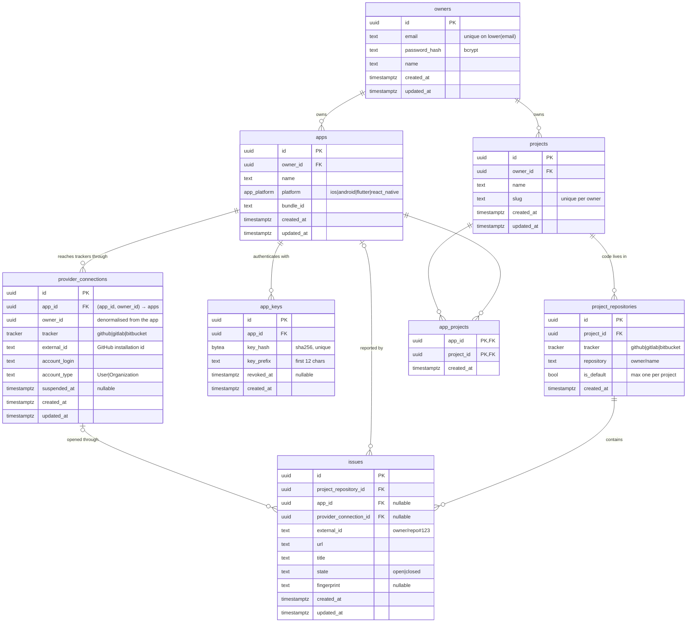

# Data model

This page covers the Postgres schema behind owners, projects, apps, provider
connections and issues. It explains each table and constraint, the
migrations that introduced them, and how sqlc turns the queries into Go.

- [Entity–relationship diagram](#entityrelationship-diagram)
- [Tables](#tables)
- [Invariants and how they are enforced](#invariants-and-how-they-are-enforced)
- [Delete behaviour (cascades)](#delete-behaviour-cascades)
- [The migrations](#the-migrations)
- [sqlc configuration](#sqlc-configuration)
- [Query catalogue](#query-catalogue)
- [Workflow: changing the schema](#workflow-changing-the-schema)

---

## Entity–relationship diagram



Enums:

| Type | Values | Used by |
|---|---|---|
| `tracker` | `github`, `gitlab`, `bitbucket` | `project_repositories.tracker`, `provider_connections.tracker` |
| `app_platform` | `ios`, `android`, `flutter`, `react_native` | `apps.platform` |

All primary keys are `uuid DEFAULT gen_random_uuid()` from the `pgcrypto`
extension, which the first migration enables. The `btree_gist` extension
(enabled by `20261021130000_app_scoped_connections`) backs the exclusion
constraint on `provider_connections`.

**Where the credentials are.** Apps hold them, projects don't. A project
repository only names a repository (`github` + `octo-org/app`). When an app
reports, the issue service picks, for each target repository, one of *that
app's* connections. So the path from a report to a tracker is
`apps → app_projects → project_repositories (default)`, with the credentials
coming separately from `apps → provider_connections`.

---

## Tables

### `owners`

An account that manages everything else. One owner can be a person or a
shared team login. There are no organisations or roles yet.

| Column | Notes |
|---|---|
| `email` | Stored lower-cased by `owner.Service`. A **unique expression index** `owners_email_lower_key ON (lower(email))` also blocks case-variant duplicates written by anything else. |
| `password_hash` | bcrypt. Never leaves the `owner` package; the `owner.Owner` DTO doesn't include it. |
| `name` | Display name, 1–200 characters after trimming. |

### `projects`

Where code lives: a group of tracker repositories that receive issues. This
is the PRD's "project", except that SDK keys and tracker credentials now
belong to apps.

| Column | Notes |
|---|---|
| `owner_id` | `NOT NULL`, `ON DELETE CASCADE`. |
| `slug` | `UNIQUE (owner_id, slug)`. Two owners can both have `ios-app`. It was globally unique before `20261017120000`. Format `^[a-z0-9]+(?:-[a-z0-9]+)*$`, at most 64 characters, derived from the name if not given. |

The default repository is the `project_repositories` row with
`is_default = true`.

### `project_repositories`

The repositories a project sends issues to. A row names a repository; it
holds **no credentials**.

| Column | Notes |
|---|---|
| `tracker` | `NOT NULL`. Which tracker hosts the repository. Must be a tracker configured on the deployment when linked (`provider.Registry.Get`). |
| `repository` | Tracker full name, e.g. `octo-org/app`. Its format is checked with `Provider.ValidateRepository`; whether a given app can reach it is decided per app, through its connections. |
| `is_default` | Partial unique index `project_repositories_one_default_per_project ON (project_id) WHERE is_default`: **at most one default per project**. |

Also `UNIQUE (project_id, tracker, repository)`
(`project_repositories_target_key`), so the same repository can't be linked
twice to a project.

### `apps`

A mobile app that reports bugs, the "source of issues". It owns its SDK keys
and its tracker connections.

| Column | Notes |
|---|---|
| `platform` | `app_platform` enum. Validated in Go as well, for a clean 422 instead of a Postgres error. |
| `bundle_id` | iOS bundle identifier or Android application ID, at most 255 characters. Informational for now; ingestion could later check that it matches the reporting app. |

`UNIQUE (id, owner_id)` (`apps_id_owner_id_key`) exists so
`provider_connections` can reference `(id, owner_id)` together.

### `provider_connections`

An **app's** link to a tracker account. On GitHub, one row means "this app
uses this GitHub App installation", and the installation is on one user or
organisation. An app can have several connections, on one tracker or on
several, such as two GitHub organisations plus a GitLab group later.

| Column | Notes |
|---|---|
| `app_id` | `NOT NULL`. Composite FK `(app_id, owner_id) → apps (id, owner_id) ON DELETE CASCADE` (`provider_connections_app_owner_fkey`). Deleting the app deletes its connections. |
| `owner_id` | Copied from the app so owner-scoped queries need no join. The composite FK guarantees it is the app's owner. |
| `tracker` | Which `provider.Provider` handles it. |
| `external_id` | The tracker's ID for the grant (GitHub: installation ID, as text). |
| `account_login`, `account_type` | Cached from the tracker (`octo-org`, `Organization`). Refreshed on every re-connect. `account_login` is also what `Covers` matches against on GitHub. |
| `suspended_at` | When set, the issue service skips the connection and repository listing rejects it. **Nothing sets it yet**; GitHub webhooks for suspend and uninstall are a follow-up. |

Constraints:

- `UNIQUE (app_id, tracker, external_id)` (`provider_connections_app_target_key`).
  An app holds a given tracker account at most once; connecting it again
  updates the row.
- `EXCLUDE USING gist (tracker WITH =, external_id WITH =, owner_id WITH <>)`
  (`provider_connections_one_owner_per_account`). Rows for the same tracker
  account must all have the same owner. **Apps of one owner may share** an
  installation, each with its own row; **two owners never can**. A violation
  is SQLSTATE `23P01`, which `apperr.Classify` maps to 409.
- Index on `app_id`; the old `owner_id` index stays for the owner-wide list.

No token is stored. GitHub access uses installation tokens, minted on demand
from the App's private key (see [github.md](github.md)). GitLab and Bitbucket
will need stored OAuth tokens. The plan is a separate encrypted table keyed by
`provider_connections.id` (see [extending.md](extending.md)).

### `app_keys`

SDK credentials. This table replaces `project_keys`.

| Column | Notes |
|---|---|
| `key_hash` | `sha256(secret)`, `UNIQUE`. Lookup is by hash (`GetActiveAppKeyByHash`). |
| `key_prefix` | First 12 characters of the secret (`msk_` + 8), so an admin can tell keys apart. |
| `revoked_at` | Set by `RevokeAppKey`. A revoked key stops working at once because the lookup filters `revoked_at IS NULL` (FR-04). |

### `app_projects`

The many-to-many link between apps and projects. Composite primary key
`(app_id, project_id)`; `LinkAppProject` uses `ON CONFLICT DO NOTHING`, so
linking twice is harmless. There's a secondary index on `project_id` for
"which apps feed this project".

### `issues`

A record of every issue m-Seismo opened on a tracker. This is the base for
deduplication (FR-54/55) and two-way status (FR-51).

| Column | Notes |
|---|---|
| `project_repository_id` | Where it was opened. `ON DELETE CASCADE`: unlinking a repository forgets its issues. They stay on the tracker. |
| `app_id` | Which app reported it. `ON DELETE SET NULL`: deleting an app keeps the history. |
| `provider_connection_id` | **Which credentials opened it**: the reporting app's connection. `ON DELETE SET NULL`. Commenting on the issue or syncing its status later needs a connection, and the repository no longer carries one. When the original connection is gone, the caller has to choose another connection of an app that covers the repository. |
| `external_id` | The tracker's issue reference as produced by the provider's `Opener`. GitHub: `owner/name#123`. |
| `state` | `CHECK (state IN ('open','closed'))`, default `open`. `SetIssueState` exists for the future status sync. |
| `fingerprint` | Optional grouping key. Index `(project_repository_id, fingerprint)` serves `GetOpenIssueByFingerprint`. |

---

## Invariants and how they are enforced

| Invariant | Enforced by |
|---|---|
| Email unique, case-insensitive | `owners_email_lower_key` + lower-casing in `owner.normaliseEmail` |
| Slug unique per owner | `projects_owner_id_slug_key` |
| One default repository per project | partial unique index + `ClearDefault` → `Link`/`SetDefault` in one transaction |
| The first linked repository is the default (FR-59: a project needs a default) | `project.Service.LinkRepository` sets `is_default` when the project has no repositories |
| A project repository is on a configured tracker, in that tracker's name format | `project.Service.LinkRepository` → `provider.Registry.Get(tracker).ValidateRepository` |
| A connection's owner is its app's owner | composite FK `(app_id, owner_id) → apps (id, owner_id)` |
| A tracker account belongs to one owner (possibly several of their apps) | exclusion constraint `provider_connections_one_owner_per_account` |
| An app holds a tracker account once | `provider_connections_app_target_key` + `ON CONFLICT … DO UPDATE` in `UpsertProviderConnection` |
| A connection is only attached across apps of the same owner | `provider.Service.AttachConnection` loads the target app and the source connection owner-scoped |
| An app opens issues only through its own connections | `issue.Service` reads `ListActiveConnectionsForApp(app_id)` |
| An app opens issues only in projects it is linked to | `ListIssueTargetsForApp` and `GetIssueTarget` join `app_projects` |
| App and project in a link have the same owner | `app.Service.LinkProject` loads both with owner-scoped queries |
| Only active keys authenticate | `GetActiveAppKeyByHash ... AND revoked_at IS NULL` |
| Suspended connections are never used | `ListActiveConnectionsForApp` filters `suspended_at IS NULL`; `provider.Service` rejects them for repository listing and attach |

---

## Delete behaviour (cascades)

```
DELETE owner
 ├─ projects               CASCADE
 │   ├─ project_repositories CASCADE
 │   │   └─ issues           CASCADE
 │   └─ app_projects        CASCADE
 └─ apps                   CASCADE
     ├─ app_keys            CASCADE
     ├─ app_projects        CASCADE
     ├─ provider_connections CASCADE
     │   └─ issues.provider_connection_id SET NULL
     └─ issues.app_id       SET NULL

DELETE provider_connection → only that app loses it. Other apps sharing the same tracker
                             account keep their own rows; project repositories are untouched;
                             issues it opened keep provider_connection_id = NULL.
DELETE project_repository  → its issues are removed; if it was the default, the project has none
                             until another is set with PUT …/default.
DELETE app                 → keys, links and connections removed; issues keep app_id = NULL
                             and provider_connection_id = NULL.
```

Deleting rows in m-Seismo never deletes anything on GitHub.

---

## The migrations

There are two migrations, in dbmate format (`-- migrate:up` /
`-- migrate:down`).

### `20261017120000_owners_apps_providers.sql`

This one introduced owners, apps and the first, owner-level connections.

**Up**, in order:

1. Create `owners` and its `lower(email)` unique index.
2. `projects`: add `owner_id NOT NULL` with an FK; replace the global slug
   unique with a per-owner unique; drop `default_repository`.
3. Create `provider_connections` owned by the owner, with
   `UNIQUE (tracker, external_id)`.
4. `project_repositories`: add `provider_connection_id NOT NULL` with an FK;
   drop `tracker`.
5. Create the `app_platform` enum, then `apps`, `app_keys` and `app_projects`.
6. Drop `project_keys`.
7. Create `issues`.

> **Existing data:** steps 2 and 4 add `NOT NULL` columns without defaults,
> so they fail if `projects` or `project_repositories` already have rows.
> There was no production data when this was written. Recreate local
> databases (`make db-down` twice, then `make db-up`).

### `20261021130000_app_scoped_connections.sql`

This one moves connections from the owner to the app, and **keeps existing
data working**.

**Up**, in order:

1. `create extension if not exists btree_gist`.
2. `provider_connections`: drop `UNIQUE (tracker, external_id)`, add a
   nullable `app_id`.
3. **Backfill.** Copy every owner-level connection to **every app of that
   owner**, keeping the tracker, external ID, account, `suspended_at` and
   timestamps. Until now every app could use every connection of its owner,
   so this keeps that behaviour. A temporary `connection_copies` table
   (`old_id`, `app_id`, `new_id`) remembers the copies.
4. `issues`: add `provider_connection_id` (FK, `ON DELETE SET NULL`). Fill it
   with the copy that belongs to (`issues.app_id`, the repository's old
   connection). Index it.
5. `project_repositories`: add `tracker`, filled from the old connection, then
   `NOT NULL`. Drop `provider_connection_id` and its index. Rows that now
   collide (the same repository linked through two connections) collapse to
   one, keeping the default and otherwise the oldest. Add
   `UNIQUE (project_id, tracker, repository)`.
6. Delete the old owner-level rows (`app_id IS NULL`); set `app_id NOT NULL`.
   An owner with connections but no apps loses them; they could not be used
   for anything anyway.
7. Constraints: `apps (id, owner_id)` unique, the composite FK, the per-app
   unique, the one-owner-per-account exclusion constraint, and an index on
   `app_id`.

**Down** is **lossy**:

1. The copies collapse to one row per (tracker, external_id), keeping the
   oldest.
2. `app_id` and `issues.provider_connection_id` are dropped, and
   `UNIQUE (tracker, external_id)` comes back.
3. Project repositories are re-linked to the connection of the project
   owner's whose `account_login` matches the repository owner
   (`split_part(repository, '/', 1)`). Repositories that match nothing are
   **deleted**, with their issues.
4. `btree_gist` is dropped.

Both directions were run against the dev database with seeded data: an owner
with two apps, one connection, a linked repository and an issue reported by
the second app. After `up`, each app had its own copy, the issue pointed at
the second app's copy, and that app could still open issues. After `down`
and `up` again, the result was the same.

`db/schema.sql` is the pg_dump snapshot sqlc reads. It was regenerated from
the dev database with `dbmate dump` after applying this migration. The
`\restrict` lines that pg_dump 18 adds are stripped, as `make db-up` does.

---

## sqlc configuration

`sqlc.yaml` generates package `db` into `internal/db` using `pgx/v5`.
Changes from the original:

```yaml
emit_pointers_for_null_types: true          # nullable text → *string (instead of pgtype.Text)
overrides:
  - db_type: "uuid"                    go_type: github.com/google/uuid.UUID
  - db_type: "uuid", nullable: true    go_type: *uuid.UUID
  - db_type: "pg_catalog.timestamptz"  go_type: time.Time
  - db_type: "pg_catalog.timestamptz", nullable: true → *time.Time
```

Why: the generated structs then use plain Go types (`uuid.UUID`,
`time.Time`, `*string`) instead of `pgtype.UUID` and `pgtype.Timestamptz`.
Services can use them and build DTOs without conversion helpers. pgx v5 scans
`uuid.UUID` through its `sql.Scanner` implementation.

> The timestamp override must name `pg_catalog.timestamptz`. sqlc resolves
> `timestamp with time zone` from `schema.sql` to that qualified name, and a
> plain `timestamptz` override is silently ignored.

`emit_interface: true` generates `db.Querier`, which services depend on so
tests can pass fakes. `project.Service` takes the concrete `*db.Queries`
instead, because it needs `WithTx` for transactions.

---

## Query catalogue

All queries are in `db/queries/`. The *Scoped by* column shows what keeps one
owner's data from another (see
[architecture.md#multi-tenancy-owner-scoping](architecture.md#multi-tenancy-owner-scoping)).

### `owners.sql`

| Query | Kind | Scoped by | Used by |
|---|---|---|---|
| `CreateOwner` | `:one` | — | `owner.Service.Register` |
| `GetOwnerByID` | `:one` | id from JWT | `owner.Service.Get/Update` |
| `GetOwnerByEmail` | `:one` | `lower(email) = lower(@email)` | `owner.Service.Login` |
| `UpdateOwner` | `:one` | id from JWT | `owner.Service.Update` (sets every column, so the service merges the PATCH first) |
| `DeleteOwner` | `:execrows` | id from JWT | `owner.Service.Delete` |

### `projects.sql`

| Query | Kind | Scoped by |
|---|---|---|
| `CreateProject` | `:one` | `owner_id` value |
| `GetProject` | `:one` | `id AND owner_id` |
| `ListProjects` | `:many` | `owner_id`, newest first |
| `UpdateProject` | `:one` | `id AND owner_id` |
| `DeleteProject` | `:execrows` | `id AND owner_id` (0 rows → 404) |

### `project_repositories.sql`

| Query | Kind | Notes |
|---|---|---|
| `LinkProjectRepository` | `:one` | insert `(project_id, tracker, repository, is_default)`; the service runs it in a transaction |
| `GetProjectRepository` | `:one` | `id AND project_id` (currently unused) |
| `ListProjectRepositories` | `:many` | the project's repositories, oldest first |
| `ClearDefaultProjectRepository` | `:exec` | sets `is_default = false` for the project |
| `SetDefaultProjectRepository` | `:execrows` | `id AND project_id` |
| `UnlinkProjectRepository` | `:execrows` | `id AND project_id` |
| `GetIssueTarget` | `:one` | one repository (`tracker`, `repository`), **only if the app is linked to its project** (joins `app_projects` on `app_id`). Used by `issue.Service.OpenInRepository` |
| `ListIssueTargetsForApp` | `:many` | `app_projects` → the **default** `project_repositories`. Returns `tracker` and `repository` only; the connection is resolved afterwards from the app's own connections. Used by `issue.Service.Targets` / `OpenForApp` |

### `provider_connections.sql`

| Query | Kind | Notes |
|---|---|---|
| `UpsertProviderConnection` | `:one` | `ON CONFLICT (app_id, tracker, external_id) DO UPDATE`. Re-connecting refreshes the login and type and clears `suspended_at`. If **another owner** already holds the tracker account, the exclusion constraint fails with `23P01`, which the service turns into 409. |
| `GetAppConnection` | `:one` | `id AND app_id AND owner_id` |
| `GetOwnerConnection` | `:one` | `id AND owner_id` (the source of an attach) |
| `ListAppConnections` | `:many` | `app_id AND owner_id` |
| `ListOwnerConnections` | `:many` | `owner_id`: every app's connections, for `GET /providers/connections` |
| `ListActiveConnectionsForApp` | `:many` | `app_id AND suspended_at IS NULL`, oldest first. The issue service picks from these. |
| `DeleteAppConnection` | `:execrows` | `id AND app_id AND owner_id` |

### `apps.sql`

| Query | Kind | Notes |
|---|---|---|
| `CreateApp` / `GetApp` / `ListApps` / `UpdateApp` / `DeleteApp` | | owner-scoped like projects |
| `CreateAppKey` | `:one` | stores the hash and prefix |
| `ListAppKeys` | `:many` | includes revoked keys |
| `RevokeAppKey` | `:execrows` | `id AND app_id AND revoked_at IS NULL` (revoking twice → 404) |
| `GetActiveAppKeyByHash` | `:one` | key authentication |
| `LinkAppProject` | `:exec` | `ON CONFLICT DO NOTHING` |
| `UnlinkAppProject` | `:execrows` | |
| `ListAppProjects` | `:many` | the projects joined through `app_projects` |

### `issues.sql`

| Query | Kind | Notes |
|---|---|---|
| `CreateIssue` | `:one` | called by `issue.Service` after a successful open, with the app and the connection used |
| `GetOpenIssueByFingerprint` | `:one` | **unused yet**; for dedup (FR-55) |
| `SetIssueState` | `:exec` | **unused yet**; for status sync (FR-51) |

---

## Workflow: changing the schema

```sh
make db-new name=add_something   # creates db/migrations/<timestamp>_add_something.sql
# edit the up and down sections
make db-up                       # applies it and regenerates db/schema.sql
# add or adjust db/queries/*.sql
make sqlc-generate               # or: go run github.com/sqlc-dev/sqlc/cmd/sqlc@v1.30.0 generate
go build ./... && go test ./...
```

Commit the migration, `schema.sql`, the queries and the regenerated
`internal/db` together.
