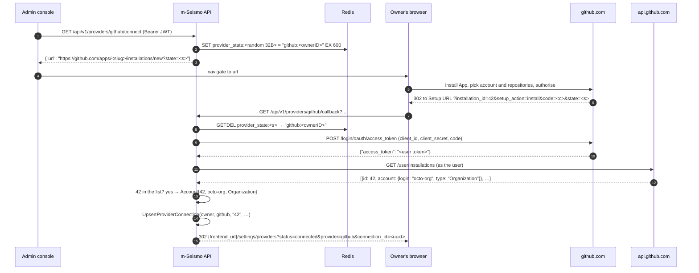

# GitHub integration

This page explains how m-Seismo reaches an owner's GitHub repositories: why
it uses a GitHub App, how the connect flow works and is secured, how tokens
are handled, and how issues are opened. All the code is in
`internal/provider/github/`, which is the only package that imports
`google/go-github` and `bradleyfalzon/ghinstallation`.

- [Why a GitHub App](#why-a-github-app)
- [Credentials and token types](#credentials-and-token-types)
- [The connect flow](#the-connect-flow)
- [Why the callback needs the OAuth code](#why-the-callback-needs-the-oauth-code)
- [Listing and verifying repositories](#listing-and-verifying-repositories)
- [Opening issues](#opening-issues)
- [Configuration](#configuration)
- [Creating the GitHub App](#creating-the-github-app)
- [Failure modes](#failure-modes)
- [Not done yet](#not-done-yet)

---

## Why a GitHub App

PRD §3.4 says m-Seismo gets "the smallest set of permissions it needs: write
issues, read metadata". The two options compare like this:

| | GitHub App (chosen) | OAuth App |
|---|---|---|
| Scope | per repository, fine-grained: Issues R/W + Metadata R | `repo`: full read/write to every private repository of the user |
| Who chooses the repositories | the installer picks "all" or specific repositories | everything the user can access |
| Stored secret | none per owner; tokens are minted from the App key | a long-lived user token per owner, which must be encrypted at rest |
| Issue author | the App bot (`m-seismo[bot]`) | the owner's personal account |
| Survives the owner leaving the org | yes, the installation belongs to the org | no |

---

## Credentials and token types

| Credential | Where it comes from | Lifetime | Used for |
|---|---|---|---|
| **App private key** (PEM) | GitHub App settings, stored in config | until rotated | signing App JWTs |
| **App JWT** | signed by `ghinstallation.AppsTransport` | ~10 min | calling `/app/...` endpoints, e.g. minting installation tokens |
| **Installation token** | `POST /app/installations/{id}/access_tokens` (done by `ghinstallation.Transport`) | 1 h, refreshed automatically | every repository and issue call |
| **Client ID / secret** | GitHub App settings | until rotated | exchanging the OAuth `code` at install time |
| **User-to-server token** | `POST /login/oauth/access_token` | **used once, then dropped** | proving the installing user can access the installation |

m-Seismo stores **no per-owner GitHub secret**. A `provider_connections` row
holds only the installation ID and display data.

`Provider.installationClient(externalID)` keeps one `*github.Client` per
installation ID in a mutex-guarded map. Each client wraps a
`ghinstallation.Transport` built with `NewFromAppsTransport`. The transport
caches the installation token and refreshes it shortly before it expires, so
repeated calls don't mint new tokens.

---

## The connect flow

What happens at each step, and where in the code:

1. **`provider.Handler.connect`** calls `provider.Service.StartConnect`. It
   generates 32 random bytes, encodes them as base64url (that's the state),
   and stores `"<tracker>:<ownerID>"` in Redis under `provider_state:<state>`
   with a **10-minute TTL**. It returns `Provider.InstallURL(state)`.
2. The API returns the URL as **JSON**, not a redirect. A single-page app
   sending a bearer token can't follow a cross-origin redirect usefully, so it
   navigates the window to the URL itself.
3. GitHub sends the browser to the App's **Setup URL** with the query
   parameters. The browser carries no bearer token, so this route is public.
4. **`provider.Service.FinishConnect`**:
   - takes the state with `GETDEL`, which makes it **single-use**: a replayed
     callback fails with "unknown or expired state";
   - checks that the tracker stored in the state matches the path tracker;
   - recovers the owner ID from the state, not from the request;
   - calls `Provider.CompleteInstall` to verify the installation (next
     section);
   - upserts the connection. If the installation already belongs to another
     owner, the result is 409 "this account is already connected to another
     owner".
5. **`provider.Handler.callback`** always redirects to
   `{server.frontend_url}/settings/providers` with
   - `status=connected&provider=github&connection_id=…`, or
   - `status=error&provider=github&reason=<client-safe message>`.

   Internal errors are logged, and the reason is always "internal error".

Re-installing, or changing which repositories the installation covers, runs
the same flow. The upsert refreshes the login and type and clears
`suspended_at`. The connection ID stays the same, so linked project
repositories are kept.

---

## Why the callback needs the OAuth code

The callback's `installation_id` is just a query parameter, and anyone can
edit it. If m-Seismo saved it as is, an attacker could:

1. start the connect flow on their own m-Seismo account, getting a valid
   state;
2. replace `installation_id` in the callback with **a victim's**
   installation ID (these IDs are sequential and easy to guess);
3. get a connection to the victim's installation, then open issues and list
   repositories through it.

`github.Provider.CompleteInstall` prevents this:

- It requires `code`, which GitHub only sends when the App has **"Request
  user authorization (OAuth) during installation"** turned on. Without it the
  callback fails with a message saying to turn that option on.
- It exchanges the code for a user-to-server token (`exchangeCode`).
- It pages through `GET /user/installations` *as that user*. This lists the
  installations of **this App** that the user can access.
- It accepts only if `installation_id` is in that list. Otherwise it returns
  422 "the authorizing GitHub user cannot access this installation".

The account login and type come from that same trusted response. The user
token is then discarded.

Other cases `CompleteInstall` handles:

| Callback query | Result |
|---|---|
| `setup_action=request` | 422. An org member *requested* the install and an org owner must approve it. There is no installation yet. |
| missing or non-numeric `installation_id` | 422 |
| missing `code` | 422, with a hint to turn on user authorization |
| GitHub rejects the code (expired, reused, wrong client secret) | 422 "github rejected the authorization code: <error>" |

This is tested in `github_test.go`, in `TestCompleteInstall` under "forged
installation id".

---

## Listing and verifying repositories

- **`ListRepositories(externalID)`** calls `GET /installation/repositories`
  (`Apps.ListRepos`) as the installation, 100 per page, following
  `NextPage`. It returns `{full_name, private, url}` for each repository.
  Exposed at `GET /api/v1/providers/connections/{id}/repositories`.
- **`HasRepository(externalID, "owner/name")`** calls `GET /repos/{owner}/{name}`
  as the installation. A 404 means the installation can't see the repository
  (not selected, or doesn't exist) and returns `false`. Other errors are
  returned as errors. `project.Service.LinkRepository` uses this, through
  `provider.Service.VerifyRepository`, so a project can only point at
  repositories the connection can actually write to.

Repository names must be `owner/name`. `splitRepository` rejects anything
else with 422.

---

## Opening issues

`Provider.Opener(externalID)` returns an `opener` bound to the installation
client. It implements `issue.Opener`:

| Method | GitHub call | Notes |
|---|---|---|
| `Open(Issue)` | `POST /repos/{o}/{r}/issues` | Sends title, body (omitted if empty), labels, assignees, and milestone (see below). Returns `Ref{ID: "o/r#N", URL: html_url}`. |
| `Comment(Ref, body)` | `POST /repos/{o}/{r}/issues/{N}/comments` | For dedup (FR-55). |
| `IsOpen(Ref)` | `GET /repos/{o}/{r}/issues/{N}` | `state == "open"`. For status sync (FR-51) and regressions (FR-57). |

**Ref format.** `Ref.ID` is `owner/name#number`, so `Comment` and `IsOpen`
work with the ref alone, without a database lookup. `parseRef` validates it.

**Milestones.** `issue.Issue.Milestone` is a *title*, which is what a routing
rule would hold. GitHub wants a *number*. `milestoneNumber` pages through the
open milestones and matches the title exactly. If none matches, the issue is
opened **without** a milestone and a warning is logged. A typo in a routing
rule should not block the bug report.

**Labels and assignees.** These are passed through unchanged. m-Seismo does
not check them first, so GitHub decides how to handle unknown labels or
users who can't be assigned. If GitHub rejects the request, that error
becomes the target's `Result.Err` in `issue.Service`.

---

## Configuration

| Key (env var) | Required | Notes |
|---|---|---|
| `github.app_id` (`SEISMO_GITHUB_APP_ID`) | to turn GitHub on | `0` or unset → provider disabled, with a warning in the log |
| `github.app_slug` (`SEISMO_GITHUB_APP_SLUG`) | yes | the `<slug>` in `https://github.com/apps/<slug>` |
| `github.client_id` / `github.client_secret` | yes | for the OAuth code exchange |
| `github.private_key` (`SEISMO_GITHUB_PRIVATE_KEY`) | one of the two | PEM contents. A value with literal `\n` sequences and no real newlines is un-escaped, which is common with env vars. |
| `github.private_key_path` | one of the two | read when `private_key` is empty |
| `github.api_url` | no | default `https://api.github.com/`; change for GitHub Enterprise (`https://ghe.example.com/api/v3/`) or tests |
| `github.web_url` | no | default `https://github.com/`; used for the install URL and OAuth exchange |
| `server.public_url` | for setup | the base of the Setup URL you enter in GitHub; not used in code yet |
| `server.frontend_url` | yes | where the callback redirects the browser |

`github.FromConfig` fails startup when the App ID is set but the slug,
client ID, client secret or private key is missing or invalid. The provider
is then configured but broken, and a startup failure makes that obvious.

---

## Creating the GitHub App

1. Go to GitHub → Settings (yours or the org's) → Developer settings →
   GitHub Apps → **New GitHub App**.
2. **Homepage URL**: anything, e.g. the repository URL.
3. **Setup URL**: `{SEISMO_SERVER_PUBLIC_URL}/api/v1/providers/github/callback`.
   - Tick **Redirect on update**, so changing repository selection also comes
     back to m-Seismo.
4. Tick **Request user authorization (OAuth) during installation**.
   **Required.**
   - Callback URL (OAuth): the same callback URL.
5. **Webhook**: untick *Active* for now. Webhooks aren't handled yet.
6. **Repository permissions**: Issues → *Read and write*, Metadata →
   *Read-only*. Leave everything else at *No access*.
7. **Where can this GitHub App be installed?** Choose *Any account* if
   owners will install it on organisations other than yours.
8. Create the App, then:
   - copy the **App ID** and **Client ID**;
   - **Generate a new client secret** and copy it;
   - **Generate a private key**, which downloads a `.pem` file;
   - take the **slug** from the App's public page URL.
9. Fill `SEISMO_GITHUB_*` in `backend/.env` and restart. `GET /api/v1/providers`
   should now return `{"providers":["github"]}`.

---

## Failure modes

| Situation | What the owner sees |
|---|---|
| State expired (more than 10 minutes on GitHub) or reused | redirect with `status=error&reason=unknown or expired state` |
| Org install awaiting approval | `reason=installation requested; an organization owner must approve it first` |
| User authorization not enabled on the App | `reason=missing authorization code: enable …` |
| Installation already linked to another owner | `reason=this account is already connected to another owner` |
| Linking a repository the installation can't see | `422 repository octo/x is not reachable through this connection` |
| App uninstalled on GitHub, connection still in m-Seismo | Repository and issue calls fail. `issue.Service` reports the error for that target; HTTP calls return 500 and log the GitHub 404. Disconnect and reconnect to fix it. |
| GitHub down or rate-limited | that target's `Result.Err` is set; the other targets go ahead |

---

## Not done yet

- **Webhooks** (`installation.deleted`, `installation.suspend`,
  `installation_repositories`). These are needed to set `suspended_at` and
  clean up automatically. The column and the filters already exist.
- **Uninstall on disconnect.** `DELETE /providers/connections/{id}` only
  forgets the connection. The owner removes the App on GitHub themselves.
- **Retries / outbox.** A failed `Open` is not retried yet (FR-62). The
  NATS JetStream connection is already wired in `infra` for this.
