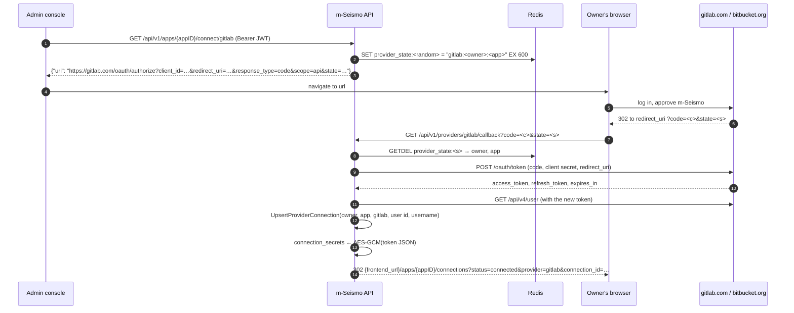
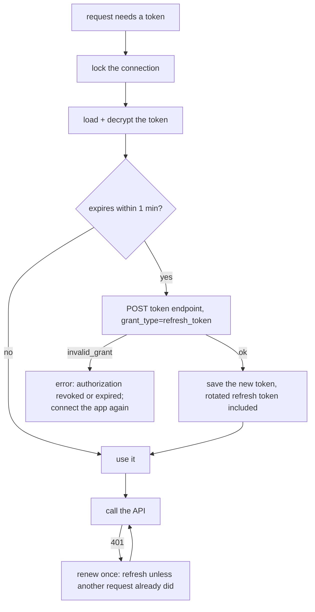

# GitLab and Bitbucket integration

This page explains how m-Seismo reaches GitLab and Bitbucket repositories on
behalf of an app. It covers the per-app OAuth model, the connect flow, how
tokens are stored, refreshed and protected, how issues are opened, rate
limits, configuration, setting up a real GitLab application and Bitbucket
consumer.

The code lives in three packages:

| Package | Contents |
|---|---|
| `internal/provider/oauth` | what both trackers share: the OAuth 2.0 authorization-code flow, the per-connection token source, and a JSON REST client with 401 and 429 handling |
| `internal/provider/gitlab` | the GitLab provider (REST API v4) and its issue opener |
| `internal/provider/bitbucket` | the Bitbucket Cloud provider (REST API 2.0) and its issue opener |

Only `gitlab` talks to GitLab and only `bitbucket` talks to Bitbucket.
Everything else sees them through `provider.Provider` and `issue.Opener`,
exactly like GitHub.

- [How it differs from GitHub](#how-it-differs-from-github)
- [The OAuth authorization belongs to the app](#the-oauth-authorization-belongs-to-the-app)
- [The connect flow](#the-connect-flow)
- [Token storage and encryption](#token-storage-and-encryption)
- [Token refresh and rotation](#token-refresh-and-rotation)
- [Repositories and Covers](#repositories-and-covers)
- [Opening issues](#opening-issues)
- [Rate limits and errors](#rate-limits-and-errors)
- [Configuration](#configuration)
- [Setting up a real GitLab application](#setting-up-a-real-gitlab-application)
- [Setting up a real Bitbucket consumer](#setting-up-a-real-bitbucket-consumer)
- [Failure modes](#failure-modes)
- [Limitations](#limitations)

---

## How it differs from GitHub

| | GitHub | GitLab | Bitbucket Cloud |
|---|---|---|---|
| Integration type | GitHub App | OAuth 2.0 application | OAuth 2.0 consumer |
| What a connection is | one App installation on a user or org | one user's OAuth grant to m-Seismo | one user's OAuth grant to m-Seismo |
| Connection `external_id` | installation ID | GitLab user ID | Bitbucket user UUID |
| Credential stored | **none** (tokens minted from the App key) | access + refresh token, **encrypted** | access + refresh token, **encrypted** |
| Issues are authored by | `m-seismo[bot]` | the authorising GitLab user | the authorising Bitbucket user |
| Scope | Issues R/W + Metadata R, per repository | `api` | consumer permissions: Account R, Repositories R, Issues W |
| Can be attached to another app | yes (shares the installation) | **no**, each app authorises itself | **no**, each app authorises itself |
| `Covers(conn, repo)` | repository owner = installation account | any valid project path | any valid `workspace/repo` |
| Repository name | `owner/name` | `group/project` or `group/sub/…/project` | `workspace/repo_slug` |
| Issue ref | `owner/name#N` | `group/project#iid` | `workspace/repo#id` |

---

## The OAuth authorization belongs to the app

```
owner ─< app ─< provider_connection (tracker=gitlab, external_id=<GitLab user id>)
                     └── connection_secrets (encrypted access + refresh token)
```

- **Each app authorises on its own.** `GET /apps/{appID}/connect/gitlab`
  starts an OAuth flow for that app. The token that comes back is stored for
  that app's connection only.
- **Two apps, two grants.** When the same GitLab user authorises two apps,
  each app gets its own connection row and its own token. Revoking,
  refreshing or disconnecting one does not affect the other.
- **No attach.** `POST /apps/{id}/connections {connection_id}` refuses
  GitLab and Bitbucket connections with 422 "… cannot be shared; connect
  this app with GET /apps/{appID}/connect/gitlab". Two reasons:
  - The grant belongs to the app that made it.
  - GitLab refresh tokens are single-use. If two apps held a copy of the
    same token, the first refresh would break the other app.

  GitHub connections can still be attached: they hold no credential, only an
  installation ID.
- **One owner per tracker account.** As with GitHub, the exclusion
  constraint `provider_connections_one_owner_per_account` stops a second
  m-Seismo owner from connecting a GitLab user or Bitbucket user that
  another owner already connected. They get "this gitlab account is already
  connected by another owner".

---

## The connect flow



The flow uses the same routes, state handling and redirects as GitHub (see
[github.md → The connect flow](github.md#the-connect-flow)). What differs is
`Provider.CompleteInstall`:

1. If the callback carries `error` (the user clicked *Deny*), the result is
   422 "gitlab authorization was not granted: <description>".
2. `code` is required (422 "missing authorization code").
3. The code is exchanged at the token endpoint. Only m-Seismo can do that,
   because the exchange needs the client secret, so a valid exchange proves
   the grant. There is no identifier in the query to forge, unlike GitHub's
   `installation_id`. A code the tracker rejects gives 422 "gitlab rejected
   the authorization code: …".
4. The authorising user is read with the new token: GitLab `GET /user` gives
   `id` and `username`; Bitbucket `GET /user` gives `uuid` and `username`.
   That user becomes the connection's account.
5. The token is returned as `Account.Secret`. `provider.Service` saves it,
   encrypted, for the new or updated connection.

**Reconnecting** the same app as the same user updates the connection row,
which keeps the same ID, and replaces its token. This is how a revoked
authorization is fixed.

---

## Token storage and encryption

| Piece | What it does |
|---|---|
| `connection_secrets` table | `provider_connection_id` (PK, FK `ON DELETE CASCADE`), `ciphertext bytea`, timestamps. Deleting the connection or its app deletes the token. |
| `internal/secrets.Cipher` | AES-256-GCM, a random 12-byte nonce per value, prepended to the ciphertext. |
| Associated data | the connection ID. A ciphertext copied into another connection's row does not decrypt. |
| `provider.SecretStore` | `Load` / `Save` per connection; `NewDBSecretStore(q, cipher)` is the Postgres implementation. `ErrNoSecret` means "this connection has no credentials" (every GitHub connection). |
| Plaintext format | `oauth.Token` as JSON: `access_token`, `refresh_token`, `expiry`. Only the providers read it. |

The key is `secrets.encryption_key`: 32 random bytes, base64-encoded
(`openssl rand -base64 32`).

- **Development** (`env=development`) with no key uses a fixed development
  key and logs a warning. Never use that outside a laptop.
- **Elsewhere**, startup fails if GitLab or Bitbucket is configured and the
  key is empty. With neither configured, no key is needed.
- **Changing the key** makes existing tokens unreadable. Every GitLab and
  Bitbucket connection then has to be reconnected. There is no key rotation
  yet.

Tokens never appear in API responses or logs. The connection DTO has no
secret field.

---

## Token refresh and rotation

Access tokens expire after about two hours on both trackers.
`oauth.Tokens` handles it:



- **Before expiry.** A token that expires within a minute is refreshed
  before it is used.
- **After a 401.** The request is retried once with a renewed token. A 401
  means the request was not processed, so retrying is safe, even for a POST.
- **Rotation.** GitLab issues a new refresh token on every refresh and
  invalidates the old one, so the new one is saved at once. Bitbucket keeps
  the same refresh token; the code handles both.
- **One refresh at a time per connection.** A per-connection lock serialises
  refreshes. Concurrent requests that find the same expiring token cause one
  refresh, and the others reuse its result. `TestTokensConcurrentRefreshOnce`
  checks this with 20 goroutines.
- **Save failures.** If the refreshed token can't be saved, the request still
  succeeds with it, and an error is logged: `oauth token refreshed but not
  saved`. With GitLab, the next refresh will then fail and the app must be
  reconnected.
- **Revoked or expired grants.** When the user revoked m-Seismo on the
  tracker, or the refresh token expired, the refresh fails with
  `oauth.ErrRevoked`. The issue target fails with "…authorization revoked
  or expired (invalid_grant: …); connect the app again", whether the token
  was found expired or was rejected with a 401. The connection is not
  suspended automatically.

---

## Repositories and Covers

| | GitLab | Bitbucket |
|---|---|---|
| `ListRepositories` | `GET /projects?membership=true&min_access_level=10` (Guest and above can open issues), 100 per page, following `X-Next-Page` | `GET /repositories?role=member&pagelen=100`, following the absolute `next` link |
| `HasRepository` | `GET /projects/{url-encoded path}` | `GET /repositories/{workspace}/{slug}` |
| `ValidateRepository` | segments of `[A-Za-z0-9_][A-Za-z0-9_.-]*`, at least two, no `..` | exactly `workspace/repo_slug`, same character rules |
| `Covers` | true for any valid path | true for any valid name |

**Why `Covers` is always true.** An OAuth token reaches every repository its
user can see, and that can't be decided without asking the tracker. So the
issue service uses an app's **first** active GitLab connection for every
GitLab target, and the first Bitbucket connection for every Bitbucket
target. Connections are ordered by creation. If that user can't reach the
repository, the tracker's 404 becomes the target's error. One connection per
tracker per app is the normal setup; a second one is only a fallback while
the first is suspended.

**Pagination links never leak the token.** `oauth.Client` only follows
absolute URLs on the configured API host. Any other host is refused before
the request is sent.

---

## Opening issues

| `issue.Issue` field | GitLab (`POST /projects/{path}/issues`) | Bitbucket (`POST /repositories/{ws}/{slug}/issues`) |
|---|---|---|
| `Title` | `title` | `title` |
| `Body` | `description` | `content.raw` (markdown) |
| `Labels` | `labels`, comma-separated | **not supported by Bitbucket**: added at the end of the body as `Labels: a, b` |
| `Milestone` (a title) | looked up with `GET /milestones?title=…&state=active`; `milestone_id` if found, otherwise left out with a warning | looked up in the first 100 milestones; `milestone.name` if found, otherwise left out with a warning |
| `Assignees` (usernames) | resolved with `GET /users?username=…` to `assignee_ids`; unknown users are skipped with a warning | **skipped with a warning**: Bitbucket needs Atlassian account IDs, which m-Seismo doesn't have |
| — | — | `kind: bug`, `priority: major` |

| Opener method | GitLab | Bitbucket |
|---|---|---|
| `Open` → `Ref.ID` | `group/project#iid` (the project-scoped `iid`), `Ref.URL` = `web_url` | `workspace/repo#id`, `Ref.URL` = `links.html.href` |
| `Comment` | `POST …/issues/{iid}/notes` `{body}` | `POST …/issues/{id}/comments` `{content: {raw}}` |
| `IsOpen` | `state == "opened"` | `state` is `new`, `open` or `on hold` (not `resolved`, `invalid`, `duplicate`, `wontfix` or `closed`) |

GitLab project paths are sent URL-encoded (`group%2Fsub%2Fproject`), as the
GitLab API expects. On Bitbucket, a repository whose issue tracker is turned
off answers 404 "Repository has no issue tracker.", and that message becomes
the target's error.

---

## Rate limits and errors

`oauth.Client` handles HTTP 429 the same way the GitHub provider does (see
[github.md → Rate limits](github.md#rate-limits)):

- **Short waits are waited out.** The wait is read from `Retry-After`
  (seconds or an HTTP date), else GitLab's `RateLimit-Reset`, else one
  minute. If it is at most `<tracker>.max_rate_limit_wait` (default 30 s)
  and fits the context deadline, the request is retried, up to three
  attempts. The request was not processed, so this can't open a duplicate
  issue.
- **Long waits fail fast** with `*issue.RateLimitError{Tracker: "gitlab",
  Wait}`. `issue.Service` then skips the app's other targets on the same
  connection, and the HTTP layer answers `429` with `Retry-After`.
- **Nothing else is retried.** That includes 5xx: a POST that failed for an
  unknown reason may have created the issue.
- **Error bodies** are read in GitLab's (`{"message": …}`) and Bitbucket's
  (`{"error": {"message": …}}`) formats into `*oauth.APIError{Status,
  Message}`. `oauth.IsStatus(err, 404)` tests it.

Limits are per GitLab or Bitbucket user, so per connection. Writes are not
paced the way GitHub's are, because neither tracker asks for it.

---

## Configuration

| Key (env var `SEISMO_…`) | Default | Notes |
|---|---|---|
| `gitlab.web_url` | `https://gitlab.com/` | authorize and token endpoints; set this for a self-managed GitLab |
| `gitlab.api_url` | `https://gitlab.com/api/v4/` | REST API |
| `gitlab.redirect_url` | `{server.public_url}/api/v1/providers/gitlab/callback` | must equal every app's GitLab application's redirect URI exactly |
| `gitlab.max_rate_limit_wait` | `30s` | negative = never wait |
| `bitbucket.web_url` | `https://bitbucket.org/` | OAuth endpoints |
| `bitbucket.api_url` | `https://api.bitbucket.org/2.0/` | REST API |
| `bitbucket.redirect_url` | `{server.public_url}/api/v1/providers/bitbucket/callback` | must match every app's Bitbucket consumer's callback URL |
| `bitbucket.max_rate_limit_wait` | `30s` | |
| `secrets.encryption_key` | empty | base64 of 32 bytes; see [Token storage](#token-storage-and-encryption) |

These are the only deployment-wide settings: there is no client ID or
secret here. GitLab and Bitbucket are always available (`GET /providers`
always lists them); each **app** registers its own OAuth application
through `PUT /apps/{appID}/providers/{tracker}/credentials` (see
[../bruno/07 App connections](../bruno/07%20App%20connections)) before it
can connect. This is unlike GitHub, which uses one App installed for the
whole deployment.

---

## Setting up a real GitLab application

1. On GitLab, go to **User settings → Applications**, or **Group →
   Settings → Applications**, or for self-managed instances **Admin →
   Applications**. Add a new application.
2. **Redirect URI**: `{SEISMO_SERVER_PUBLIC_URL}/api/v1/providers/gitlab/callback`
   (e.g. `http://localhost:8080/api/v1/providers/gitlab/callback` locally).
   This is the same URL for every app on this deployment.
3. **Confidential**: yes. **Scopes**: `api`. `api` is the narrowest scope
   that can create issues; `read_api` cannot.
4. Save it, then register the **Application ID** and **Secret** on the app
   that will use it: `PUT /apps/{appID}/providers/gitlab/credentials` with
   `{"client_id": "…", "client_secret": "…"}`.
5. For self-managed GitLab, also set `SEISMO_GITLAB_WEB_URL` and
   `SEISMO_GITLAB_API_URL` (deployment-wide: every app's GitLab application
   must be on the same instance).
6. Set `SEISMO_SECRETS_ENCRYPTION_KEY` (outside development), then
   `GET /apps/{appID}/connect/gitlab` starts the flow for that app.

## Setting up a real Bitbucket consumer

1. On Bitbucket, open your **workspace settings → OAuth consumers → Add
   consumer**.
2. **Callback URL**: `{SEISMO_SERVER_PUBLIC_URL}/api/v1/providers/bitbucket/callback`
   (the same URL for every app on this deployment).
3. **This is a private consumer**: ticked, because a confidential client is
   needed for refresh tokens.
4. **Permissions**: Account → *Read*, Repositories → *Read*, Issues →
   *Write*.
5. Save it, then register the **Key** and **Secret** on the app that will
   use it: `PUT /apps/{appID}/providers/bitbucket/credentials` with
   `{"client_id": "…", "client_secret": "…"}`.
6. Set `SEISMO_SECRETS_ENCRYPTION_KEY` (outside development), then
   `GET /apps/{appID}/connect/bitbucket` starts the flow for that app.

Each repository that should receive issues needs its **issue tracker turned
on** (Repository settings → Issue tracker).

---

## Failure modes

| Situation | What the owner sees |
|---|---|
| User clicks *Deny* on GitLab/Bitbucket | redirect with `status=error&reason=gitlab authorization was not granted: …` |
| Code expired, reused or forged | `reason=gitlab rejected the authorization code: invalid_grant: …` |
| Redirect URI mismatch (misconfiguration) | the tracker shows its own error page, or the exchange fails with `rejected the authorization code` |
| Another owner already connected this tracker user | `reason=this gitlab account is already connected by another owner` |
| Attaching a GitLab or Bitbucket connection to another app | `422 gitlab connections use the app's own OAuth authorization and cannot be shared; …` |
| The user revoked m-Seismo, or the refresh token expired | target error `…authorization revoked or expired (…); connect the app again`; reconnecting the app fixes it |
| The user lost access to the repository | target error with the tracker's 404 |
| Bitbucket repository without an issue tracker | target error `… Repository has no issue tracker.` |
| Rate limited | waited out when short; otherwise `429` / `*issue.RateLimitError` |
| Encryption key changed or lost | every GitLab and Bitbucket target fails with `cannot decrypt`; reconnect those apps |

---

## Limitations

- **Refreshes are serialised within one backend process only.** With several
  backend instances, two of them could refresh the same GitLab token at the
  same time. One would get `invalid_grant`, and the connection would need
  reconnecting. A Postgres advisory lock around the refresh would fix this
  before scaling out.
- **No automatic suspension.** A revoked connection stays active, and keeps
  failing, until it is reconnected or removed. `suspended_at` isn't set for
  OAuth trackers yet.
- **No key rotation** for `secrets.encryption_key`.
- **Bitbucket labels and assignees** are not native: labels go into the body
  and assignees are skipped.
- **Only the first connection per tracker is used** for an app's GitLab or
  Bitbucket targets (see [Covers](#repositories-and-covers)).
- **Bitbucket Server / Data Center** (self-hosted) is a different API and is
  not supported; this is Bitbucket Cloud.
