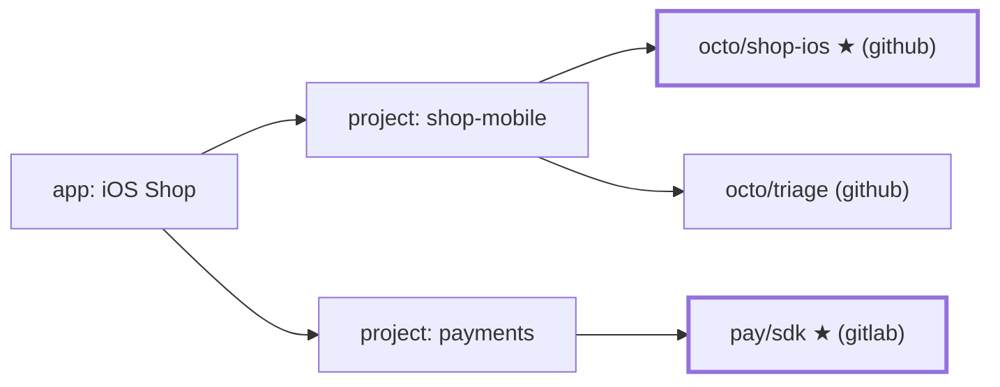
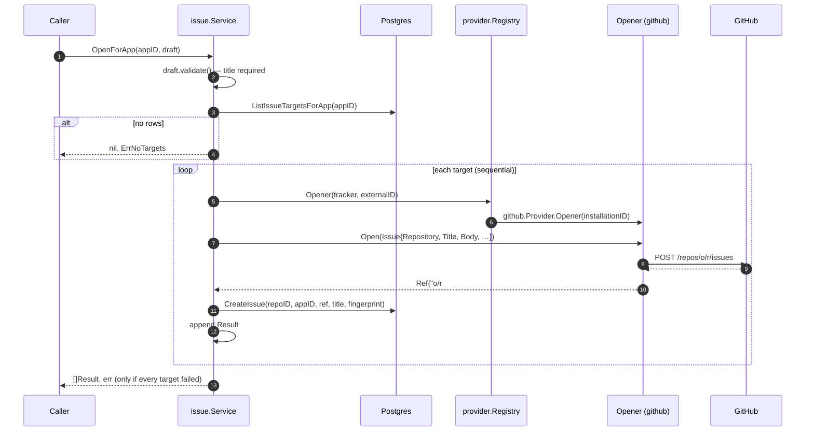

# Issue service

`internal/issue` defines what "opening an issue" means for any tracker, and
`issue.Service` decides **where** an app's issue goes, opens it, and records
it. It is a Go service with no route of its own. The future ingestion
pipeline is expected to call it after a report is accepted and enriched.
Today its only HTTP entry point is the owner's
[`POST /apps/{appID}/test-issue`](api.md#test-issue), which calls
`OpenForApp` with a test draft. The API scripts use it to exercise the
service end to end (`backend/scripts/api/issues.sh`).

- [Types](#types)
- [Where an issue goes](#where-an-issue-goes)
- [OpenForApp, step by step](#openforapp-step-by-step)
- [Error semantics](#error-semantics)
- [OpenInRepository](#openinrepository)
- [Calling it](#calling-it)
- [How it will grow](#how-it-will-grow)

---

## Types

From `issue.go`. These existed before and are unchanged, apart from the
package comment.

```go
type Issue struct {           // a fully targeted issue, tracker-independent (FR-47)
    Repository string         // "owner/name"
    Title, Body string
    Labels, Assignees []string
    Milestone string          // title; each provider resolves it
}

type Ref struct {             // what the tracker returned
    ID  string                // tracker-native, e.g. "octo/app#7"
    URL string                // web URL
}

type Opener interface {       // one per tracker, bound to one connection
    Open(ctx, Issue) (Ref, error)
    Comment(ctx, Ref, body string) error   // dedup, FR-55
    IsOpen(ctx, Ref) (bool, error)         // status sync / regressions, FR-51/57
}
```

From `service.go`. These are new.

```go
type OpenerSource interface { // implemented by provider.Registry
    Opener(ctx, tracker db.Tracker, externalID string) (Opener, error)
}

type Draft struct {           // an issue before its repository is known
    Title, Body string        // Title is required
    Labels, Assignees []string
    Milestone string
    Fingerprint string        // optional grouping key (FR-54)
}

type Result struct {          // one per target repository
    ProjectID, ProjectRepositoryID uuid.UUID
    Repository string
    Tracker    db.Tracker
    IssueID    uuid.UUID      // the m-Seismo issues row; zero on failure
    Ref        Ref            // zero on failure
    Err        error          // nil on success
}

var ErrNoTargets = errors.New("issue: app has no linked project with a default repository")
```

`Draft` and `Issue` are separate types on purpose. A draft is what the
reporter and pipeline produce. An `Issue` is a draft plus a concrete
repository, which is what an `Opener` needs.

---

## Where an issue goes

`ListIssueTargetsForApp` (in `db/queries/project_repositories.sql`) resolves
an app to its targets:

```sql
SELECT pr.id, pr.project_id, pr.repository, pc.tracker, pc.external_id
FROM app_projects ap
JOIN project_repositories pr ON pr.project_id = ap.project_id AND pr.is_default
JOIN provider_connections pc ON pc.id = pr.provider_connection_id
WHERE ap.app_id = $1 AND pc.suspended_at IS NULL
ORDER BY ap.created_at;
```

So the targets are **one per linked project**: that project's **default
repository**, through an **active** connection.



Here an issue from *iOS Shop* is opened in `octo/shop-ios` and `pay/sdk` (★
marks the defaults). It is not opened in `octo/triage`.

Projects that are linked but have no default repository, or whose default
uses a suspended connection, are skipped without an error. If nothing is
left, the call returns `ErrNoTargets`.

> Routing rules (FR-58) will later choose a repository other than the default
> based on severity, category and so on. They will call
> [`OpenInRepository`](#openinrepository) with the chosen repository instead
> of using `OpenForApp`'s default-only targeting.

---

## OpenForApp, step by step



Details:

1. **Validation.** An empty `Title` returns an error before any I/O.
2. **Targets are processed one at a time**, in link order. This is
   deliberate: GitHub's secondary rate limits penalise concurrent writes
   (see [github.md → Rate limits](github.md#rate-limits)), and the provider
   paces writes per installation anyway.
3. **Rate limits are per connection.** When a target fails with
   `*issue.RateLimitError`, every later target **on the same connection**
   (same tracker and external ID) is skipped without calling the tracker. Its
   `Result.Err` wraps the same `*RateLimitError`. Targets on other
   connections are still tried.
4. **Opener lookup failures** are per target. A tracker that isn't
   configured on this deployment (such as GitLab today) fails only its own
   targets.
5. **Recording.** After a successful `Open`, the service inserts an `issues`
   row with `app_id`, `external_id = Ref.ID`, `url`, `title` and the optional
   `fingerprint`. If that **insert fails**, the issue still exists on the
   tracker. The service logs `issue opened but not recorded` at error level
   and returns the result **as a success** with `IssueID == uuid.Nil`. The
   reporter's bug did reach the tracker; the only loss is dedup for that one
   issue.

---

## Error semantics

| Situation | Returned `[]Result` | Returned `error` |
|---|---|---|
| Empty title | `nil` | validation error |
| Target query fails | `nil` | wrapped DB error |
| App has no targets | `nil` | `ErrNoTargets` (use `errors.Is`) |
| Some targets fail | every result; failed ones have `Err` set | **`nil`** |
| Every target fails | every result | `"issue: every target failed: …"` (an `errors.Join` of every target's error) |

To tell a retryable rate limit from other failures:

```go
var rl *issue.RateLimitError
if errors.As(res.Err, &rl) {
    // not processed by the tracker; safe to retry after rl.Wait
    // (rl.Secondary distinguishes burst limits from the hourly quota)
}
```

The caller should **always look at each `Result.Err`**, even when the
returned error is nil. Partial delivery is normal, for example when one
tracker is down. FR-62 retries will build on those per-target errors.

Each `Result.Err` is wrapped with context, for example
`issue: open on github octo/app: github: create issue in octo/app: …`.

---

## OpenInRepository

```go
func (s *Service) OpenInRepository(ctx, projectRepositoryID uuid.UUID, appID *uuid.UUID, d Draft) (Result, error)
```

This opens the draft in exactly one project repository, whether or not it is
the default. It looks the repository up with `GetIssueTarget`, which also
skips suspended connections. `appID` is optional and recorded when given.
The returned `error` is the same as `Result.Err`, plus the resolve and
validation errors.

---

## Calling it

`issue.Module` provides `*issue.Service`. Inject it like any other
dependency:

```go
type Ingestor struct{ issues *issue.Service }

func (in *Ingestor) Handle(ctx context.Context, appID uuid.UUID, r Report) error {
    results, err := in.issues.OpenForApp(ctx, appID, issue.Draft{
        Title:       r.Title,
        Body:        renderBody(r), // FR-47 content
        Labels:      []string{"m-seismo", r.Severity},
        Fingerprint: r.Fingerprint,
    })
    if errors.Is(err, issue.ErrNoTargets) {
        // the app isn't connected to anything yet; keep the report and tell the admin
    }
    for _, res := range results {
        if res.Err != nil {
            // schedule a retry for res.ProjectRepositoryID (FR-62)
        }
    }
    return err
}
```

To get `appID` from an SDK request, use `app.Service.Authenticate(ctx, rawKey)`.

---

## How it will grow

| Feature | Building block already in place |
|---|---|
| Dedup (FR-55): comment instead of opening a duplicate | `Draft.Fingerprint`, `issues.fingerprint` + index, `GetOpenIssueByFingerprint`, `Opener.Comment` |
| Two-way status (FR-51) | `issues.state`, `SetIssueState`, `Opener.IsOpen` |
| Routing rules (FR-58) | `OpenInRepository` |
| Retries (FR-62) | per-target `Result.Err` and `ProjectRepositoryID`; NATS JetStream in `infra` |
| New trackers | `OpenerSource` → `provider.Registry` (see [extending.md](extending.md)) |
