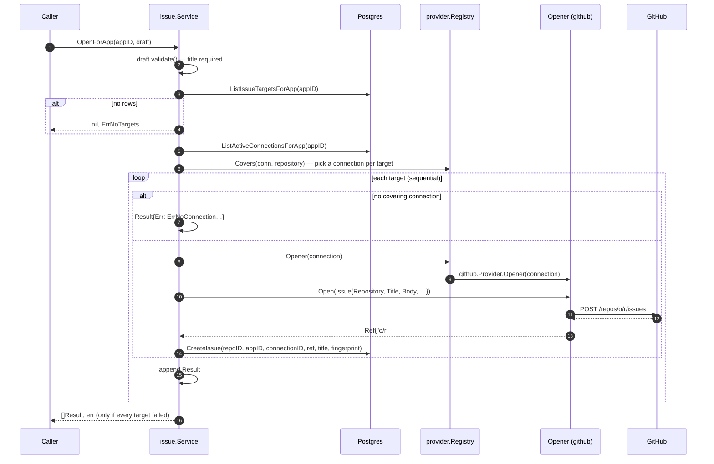

# Issue service

`internal/issue` defines what "opening an issue" means for any tracker.
`issue.Service` decides **where** an app's issue goes and **through which of
the app's connections**, opens it, and records it. It is a Go service with no
route of its own. The [worker](worker.md) calls `OpenInRepository` for every
accepted report.

It also has two HTTP entry points, both owner-only:

- `POST /apps/{appID}/test-issue` (see [../bruno/09 Test issue](../bruno/09%20Test%20issue))
  calls `OpenForApp` with a test draft.
- `GET /apps/{appID}/targets` (see [../bruno/08 Targets](../bruno/08%20Targets))
  calls `Targets`, to preview where an issue would go.

The API scripts use them to exercise the service end to end
(`backend/scripts/api/issues.sh`).

- [Types](#types)
- [Where an issue goes](#where-an-issue-goes)
- [Which connection opens it](#which-connection-opens-it)
- [OpenForApp, step by step](#openforapp-step-by-step)
- [Error semantics](#error-semantics)
- [OpenInRepository](#openinrepository)
- [Calling it](#calling-it)
- [How it will grow](#how-it-will-grow)

---

## Types

From `issue.go`:

```go
type Issue struct {           // a fully targeted issue, tracker-independent (FR-47)
    Repository string         // "owner/name"
    Title, Body string
    Labels, Assignees []string
    Milestone string          // title; each provider resolves it
}

type Ref struct {             // what the tracker returned
    ID  string                // tracker-native, e.g. "octo/app#7"
    URL string                // web URL
}

type Opener interface {       // one per tracker, bound to one connection
    Open(ctx, Issue) (Ref, error)
    Comment(ctx, Ref, body string) error   // dedup, FR-55
    IsOpen(ctx, Ref) (bool, error)         // status sync / regressions, FR-51/57
}

type Connection struct {      // one of an app's tracker connections
    ID           uuid.UUID    // provider_connections.id
    Tracker      db.Tracker
    ExternalID   string       // GitHub: installation ID
    AccountLogin string       // GitHub: the user or org it is installed on
}
func ConnectionFromRow(db.ProviderConnection) Connection

type RateLimitError struct { Tracker string; Wait time.Duration; Secondary bool; Err error }
```

From `service.go`:

```go
type OpenerSource interface { // implemented by provider.Registry
    Opener(ctx, c Connection) (Opener, error)
    Covers(c Connection, repository string) bool // no network call
}

type Draft struct {           // an issue before its repository is known
    Title, Body string        // Title is required
    Labels, Assignees []string
    Milestone string
    Fingerprint string        // optional grouping key (FR-54)
}

type Target struct {          // where an app's issue goes, before opening
    ProjectID, ProjectRepositoryID uuid.UUID
    Repository string
    Tracker    db.Tracker
    Connection *Connection    // the app's connection for it; nil when Err is set
    Err        error          // wraps ErrNoConnection
}

type Result struct {          // one per target repository
    ProjectID, ProjectRepositoryID uuid.UUID
    Repository   string
    Tracker      db.Tracker
    ConnectionID uuid.UUID    // the app connection used; zero if none covered it
    IssueID      uuid.UUID    // the m-Seismo issues row; zero on failure
    Ref          Ref          // zero on failure
    Err          error        // nil on success
}

var ErrNoTargets    = errors.New("issue: app has no linked project with a default repository")
var ErrNoConnection = errors.New("issue: app has no connection for the repository")
```

`Draft` and `Issue` are separate types on purpose. A draft is what the
reporter and pipeline produce. An `Issue` is a draft plus a concrete
repository, which is what an `Opener` needs.

---

## Where an issue goes

`ListIssueTargetsForApp` (in `db/queries/project_repositories.sql`) resolves
an app to its target repositories:

```sql
SELECT pr.id, pr.project_id, pr.tracker, pr.repository
FROM app_projects ap
JOIN project_repositories pr ON pr.project_id = ap.project_id AND pr.is_default
WHERE ap.app_id = $1
ORDER BY ap.created_at;
```

So the targets are **one per linked project**: that project's **default
repository**.


Here an issue from *iOS Shop* is aimed at `octo/shop-ios` and `pay/sdk` (★
marks the defaults). It is not opened in `octo/triage`.

Projects that are linked but have no default repository are not targets. If
there are no targets at all, `OpenForApp` returns `ErrNoTargets`.

> Routing rules (FR-58) will later choose a repository other than the default
> based on severity, category and so on. They will call
> [`OpenInRepository`](#openinrepository) with the chosen repository instead
> of using `OpenForApp`'s default-only targeting.

---

## Which connection opens it

Projects hold no credentials, so each target is paired with one of the
**reporting app's** connections. `Service.Targets(ctx, appID)` does this, and
`OpenForApp` calls it:

1. Load the app's active connections: `ListActiveConnectionsForApp`
   (`suspended_at IS NULL`, oldest first).
2. For each target, take the **first** connection with the same tracker for
   which `OpenerSource.Covers(conn, repository)` is true.
   - GitHub: the repository owner equals the installation's `account_login`,
     ignoring case.
   - GitLab and Bitbucket: any valid repository name. An OAuth token reaches
     whatever its user can see, so the app's first connection on that
     tracker is used.
   - A connection on a tracker this deployment doesn't configure covers
     nothing.
3. No match: the target's `Err` wraps `ErrNoConnection`, for example
   `no github connection on this app covers octo/shop-ios`. That target fails
   without calling the tracker; the others go ahead.

Continuing the example: if *iOS Shop* has one GitHub connection on `octo` and
no GitLab connection, `octo/shop-ios` opens through that connection, and
`pay/sdk` fails with "no gitlab connection on this app covers pay/sdk".
Another app linked to the same projects uses **its own** connections, so it
might reach both repositories, or neither.

`Covers` is a cheap, local check: "could this connection reach the
repository at all?" It does not ask the tracker whether the repository was
actually selected for the installation. If it wasn't, the tracker's own error
surfaces when the issue is opened. `GET /apps/{id}/targets` shows the result
of this resolution without opening anything.

---

## OpenForApp, step by step



Details:

1. **Validation.** An empty `Title` returns an error before any I/O.
2. **Targets are processed one at a time**, in link order. This is
   deliberate: GitHub's secondary rate limits penalise concurrent writes
   (see [github.md → Rate limits](github.md#rate-limits)), and the provider
   paces writes per installation anyway.
3. **Rate limits are per tracker-side connection.** When a target fails with
   `*issue.RateLimitError`, every later target on the same tracker and
   external ID is skipped without calling the tracker. Its `Result.Err`
   wraps the same `*RateLimitError`. Targets on other connections are still
   tried.
   - Two apps sharing a GitHub installation also share its quota. The
     provider keeps one client per installation, so once the hourly quota is
     exhausted, the second app gets the rate-limit error straight away,
     without a request to GitHub.
4. **Opener lookup failures** are per target, for example when the tracker
   isn't configured on this deployment.
5. **Recording.** After a successful `Open`, the service inserts an `issues`
   row with `app_id`, **`provider_connection_id`** (the connection used),
   `external_id = Ref.ID`, `url`, `title` and the optional `fingerprint`.
   - If that **insert fails**, the issue still exists on the tracker. The
     service logs `issue opened but not recorded` at error level and returns
     the result **as a success** with `IssueID == uuid.Nil`.
   - The reporter's bug did reach the tracker; the only loss is dedup for that
     one issue.

---

## Error semantics

| Situation | Returned `[]Result` | Returned `error` |
|---|---|---|
| Empty title | `nil` | validation error |
| Target or connection query fails | `nil` | wrapped DB error |
| App has no targets | `nil` | `ErrNoTargets` (use `errors.Is`) |
| Some targets fail (tracker error, rate limit, or no connection) | every result; failed ones have `Err` set | **`nil`** |
| Every target fails | every result | `"issue: every target failed: …"` (an `errors.Join` of every target's error) |

To tell the failure kinds apart:

```go
var rl *issue.RateLimitError
switch {
case errors.Is(res.Err, issue.ErrNoConnection):
    // configuration: the app needs a connection for res.Tracker that covers res.Repository
case errors.As(res.Err, &rl):
    // not processed by the tracker; safe to retry after rl.Wait
    // (rl.Secondary distinguishes burst limits from the hourly quota)
}
```

The caller should **always look at each `Result.Err`**, even when the
returned error is nil. Partial delivery is normal, for example when one
tracker is down. FR-62 retries will build on those per-target errors.
A missing connection is a configuration problem, so it should be reported to
the owner rather than retried.

Each `Result.Err` is wrapped with context, for example
`issue: open on github octo/app: github: create issue in octo/app: …`.

---

## OpenInRepository

```go
func (s *Service) OpenInRepository(ctx, appID, projectRepositoryID uuid.UUID, d Draft) (Result, error)
```

This opens the draft in exactly one project repository, whether or not it is
the default, **through the app's connection** for it.

- The app is required, because credentials come from the app.
- `GetIssueTarget` loads the repository only if the app is **linked to the
  repository's project**. Otherwise it gets no row, which is an error.
- The connection is chosen exactly as in `OpenForApp`. No covering connection
  returns an error wrapping `ErrNoConnection`.
- The returned `error` is the same as `Result.Err`, plus the resolve and
  validation errors.

---

## Calling it

`issue.Module` provides `*issue.Service`. Inject it like any other
dependency:

```go
type Ingestor struct{ issues *issue.Service }

func (in *Ingestor) Handle(ctx context.Context, appID uuid.UUID, r Report) error {
    results, err := in.issues.OpenForApp(ctx, appID, issue.Draft{
        Title:       r.Title,
        Body:        renderBody(r), // FR-47 content
        Labels:      []string{"m-seismo", r.Severity},
        Fingerprint: r.Fingerprint,
    })
    if errors.Is(err, issue.ErrNoTargets) {
        // the app isn't linked to a project with a default repository yet;
        // keep the report and tell the admin
    }
    for _, res := range results {
        switch {
        case errors.Is(res.Err, issue.ErrNoConnection):
            // tell the admin: connect this app to res.Tracker
        case res.Err != nil:
            // schedule a retry for (appID, res.ProjectRepositoryID) (FR-62)
        }
    }
    return err
}
```

To get `appID` from an SDK request, use `app.Service.Authenticate(ctx, rawKey)`.
To show where an app's issues would go without opening any, call
`Targets(ctx, appID)`.

---

## How it will grow

| Feature | Building block already in place |
|---|---|
| Dedup (FR-55): comment instead of opening a duplicate | `Draft.Fingerprint`, `issues.fingerprint` + index, `GetOpenIssueByFingerprint`, `Opener.Comment`; `issues.provider_connection_id` says which connection to comment through |
| Two-way status (FR-51) | `issues.state`, `SetIssueState`, `Opener.IsOpen`, `issues.provider_connection_id` |
| Routing rules (FR-58) | `OpenInRepository(appID, repositoryID, draft)` |
| Retries (FR-62) | per-target `Result.Err`, `ProjectRepositoryID`, `ConnectionID`; NATS JetStream in `infra` |
| New trackers | `OpenerSource` → `provider.Registry`, `Provider.Covers` (see [extending.md](extending.md)) |
