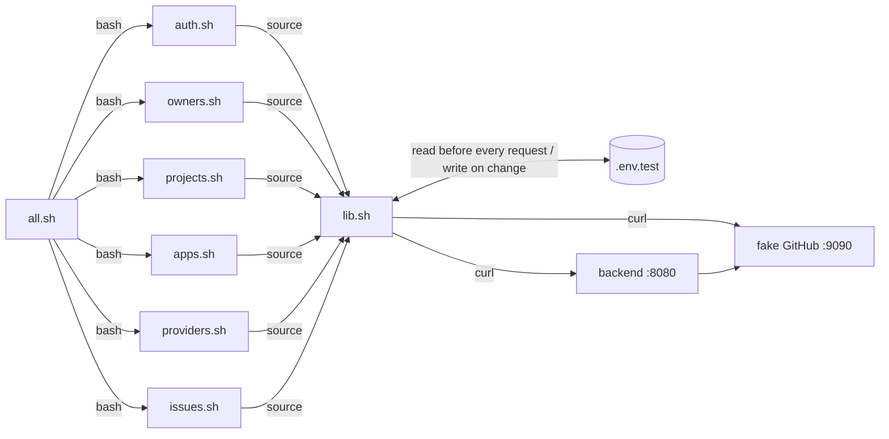
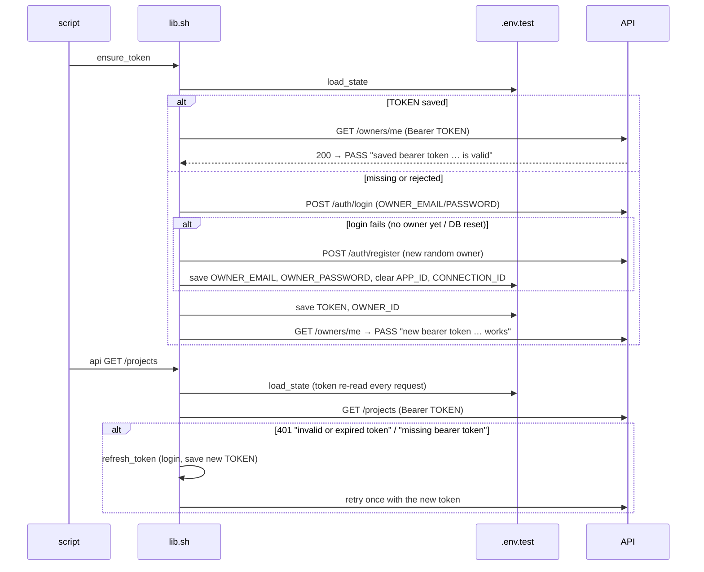

# API test scripts: interface reference

`backend/scripts/api/` is an end-to-end test suite for the HTTP API, written
in bash and curl. This page is its reference: how a script runs, what the
shared library `lib.sh` provides (every function, with its inputs, outputs
and side effects), the state file, the fake GitHub it relies on, and how to
add tests.

For a quick start, see [scripts/api/README.md](../scripts/api/README.md).

- [How the suite is organised](#how-the-suite-is-organised)
- [Lifecycle of a script](#lifecycle-of-a-script)
- [The state file](#the-state-file)
- [Bearer token handling in detail](#bearer-token-handling-in-detail)
- [lib.sh reference](#libsh-reference)
  - [Configuration variables](#configuration-variables)
  - [Global variables](#global-variables)
  - [Output and result counting](#output-and-result-counting)
  - [HTTP](#http)
  - [JSON](#json)
  - [Assertions](#assertions)
  - [State](#state)
  - [Setup and fixtures](#setup-and-fixtures)
  - [GitHub](#github)
- [The scripts](#the-scripts)
- [The fake GitHub contract](#the-fake-github-contract)
- [Exit codes](#exit-codes)
- [Writing tests](#writing-tests)
- [Troubleshooting](#troubleshooting)

---

## How the suite is organised

```
backend/scripts/api/
  lib.sh          shared library — sourced, never run
  auth.sh         one script per API area; each runs on its own
  owners.sh
  projects.sh
  apps.sh
  providers.sh
  issues.sh
  all.sh          runs the six in order and combines the result
  .env.test       state file (generated, git-ignored)
```



Design principles:

- **Each script is independent.** It creates what it needs (projects, apps,
  repository links, a GitHub connection) and cleans up after itself, so you
  can run `projects.sh` alone. `all.sh` only orders them.
- **Scripts share an identity, not data.** The owner, its token, one test
  app and that app's GitHub connection in `.env.test` are reused across
  scripts and runs, and re-verified each time. Apps created by a script get
  their own connection by attaching the saved one (no new install). Everything else is created fresh, with a unique
  `run` suffix, so runs never collide.
- **Tests go through HTTP only.** Nothing reads the database directly. The
  fake GitHub's inspection endpoints (`/_fake/...`) are the only way to look
  behind the API.
- **Failures don't stop a script.** Every assertion is counted, and the
  script continues so one run shows every problem. Only unrecoverable setup
  problems (`fatal`) stop it.

---

## Lifecycle of a script

Every script has the same shape:

```bash
source "$(dirname "${BASH_SOURCE[0]}")/lib.sh"   # 1. load the library and config
wait_for_server                                   # 2. block until /healthz is 200 (≤ 60 s)
ensure_token                                      # 3. valid bearer token in .env.test
ensure_github_connection                          #    (issues.sh only) saved app + its connection
run=$(rand)                                       # 4. unique suffix for this run's data

section "…"                                       # 5. groups of requests + assertions
api POST /projects '{"name":"…"}'
expect_status 201 "create a project"

summary                                           # 6. print counts; exit 1 if anything failed
```

When `lib.sh` is sourced it:

1. sets `set -uo pipefail`, so unset variables are errors and pipelines
   fail on any stage (deliberately *not* `-e`, since failing assertions must
   not stop the script);
2. resolves the configuration variables;
3. creates a private temporary directory, removed by an `EXIT` trap;
4. turns on colours when stdout is a terminal;
5. picks a JSON tool, `jq` or else Python 3, and stops with `fatal` if
   neither exists.

---

## The state file

Default path `backend/scripts/api/.env.test`, overridable with `STATE_FILE`.
It is a bash fragment of single-quoted assignments, sourced by `load_state`:

```bash
OWNER_EMAIL='owner-176086901212345@example.com'
OWNER_PASSWORD='pw-176086901254321-secret'
TOKEN='eyJhbGciOiJIUzI1NiIsInR5cCI6IkpXVCJ9.eyJpc3Mi…'
OWNER_ID='4c0b0e3e-…'
APP_ID='71a2…'
CONNECTION_ID='9d1f…'
```

| Variable | Written by | Meaning |
|---|---|---|
| `OWNER_EMAIL`, `OWNER_PASSWORD` | `refresh_token` (on register) | credentials of the suite's owner |
| `TOKEN` | `refresh_token` | current bearer token for that owner |
| `OWNER_ID` | `refresh_token` | that owner's UUID |
| `APP_ID` | `ensure_app` | the suite's test app, which owns the saved connection |
| `CONNECTION_ID` | `ensure_github_connection` | `APP_ID`'s GitHub connection. `issues.sh` attaches it to the apps it creates. |

The file is git-ignored by the root `.gitignore` rule `.env.*`. Delete it,
or run `all.sh --fresh`, to start with a new owner. If the database is
reset (`make dev-reset`), the saved owner no longer exists: the next
`refresh_token` sees the login fail, registers a new owner, and clears
`APP_ID` and `CONNECTION_ID`. `ensure_app` also replaces a saved app that no
longer exists, and clears its connection.

---

## Bearer token handling in detail

The flow is: get a token, save it, and re-check it on every request.



Details that matter:

- **Re-read, not cached.** `api` calls `load_state` before every request,
  so a token refreshed by one script, or by a parallel run, is picked up
  immediately.
- **Only token failures trigger a refresh.** `api` refreshes only when the
  401 body is exactly `invalid or expired token` or `missing bearer token`.
  Other 401s, such as `current_password is required…` on
  `PATCH /owners/me`, are real results and are passed to the assertion
  unchanged.
- **One retry.** If the refreshed token is also rejected, the second
  response is what the assertion sees.
- **`auth.sh` proves it.** It overwrites the saved `TOKEN` with garbage and
  expects the next `api` call to succeed, with the new token written back to
  the file.
- **Explicit tokens bypass all of this.** `http METHOD PATH BODY TOKEN`
  sends exactly the token given, for negative tests and second owners.

---

## lib.sh reference

### Configuration variables

Set these in the environment before running a script. Defaults are in
brackets.

| Variable | Default | Used for |
|---|---|---|
| `API_URL` | `http://localhost:8080/api/v1` | base of every relative `http`/`api` path; trailing `/` removed |
| `BASE_URL` | derived: `API_URL` minus `/api/v1` | `/healthz`; trimmed from logged request lines |
| `FAKE_GITHUB_URL` | `http://localhost:9090` | `fake_issue_count`, `fake_stat` |
| `GITHUB_MODE` | `fake` | `fake`: automatic connect and fake-only tests. `real`: interactive connect, fake-only tests skipped. |
| `GITHUB_TEST_REPO` | `octo-org/seismo-test` | repository linked as the default in `providers.sh` and `issues.sh` |
| `STATE_FILE` | `$LIB_DIR/.env.test` | where identity and token are kept |
| `VERBOSE` | `0` | `1` prints every request, request body and the first 300 characters of the response |

### Global variables

| Variable | Set by | Contents |
|---|---|---|
| `STATUS` | `http`, `api` | HTTP status of the last request as a string; `000` if curl failed |
| `BODY` | `http`, `api` | raw response body; for curl failures, `curl: <error>` |
| `HEADERS` | `http`, `api` | response headers, CR stripped, one per line |
| `LAST_REQUEST` | `http`, `api` | `METHOD /path` for failure messages |
| `PASS`, `FAIL`, `SKIP` | `pass`, `fail`, `skip` | counters reported by `summary` |
| `CREATED_ID` | `create_project`, `create_app`, `link_repo`, `attach_connection` | ID of what was just created, or empty on failure |
| `NEW_EMAIL`, `NEW_PASSWORD`, `NEW_TOKEN`, `NEW_OWNER_ID` | `new_owner` | a throwaway second owner |
| `CONNECTION_ID` | `github_connect` (not saved), `ensure_github_connection` (saved) | the connection just made, or the saved one |
| `OWNER_EMAIL`, `OWNER_PASSWORD`, `TOKEN`, `OWNER_ID`, `APP_ID`, `CONNECTION_ID` | `load_state` / `save_var` | mirror of the state file |
| `JSON_TOOL`, `PY` | sourcing | `jq` or `python`, and the Python executable |
| `LIB_DIR`, `TMP_DIR` | sourcing | library directory; per-run temporary directory |

> **Subshell caveat.** `$( … )` runs in a subshell. Globals it sets
> (`STATUS`, `BODY`, counters) are lost. That's why the `create_*` helpers
> set `CREATED_ID` instead of printing an ID, and why `fake_issue_count` /
> `fake_stat`, which are meant for `$( … )`, document that they don't change
> the caller's `BODY`.

### Output and result counting

| Function | Signature | Behaviour |
|---|---|---|
| `section` | `section TITLE…` | prints `== TITLE ==` |
| `note` | `note TEXT…` | prints dimmed, indented text; counts nothing |
| `pass` | `pass DESC` | `PASS +1`; prints `PASS DESC` |
| `fail` | `fail DESC [DETAIL]` | `FAIL +1`; prints `FAIL DESC`, the detail, the last request with its status, and up to 400 characters of the body |
| `skip` | `skip DESC` | `SKIP +1`; prints `SKIP DESC` |
| `fatal` | `fatal TEXT…` | prints to stderr and **exits 2** at once |
| `summary` | `summary` | prints `<script>: N passed, N failed, N skipped`; returns 0 when `FAIL == 0`, else 1. Make it the last command. |
| `rand` | `rand` | prints a unique-enough suffix: Unix seconds + 5-digit `$RANDOM` |

### HTTP

#### `http METHOD PATH [BODY] [TOKEN]`

Sends one request with curl and records the result.

- `PATH` is appended to `API_URL` unless it starts with `http`, in which case
  it is used as is (for `/healthz` and the fake GitHub).
- `BODY`, if non-empty, is sent as `application/json` with `--data-binary`.
- `TOKEN`, if non-empty, is sent as `Authorization: Bearer TOKEN`.
- It always sends `Accept: application/json`, uses a 30 s timeout, and
  **never follows redirects**, so a `302` and its `Location` can be inspected.
- It sets `STATUS`, `BODY`, `HEADERS` and `LAST_REQUEST`, and always returns
  0. Test the result with the assertions.

```bash
http POST /auth/login '{"email":"a@b.c","password":"x"}'
http GET /owners/me "" "$NEW_TOKEN"
http GET "$BASE_URL/healthz"
```

#### `api METHOD PATH [BODY]`

Like `http`, but authenticated as the saved owner, with refresh-and-retry
(see [Bearer token handling](#bearer-token-handling-in-detail)). Use it for
every request made as the suite's owner.

#### `header NAME`

Prints the value of response header `NAME` from the last request
(case-insensitive). If the header appears more than once, the last value is
printed. Prints an empty line if it is absent.

```bash
location=$(header Location)
retry=$(header Retry-After)
```

#### `query_param URL NAME`

Prints the raw (not URL-decoded) value of query parameter `NAME` in `URL`.
Used for `state` in install URLs and for `status`, `reason` and
`connection_id` in callback redirects. Because the value isn't decoded,
spaces appear as `+`; match on that, e.g. `'unknown\+or\+expired\+state'`.

### JSON

All three functions read the last response's `BODY` unless a JSON string is
passed as the extra argument. They support a subset of jq paths that works
with both `jq` and the Python fallback: `.`, `.field`, `.a.b`, `.[0]`,
`.a[1].b`.

| Function | Signature | Prints |
|---|---|---|
| `jget` | `jget PATH [JSON]` | the value: strings unquoted, `true`/`false`, numbers, arrays/objects as JSON; `null` when missing or on parse errors |
| `jlen` | `jlen PATH [JSON]` | length of the array/object/string at `PATH`; `0` when missing |
| `jcount` | `jcount PATH FIELD VALUE [JSON]` | how many objects in the array at `PATH` have `FIELD` equal to `VALUE`. Non-string fields are compared in JSON form: `null`, `true`, `["a"]`. |

```bash
jget .token.access_token
jget '.[0].id'
jlen .results
jcount . id "$project_id"                 # is it in the list?
jcount .results error null                # how many targets succeeded
jcount . labels '["m-seismo-test"]'       # arrays compare as compact JSON
```

> With jq, arrays and objects print pretty (multi-line). With Python they
> print compact. Compare scalars with `expect_eq`, and use `expect_match` or
> `jcount` for structured values.

### Assertions

Each assertion calls `pass` or `fail`. None of them stop the script.

| Function | Signature | Passes when |
|---|---|---|
| `expect_status` | `expect_status CODE DESC` | `STATUS == CODE` |
| `expect_eq` | `expect_eq ACTUAL EXPECTED DESC` | the strings are equal |
| `expect_ne` | `expect_ne ACTUAL UNEXPECTED DESC` | the strings differ |
| `expect_match` | `expect_match VALUE REGEX DESC` | `VALUE =~ REGEX` (bash ERE, unanchored unless you add `^…$`) |
| `expect_json` | `expect_json PATH EXPECTED DESC` | `jget PATH == EXPECTED` |

For a condition that isn't a plain comparison, compute it first:
`expect_eq "$( ((n > 3000)) && echo yes)" yes "…"`.

### State

| Function | Signature | Behaviour |
|---|---|---|
| `load_state` | `load_state` | sources `STATE_FILE` if it exists; always returns 0 |
| `save_var` | `save_var NAME VALUE` | replaces or appends `NAME='VALUE'` in the file and sets the shell variable. Values must not contain `'`. |
| `clear_var` | `clear_var NAME` | removes `NAME` from the file and unsets it |

### Setup and fixtures

| Function | Signature | Behaviour |
|---|---|---|
| `wait_for_server` | `wait_for_server` | polls `BASE_URL/healthz` once a second for up to 60 s; `fatal` if it never answers 200 |
| `refresh_token` | `refresh_token` | logs the saved owner in, or registers a new one if needed; saves `TOKEN` and `OWNER_ID`. Returns 1 if even registration fails. |
| `ensure_token` | `ensure_token` | verifies the saved token with `GET /owners/me` (`pass`), or refreshes it and verifies the new one; `fatal` if no token can be obtained |
| `new_owner` | `new_owner` | registers a throwaway owner (not saved to the file) and sets `NEW_EMAIL`, `NEW_PASSWORD`, `NEW_TOKEN`, `NEW_OWNER_ID`. Delete it at the end with `http DELETE /owners/me "" "$NEW_TOKEN"`. |
| `create_project` | `create_project NAME` | `POST /projects`; sets `CREATED_ID`; `fail` and return 1 on a non-201 |
| `create_app` | `create_app NAME` | `POST /apps` (platform `ios`, unique bundle ID); sets `CREATED_ID` |
| `link_repo` | `link_repo PROJECT_ID REPO [IS_DEFAULT] [TRACKER]` | `POST /projects/{id}/repositories {"tracker":TRACKER (default github),"repository":REPO,"is_default":…}`; sets `CREATED_ID`. Projects hold no credentials, so no connection is involved. |
| `ensure_app` | `ensure_app` | reuses the saved `APP_ID` if `GET /apps/{id}` still answers 200; otherwise creates "API test app", saves it as `APP_ID` and clears `CONNECTION_ID` |

### GitHub

| Function | Signature | Behaviour |
|---|---|---|
| `fake_install_id` | `fake_install_id` | prints a fresh random installation ID on `octo-org` for the fake (below 33 million). Add `100000000` for one on `other-org`. |
| `github_connect` | `github_connect APP_ID [INSTALLATION_ID]` | Runs the connect flow **for that app** and sets `CONNECTION_ID`, but does **not** save it. **Fake mode:** calls `GET /apps/{APP_ID}/connect/github`, takes the `state` from the install URL, and calls `/providers/github/callback?installation_id=N&code=fake-code-N&state=…` the way GitHub's redirect would. `N` is `INSTALLATION_ID`, or `fake_install_id` when not given. It expects `302` with `status=connected`. **Real mode:** prints the install URL and polls `GET /apps/{APP_ID}/connections` every 3 s, for up to 5 minutes, until a new connection appears. |
| `ensure_github_connection` | `ensure_github_connection` | `ensure_app`, then reuses the saved `CONNECTION_ID` if that app still lists it; otherwise `github_connect "$APP_ID"` and saves the result |
| `attach_connection` | `attach_connection APP_ID CONNECTION_ID` | `POST /apps/{APP_ID}/connections {"connection_id":…}`: gives the app its own connection to the same installation, with no OAuth. Sets `CREATED_ID` to the app's connection; `fail` on a non-201. |
| `fake_issue_count` | `fake_issue_count TITLE` | prints how many issues on the fake GitHub have that exact title. Use it in `$( … )`. |
| `fake_stat` | `fake_stat NAME` | prints a counter from `/_fake/stats`: `secondary_limited`, `primary_limited` or `issues`. Use it in `$( … )`. |
| `require_fake` | `require_fake DESC` | returns 0 in fake mode; otherwise records `SKIP DESC` and returns 1. Use as `if require_fake "…"; then … fi`. |

Connections belong to apps, so a test that needs a GitHub-connected app
creates the app and then either attaches the saved connection or connects a
fresh installation:

```bash
ensure_github_connection                      # the saved app's connection, in $CONNECTION_ID
shared=$CONNECTION_ID
create_app "My App $run"; app=$CREATED_ID
attach_connection "$app" "$shared"            # same installation, no install step (works in real mode)
# or, fake mode only, a separate installation (e.g. to keep a rate limit away from the shared one):
github_connect "$app"                         # $CONNECTION_ID is the new one; nothing is saved
github_connect "$app" "$((100000000 + $(fake_install_id)))"   # an installation on other-org
```

Deleting the app deletes its connections, so nothing else needs cleaning up.

---

## The scripts

Check counts are from a full fake-mode run.

| Script | Checks | Sections |
|---|---|---|
| `auth.sh` | 33 | health · register (normalisation, case-insensitive duplicate, invalid email/password/name, unknown field, malformed JSON) · login (case-insensitive email, wrong password, unknown email gives the *same* error) · bearer checks (missing, garbage, tampered signature, valid) · saved token lifecycle (save, reuse, break, auto-refresh, written back) |
| `owners.sh` | 27 | read/update the saved owner (name, blank name, unknown field, empty PATCH) · email and password changes on a throwaway owner (`current_password` missing/wrong/right, email conflict, login with old/new credentials) · delete (then token gives 404, login 401) · saved owner unaffected |
| `projects.sh` | 35 | create (derived and explicit slug, duplicate, invalid slug, empty name, unknown field) · read (list, get, unknown and malformed IDs) · update (rename, slug conflict, slug change, invalid slug) · empty repository list · isolation (another owner gets 404 for read/update/delete/repositories; slugs unique per owner) · delete (then 404, delete twice 404) |
| `apps.sh` | 43 | create (platform, bundle ID and name validation) · read/update · SDK keys (format `msk_` + 43, prefix, secret never listed, revoke, revoke twice, revoked vs active) · project links (idempotent PUT, unknown project) · test-issue without targets gives 422 · isolation · unlink and delete (keys go with the app) |
| `providers.sh` | 85 | provider list, unknown tracker, auth required, unknown app · **old owner-level routes give 404** · rejected callbacks (unknown state → back to `/apps`; *fake:* forged `installation_id`, state replay, missing OAuth code, pending org approval, each back to the app's page, none creating a connection) · per-app connect (redirect to `/apps/{id}/connections`) · **connections are per app** (app B doesn't see, use or delete app A's; owner-wide list includes it) · repository listing (*fake:* other-org repositories not listed) · **attach** (own row, idempotent, unknown 404, unknown field 422; *fake:* the connect flow on the same installation reuses the row) · linking by tracker (first becomes default, duplicate 409, malformed 422, missing tracker 422, unconfigured tracker 404, old `connection_id` body 422) · *fake:* default switching, rollback · owner isolation (*fake:* **another owner connecting the same installation → error "already connected by another owner"**) · disconnect (only that app; the other app and project repositories untouched) · deleting an app deletes its connections · unlink |
| `issues.sh` | 99 | **targets preview** · open an issue through the app's own connection (ref, URL, recorded ID, `connection_id`; *fake:* exactly one issue, label, body on the tracker) · default title · **each app uses its own connection** (a second app on the same project has no connection → 502 "no github connection…", nothing sent; after attaching → 201 through its own connection; disconnecting it leaves the first app intact) · *fake:* **two GitHub accounts** (other-org target uncovered → partial 201; after connecting an other-org installation, each repository goes through the matching connection) · *fake:* fan-out · non-default repositories ignored · partial failure 201 · total failure 502 · projects without a default skipped (and absent from targets) · **GitHub secondary limit waited out** · **primary quota exhausted** (429 + `Retry-After` ≈ 1 h, fast, GitHub not called again; **an app sharing that installation is limited too, without a GitHub call**) · **per-app throttle** · validation and isolation (targets 404 for another owner) |

---

## The fake GitHub contract

`backend/cmd/fakegithub` (`:9090` in the dev stack) implements exactly what
the backend's GitHub provider calls, plus inspection endpoints.

| Endpoint | Auth expected | Behaviour |
|---|---|---|
| `GET /healthz` | — | `{"status":"ok"}` |
| `GET /apps/{slug}/installations/new?state=` | — | plain-text page explaining how to finish by hand |
| `POST /login/oauth/access_token` | form `client_secret=fake-secret` | `code=fake-code-N` → `{"access_token":"fake-user-token-N"}`; anything else → `{"error":"bad_verification_code"}` |
| `GET /user/installations` | `Bearer fake-user-token-N` | exactly installation `N`: on `octo-org` (Organization), or on `other-org` when `N ≥ 100000000` |
| `POST /app/installations/{N}/access_tokens` | an App JWT (`Bearer ey…`, signature not checked) | `{"token":"fake-installation-token-N","expires_at":…}` |
| `GET /installation/repositories` | installation token | the fixture repositories of the installation's account (five on `octo-org`, `other-org/tools` on `other-org`) |
| `GET /repos/{o}/{r}` | installation token | 200 for fixtures **on the installation's account**, 404 otherwise, as on GitHub. The same rule applies to the milestone, issue and comment endpoints. |
| `GET /repos/{o}/{r}/milestones` | installation token | `[{"number":1,"title":"v1.0"}]` |
| `POST /repos/{o}/{r}/issues` | installation token | stores and returns the issue; see special repositories below |
| `GET /repos/{o}/{r}/issues/{n}`, `POST …/comments` | installation token | read / comment |
| `GET /_fake/issues` · `DELETE /_fake/issues` | — | every stored issue (`repository, number, title, body, labels, assignees, milestone, state, comments, html_url`) · clear them |
| `GET /_fake/stats` | — | `{"secondary_limited":n,"primary_limited":n,"issues":n}` |

Special repositories:

| Repository | Issue creation |
|---|---|
| `octo-org/seismo-test`, `octo-org/another` | works |
| `octo-org/broken` | always `500` (a GitHub outage) |
| `octo-org/slow-down` | first attempt for each title: `403` secondary limit with `Retry-After: 1`; then works |
| `octo-org/exhausted` | always `403` with `X-RateLimit-Remaining: 0` and a reset in one hour |
| `other-org/tools` | works, but only for installations on `other-org` |

Every installation-authenticated response carries `X-RateLimit-Limit: 5000`,
`X-RateLimit-Remaining` (counted per token), `X-RateLimit-Used`,
`X-RateLimit-Reset` (the next full hour) and `X-RateLimit-Resource: core`.
Issues and counters are kept in memory and reset when the container restarts.

---

## Exit codes

| Code | Meaning |
|---|---|
| `0` | every assertion passed (skips are allowed) |
| `1` | at least one assertion failed (`summary`), or for `all.sh`, at least one script failed |
| `2` | `fatal`: backend unreachable, no token, no JSON tool, second owner could not register |

`all.sh` runs every script even if an earlier one fails, then prints
`all N scripts passed` or `K of N scripts failed: names`.

---

## Writing tests

Add checks to the script for the area being tested, or create a new
`thing.sh`. If you create a new script, add it to the `scripts` array in
`all.sh`.

```bash
#!/usr/bin/env bash
# Things: CRUD and isolation.
source "$(dirname "${BASH_SOURCE[0]}")/lib.sh"
wait_for_server
ensure_token
run=$(rand)

section "create"
api POST /things "{\"name\":\"Thing $run\"}"
expect_status 201 "create a thing"
thing_id=$(jget .id)
expect_json .name "Thing $run" "name stored"

section "isolation"
new_owner
http GET "/things/$thing_id" "" "$NEW_TOKEN"
expect_status 404 "another owner cannot read it"
http DELETE /owners/me "" "$NEW_TOKEN"

section "cleanup"
api DELETE "/things/$thing_id"
expect_status 204 "delete"

summary
```

Guidelines:

- **Name checks by what must be true** (`"duplicate slug is a conflict"`),
  not by the request. The request is printed on failure anyway.
- **Make data unique per run** with `$run`: titles, names, slugs, bodies.
  The fake GitHub keeps issues across runs, so count by a unique title or
  body.
- **Don't call `http`/`api` inside `$( … )`** unless you only need what it
  prints.
- **Guard fake-only behaviour** with `if require_fake "…"; then … fi`, so
  real mode skips it instead of failing (or opening junk issues on real
  GitHub).
- **Clean up** what you create, including throwaway owners. Deleting an app
  also deletes its connections.
- **Keep scripts runnable on their own**: set up preconditions in the
  script, never rely on another script having run.

---

## Troubleshooting

| Symptom | Cause / fix |
|---|---|
| `FATAL backend not reachable …` | Start the stack: `make dev-up`. Or point `API_URL` at your server. |
| `FATAL need jq or python3` | Install `jq`, or make `python3` / `python` available on `PATH`. |
| `$'\r': command not found` | The scripts were checked out with CRLF. The repository's `.gitattributes` forces LF for `*.sh`; run `git add --renormalize .`, or re-clone. |
| `connect GitHub installation … to app …` fails | The backend is not using the fake (check `SEISMO_GITHUB_*` in `deploy/.env`), or `fakegithub` is down. With `reason=…already+connected+by+another+owner`, the installation ID is already held by another owner: use a fresh one (`fake_install_id`). |
| `no github connection on this app covers …` in your own experiments | The app has no connection on that repository's account. Connect it (`GET /apps/{id}/connect/github`) or attach one (`POST /apps/{id}/connections`); `GET /apps/{id}/targets` shows the result. |
| Many failures right after `make dev-reset` | Expected once: the saved owner no longer exists, so a new one is registered. Or run `all.sh --fresh`. |
| `429 too many test issues` in your own experiments | The per-app throttle (default 10/min). Wait for `Retry-After`, or raise `SEISMO_LIMITS_TEST_ISSUES_PER_MINUTE` in `deploy/.env`. |
| Want to see the traffic | `VERBOSE=1 backend/scripts/api/issues.sh`, and `make dev-logs` for the server side. |
