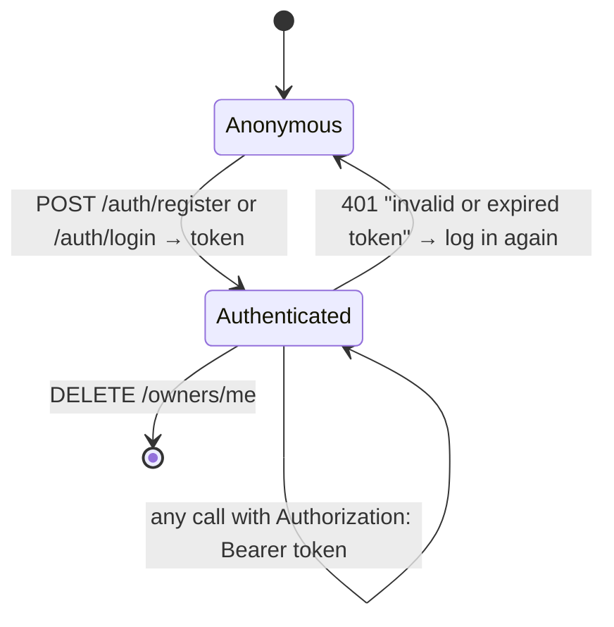
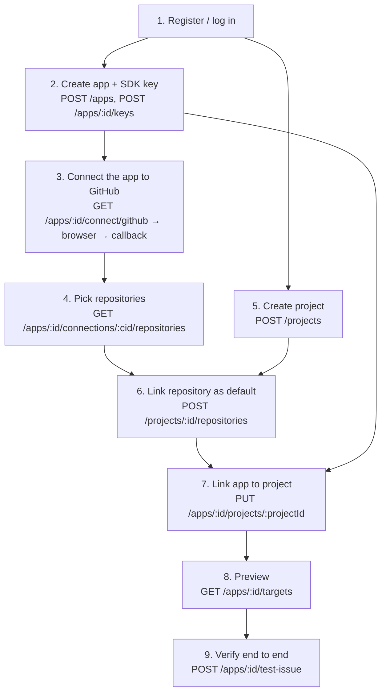

# Using the backend interfaces

This guide shows how to **use** what the backend offers, from two sides:

- **Part A, the HTTP API**, for anyone building a client: the admin console,
  scripts or other services. It covers the authentication lifecycle, the
  full onboarding workflow, error handling, rate limits and retries.
- **Part B, the Go interfaces**, for developers writing code inside the
  backend, such as the ingestion pipeline, a status-sync job or a new
  tracker. It covers which service to call, what each method promises, and
  how errors flow.

Reference pages: [api.md](api.md) lists every endpoint;
[architecture.md](architecture.md) explains how the pieces fit together.

- [Interfaces at a glance](#interfaces-at-a-glance)
- **Part A: HTTP API**
  - [A1. Authentication lifecycle](#a1-authentication-lifecycle)
  - [A2. Onboarding workflow, end to end](#a2-onboarding-workflow-end-to-end)
  - [A3. Handling the GitHub connect redirect in a frontend](#a3-handling-the-github-connect-redirect-in-a-frontend)
  - [A4. Errors, retries and idempotency](#a4-errors-retries-and-idempotency)
  - [A5. A minimal client](#a5-a-minimal-client)
- **Part B: Go interfaces**
  - [B1. Getting a service](#b1-getting-a-service)
  - [B2. Opening issues: issue.Service](#b2-opening-issues-issueservice)
  - [B3. Authenticating SDK keys: app.Service](#b3-authenticating-sdk-keys-appservice)
  - [B4. Working with an existing issue: issue.Opener](#b4-working-with-an-existing-issue-issueopener)
  - [B4b. Managing an app's connections: provider.Service](#b4b-managing-an-apps-connections-providerservice)
  - [B5. Implementing a tracker: provider.Provider](#b5-implementing-a-tracker-providerprovider)
  - [B6. Returning errors: apperr](#b6-returning-errors-apperr)
  - [B7. Writing an HTTP handler: httpx](#b7-writing-an-http-handler-httpx)
  - [B8. Throttling an action: ratelimit.Limiter](#b8-throttling-an-action-ratelimitlimiter)
  - [B9. Guarantees](#b9-guarantees)

---

## Interfaces at a glance

| Interface | Kind | Who uses it | Where |
|---|---|---|---|
| REST API `/api/v1` | HTTP + JSON, bearer JWT | admin console, scripts | [api.md](api.md) |
| `issue.Service` | Go service | ingestion, future jobs | `internal/issue/service.go` |
| `provider.Service` | Go service | anything managing app connections | `internal/provider/service.go` |
| `app.Service.Authenticate` | Go method | the future ingestion endpoint (SDK keys) | `internal/app/service.go` |
| `issue.Opener` / `issue.OpenerSource` | Go interfaces | dedup, status sync | `internal/issue/` |
| `issue.RateLimitError` | Go error type | anyone handling tracker failures | `internal/issue/issue.go` |
| `provider.Provider` | Go interface (plug-in) | tracker implementers | `internal/provider/provider.go` |
| `apperr` | error vocabulary | every service | `internal/apperr` |
| `httpx` | handler toolkit | every HTTP package | `internal/httpx` |
| `*ratelimit.Limiter` | Go type (token bucket) | anything that needs a throttle | `internal/ratelimit` |

---

# Part A: HTTP API

## A1. Authentication lifecycle



1. **Get a token.** Call `POST /auth/register` once, then
   `POST /auth/login`. Both return
   `{"owner": {...}, "token": {"access_token", "token_type": "Bearer", "expires_at"}}`.
2. **Store it** for the session. Admin consoles typically keep it in memory
   or session storage, and scripts in a file (the test suite uses
   `scripts/api/.env.test`).
3. **Send it on every request**: `Authorization: Bearer <access_token>`.
4. **Plan for expiry.** Tokens last `auth.jwt_ttl` (default 24 h). There is
   no refresh endpoint. When a call returns `401` with
   `{"error":"invalid or expired token"}`, log in again and retry once.
5. **Not every 401 means the token expired.** `401 invalid email or password`
   (login) and `401 current_password is required and must be correct`
   (`PATCH /owners/me`) are about credentials. Only
   `invalid or expired token` and `missing bearer token` mean "get a new
   token". Check the `error` string, not just the status.

## A2. Onboarding workflow, end to end

Credentials belong to **apps**, and projects only say where code lives. The
order matters, because each step uses an ID from an earlier one.



| Step | Request | Keep from the response |
|---|---|---|
| 1 | `POST /auth/login {"email","password"}` | `token.access_token` |
| 2 | `POST /apps {"name","platform":"ios","bundle_id"}` then `POST /apps/{appId}/keys` | `id`; and `secret`, which is **shown once**, so configure it in the SDK now |
| 3 | `GET /apps/{appId}/connect/github`, then send the browser to `url` | after the redirect: `connection_id` (see A3) |
| 4 | `GET /apps/{appId}/connections/{connection_id}/repositories` | a `full_name`, e.g. `octo-org/shop-ios` |
| 5 | `POST /projects {"name":"Shop Mobile"}` | `id` |
| 6 | `POST /projects/{id}/repositories {"tracker":"github","repository":"octo-org/shop-ios"}` | the first one becomes the default automatically |
| 7 | `PUT /apps/{appId}/projects/{id}` | — (204) |
| 8 | `GET /apps/{appId}/targets` | every entry should have a `connection_id` and no `error` |
| 9 | `POST /apps/{appId}/test-issue` | `results[].url`: open it and check the issue on GitHub |

**A second app.** It needs its own connection before it can report:

- If it reports into the same GitHub account as the first app, **attach**
  the first app's connection: `POST /apps/{app2}/connections
  {"connection_id": "<first app's connection>"}`. No GitHub round trip is
  needed. `GET /providers/connections` lists every connection you have to
  choose from.
- If it reports into a different account, run step 3 for it.

Variations:

- **One central triage repository:** link every app to one project whose
  default is the triage repository, and give each app a connection on that
  repository's account.
- **One repository per app:** one project per app, each with its own
  default.
- **Fan-out:** link one app to several projects. Every report opens an issue
  in each project's default repository, each through the app's connection
  for that repository.
- **Several GitHub organisations:** connect the app once per organisation
  (step 3 again). The issue service picks the connection whose account owns
  each repository.
- **Separate credentials per app:** because connections are per app, two
  apps feeding the same project can use different installations, or one of
  them can have none. A target without a connection fails with
  `no github connection on this app covers …`, and the other targets still
  go through.

## A3. Handling the GitHub connect redirect in a frontend

`GET /apps/{appId}/connect/github` returns JSON, not a redirect, because a
page that sends a bearer token cannot follow a cross-origin redirect
usefully:

```js
const { url } = await api('GET', `/apps/${appId}/connect/github`);
window.location.assign(url);           // the user installs the App on GitHub
```

GitHub then sends the browser to the backend's callback, which redirects to
`{server.frontend_url}/apps/{appId}/connections` with query parameters.
That's the same app the flow was started for, because the backend keeps it in
the one-time state. Your page at that path reads them:

| Parameter | Value |
|---|---|
| `provider` | `github` |
| `status` | `connected` or `error` |
| `connection_id` | on success: the app's new or updated connection |
| `reason` | on error: a readable message (URL-encoded), e.g. `this github account is already connected by another owner` |

```js
const q = new URLSearchParams(location.search);
if (q.get('status') === 'connected') showToast('GitHub connected');
else showError(q.get('reason') ?? 'GitHub connection failed');
```

If the state is missing, unknown or expired, the backend can't tell which app
the flow was for. It redirects to `{server.frontend_url}/apps` with
`status=error` instead.

The state behind the flow expires after **10 minutes** and works **once**.
If the user takes longer, start again from `connect`.

## A4. Errors, retries and idempotency

Every error is `{"error": "<message>"}` with these statuses:

| Status | What to do |
|---|---|
| `401` | see A1: re-login only for token errors |
| `404` | not found **or not yours**. They look the same on purpose; don't retry. |
| `409` | duplicate (email, slug, repository link), or a GitHub installation that another owner holds: show the message |
| `422` | fix the input; the message names the problem. Unknown JSON fields are rejected, so check spelling. |
| `429` | **wait `Retry-After` seconds**, then retry. This comes from m-Seismo's own throttle or from GitHub's rate limits. |
| `500` | server bug or outage; retry later with backoff; report with the time of the request |
| `502` | test-issue only: every target failed; read `results[].error` |

**Which requests are safe to retry** after a timeout or a `5xx`:

| Request | Safe? | Why |
|---|---|---|
| `GET` anything | yes | read-only |
| `PUT /apps/{id}/projects/{pid}`, `PUT …/default`, `POST /apps/{id}/connections` (attach) | yes | idempotent |
| `DELETE …` | yes; a repeat may return `404` | the first one already deleted it |
| `PATCH …` | yes, if you send the full intended values | last write wins |
| `POST /projects`, `/apps`, `/apps/{id}/keys`, `…/repositories` | **no**: list first | may create a duplicate (or 409 for slugs and links) |
| `POST /apps/{id}/test-issue` | **no** | each call can open new issues; it is also throttled to 10/min/app |
| any request answered `429` | yes, **after** `Retry-After` | nothing was done |

**Rate limits.** GitHub limits each installation to about 5,000 requests per
hour, plus stricter burst limits on creating issues. The backend paces and
retries for you (see [github.md → Rate limits](github.md#rate-limits)), so
clients only need to honour `Retry-After` on `429`. Don't retry in a tight
loop.

## A5. A minimal client

A small wrapper in TypeScript that does A1 and A4. It works in a browser or
in Node 18+.

```ts
const API = 'http://localhost:8080/api/v1';
let token: string | null = null;

async function login(email: string, password: string) {
  const r = await fetch(`${API}/auth/login`, {
    method: 'POST',
    headers: { 'Content-Type': 'application/json' },
    body: JSON.stringify({ email, password }),
  });
  if (!r.ok) throw new Error((await r.json()).error);
  token = (await r.json()).token.access_token;
}

export async function api<T>(method: string, path: string, body?: unknown, retried = false): Promise<T> {
  const r = await fetch(`${API}${path}`, {
    method,
    headers: {
      ...(body !== undefined && { 'Content-Type': 'application/json' }),
      ...(token && { Authorization: `Bearer ${token}` }),
    },
    body: body === undefined ? undefined : JSON.stringify(body),
  });
  if (r.status === 204) return undefined as T;
  const data = await r.json();
  if (r.ok) return data as T;

  const tokenProblem = data.error === 'invalid or expired token' || data.error === 'missing bearer token';
  if (r.status === 401 && tokenProblem && !retried) {
    await reauthenticate();              // e.g. show the login form, then call login()
    return api<T>(method, path, body, true);
  }
  if (r.status === 429) {
    const wait = Number(r.headers.get('Retry-After') ?? '1');
    throw Object.assign(new Error(data.error), { retryAfterSeconds: wait, results: data.results });
  }
  throw Object.assign(new Error(data.error), { status: r.status, results: data.results });
}
```

The bash equivalent, with the token stored in a file and re-checked on every
request, is `scripts/api/lib.sh` (see [test-scripts.md](test-scripts.md)).

---

# Part B: Go interfaces

## B1. Getting a service

Everything is wired by fx. To use a service, add it as a constructor
parameter of your own component and register that component in a module:

```go
package ingest

type Handler struct {
    apps    *app.Service
    issues  *issue.Service
    require httpx.AuthMiddleware // only if you need owner auth
}

func NewHandler(apps *app.Service, issues *issue.Service) *Handler {
    return &Handler{apps: apps, issues: issues}
}

var Module = fx.Module("ingest",
    fx.Provide(httpx.AsRoutes(NewHandler)), // or fx.Provide(NewWorker) for a background job
)
```

Then add `ingest.Module` to `Options()` in `main.go`. `go test .` runs
`TestGraph`, which fails if a dependency is missing.

| You need | Ask fx for |
|---|---|
| open issues for an app, or see where they would go | `*issue.Service` |
| check an SDK key | `*app.Service` |
| manage an app's connections | `*provider.Service` |
| act on one tracker connection | `issue.OpenerSource` (or `*provider.Registry`) |
| raw SQL queries | `db.Querier` (or `*db.Queries` + `*pgxpool.Pool` for transactions) |
| a throttle | `*ratelimit.Limiter` |
| settings | `*config.Config` |

## B2. Opening issues: `issue.Service`

```go
func (s *Service) OpenForApp(ctx context.Context, appID uuid.UUID, d issue.Draft) ([]issue.Result, error)
func (s *Service) OpenInRepository(ctx context.Context, appID, projectRepositoryID uuid.UUID, d issue.Draft) (issue.Result, error)
func (s *Service) Targets(ctx context.Context, appID uuid.UUID) ([]issue.Target, error)
```

**Input: `issue.Draft`**

| Field | Required | Notes |
|---|---|---|
| `Title` | **yes** | empty → error before any I/O |
| `Body` | no | Markdown, as GitHub renders it |
| `Labels`, `Assignees` | no | passed to the tracker unchanged |
| `Milestone` | no | a **title**; the provider resolves it (cached); unknown → opened without it, plus a warning in the log |
| `Fingerprint` | no | stored with the issue for future dedup (FR-54) |

**Where it goes, and through what.**

- `OpenForApp` targets the **default repository of every project linked to
  the app**. Projects without a default are skipped.
- `OpenInRepository` targets one repository you chose, for example from
  routing rules, in a project the app is linked to.
- In both cases each repository is opened through **the app's own
  connection** for it: the first active connection on the same tracker that
  covers the repository (on GitHub, the installation is on the repository's
  owner).
- A repository no connection covers gets an error wrapping
  `issue.ErrNoConnection`, and the tracker is not called.
- `Targets` runs the same resolution without opening anything.

**Output.** One `Result` per target, in link order:

```go
results, err := issues.OpenForApp(ctx, appID, issue.Draft{
    Title:       report.Title,
    Body:        render(report),
    Labels:      []string{"m-seismo", report.Severity},
    Fingerprint: report.Fingerprint,
})
switch {
case errors.Is(err, issue.ErrNoTargets):
    // app not wired to any repository yet: keep the report, tell the admin
case err != nil && results == nil:
    // could not even resolve targets (DB problem): retry the whole thing later
}
for _, r := range results {           // read every result, even when err == nil
    var rl *issue.RateLimitError
    switch {
    case r.Err == nil:
        log.Printf("opened %s (%s) through connection %s, row %s", r.Ref.ID, r.Ref.URL, r.ConnectionID, r.IssueID)
    case errors.Is(r.Err, issue.ErrNoConnection):
        notifyAdmin(appID, r.Tracker, r.Repository) // configuration, not a transient failure
    case errors.As(r.Err, &rl):
        retryLater(r.ProjectRepositoryID, rl.Wait) // GitHub refused; nothing was created
    default:
        retryWithBackoff(r.ProjectRepositoryID)    // may or may not have been created upstream
    }
}
```

| Returned `err` | Meaning |
|---|---|
| `nil` | at least one target succeeded; check every `Result.Err` |
| `issue.ErrNoTargets` | no linked project has a usable default repository |
| `"issue: every target failed: …"` | all failed; `results` holds each reason |
| other, with `results == nil` | validation or database failure |

**Context and time.** The context bounds the whole call, including waiting
out GitHub rate limits. With a deadline, the provider never waits past it.
It returns `*issue.RateLimitError` straight away instead. For an HTTP request,
pass `r.Context()`. For a background job, set a deadline that suits the job.

**Concurrency.** Targets run one at a time. The GitHub provider also
serialises writes per installation, at least 1 s apart. Calling
`OpenForApp` from several goroutines is safe, and their writes to the same
installation are queued, not bunched.

## B3. Authenticating SDK keys: `app.Service`

```go
func (s *Service) Authenticate(ctx context.Context, rawKey string) (uuid.UUID, error)
```

It returns the app ID for an active key. Every failure, whether a wrong
prefix, an unknown key or a revoked key, is the same
`apperr.Unauthorized("invalid key")`. A sketch of the ingestion endpoint
built on it:

```go
func (h *Handler) Mount(r chi.Router) {
    r.Post("/reports", h.submit) // no owner JWT: the SDK authenticates with its key
}

func (h *Handler) submit(w http.ResponseWriter, r *http.Request) {
    appID, err := h.apps.Authenticate(r.Context(), r.Header.Get("X-Seismo-Key"))
    if err != nil {
        httpx.Error(w, r, err) // 401
        return
    }
    var rep Report
    if err := httpx.Decode(w, r, &rep); err != nil {
        httpx.Error(w, r, err) // 422
        return
    }
    // Acknowledge fast (PRD: < 0.5 s) and open the issue asynchronously,
    // e.g. publish to NATS and call issue.Service from a consumer.
    enqueue(appID, rep)
    httpx.JSON(w, http.StatusAccepted, map[string]string{"status": "queued"})
}
```

## B4. Working with an existing issue: `issue.Opener`

To comment on an issue or check its state later (dedup, status sync), ask
the registry for an opener bound to the connection that opened the issue.
`issues.provider_connection_id` records it:

```go
type OpenerSource interface {
    Opener(ctx context.Context, c issue.Connection) (issue.Opener, error)
    Covers(c issue.Connection, repository string) bool
}

type Opener interface {
    Open(ctx context.Context, in issue.Issue) (issue.Ref, error)
    Comment(ctx context.Context, ref issue.Ref, body string) error
    IsOpen(ctx context.Context, ref issue.Ref) (bool, error)
}
```

```go
// row is an issues row; its provider_connection_id names the connection that opened it.
conn, err := q.GetOwnerConnection(ctx, db.GetOwnerConnectionParams{ID: *row.ProviderConnectionID, OwnerID: ownerID})
if err != nil { return err } // gone: pick another connection of an app that Covers the repository

op, err := openers.Opener(ctx, issue.ConnectionFromRow(conn))
if err != nil { return err }

ref := issue.Ref{ID: row.ExternalID, URL: row.Url}  // from the issues table
open, err := op.IsOpen(ctx, ref)
if err == nil && !open {
    q.SetIssueState(ctx, db.SetIssueStateParams{ID: row.ID, State: "closed"})
}
```

- `Ref.ID` is opaque outside the provider. For GitHub it is `owner/name#N`.
  Store it as you got it, in `issues.external_id`.
- Openers are cheap and safe to reuse. The GitHub one shares the
  installation's cached client, token and write pacer, even across apps.
- Every method can return `*issue.RateLimitError`. Treat it as "try again
  after `Wait`".

## B4b. Managing an app's connections: `provider.Service`

```go
func (s *Service) StartConnect(ctx, ownerID, appID uuid.UUID, tracker db.Tracker) (url string, err error)
func (s *Service) FinishConnect(ctx, tracker db.Tracker, query url.Values) (appID uuid.UUID, c Connection, err error)
func (s *Service) AttachConnection(ctx, ownerID, appID, fromConnectionID uuid.UUID) (Connection, error)
func (s *Service) ListConnections(ctx, ownerID, appID uuid.UUID) ([]Connection, error)
func (s *Service) ListOwnerConnections(ctx, ownerID uuid.UUID) ([]Connection, error)
func (s *Service) Disconnect(ctx, ownerID, appID, connectionID uuid.UUID) error
func (s *Service) ListRepositories(ctx, ownerID, appID, connectionID uuid.UUID) ([]Repository, error)
```

- Every method checks ownership in SQL. Another owner's app or connection is
  `apperr.NotFound`.
- `FinishConnect` returns the app ID even on error, whenever the state was
  valid, so the caller can send the browser back to that app.
- `AttachConnection` is idempotent and needs no tracker call. Connecting a
  tracker account that another owner holds is `apperr.Conflict` (the
  database's exclusion constraint, SQLSTATE `23P01`).

## B5. Implementing a tracker: `provider.Provider`

The method-by-method contract (step-by-step recipe in
[extending.md](extending.md#add-a-tracker-gitlab-bitbucket)):

| Method | Must | Must not |
|---|---|---|
| `Tracker()` | return a `db.Tracker` enum value | — |
| `InstallURL(state)` | return the tracker's authorise/install URL carrying `state` unchanged | — |
| `CompleteInstall(ctx, query)` | **verify** the grant with the tracker, using credentials that belong to the user (e.g. an OAuth code exchange); return `ExternalID`, `Login` and `Type`; return `apperr.Invalid` for user errors | trust IDs in `query` without verifying them |
| `ListRepositories(ctx, c)` | return every reachable repository (paginate); return `[]`, not nil, when empty | — |
| `HasRepository(ctx, c, repo)` | return `false, nil` when the repository is not reachable; an error only for real failures; `apperr.Invalid` for malformed names | report "not found" as an error |
| `ValidateRepository(repo)` | check the tracker's name format; `apperr.Invalid` when wrong | call the tracker |
| `Covers(c, repo)` | say whether connection `c` could reach `repo` at all (GitHub: the repository owner is `c.AccountLogin`); `true` when it can't be told locally | call the tracker; it runs for every target of every report |
| `Opener(ctx, c)` | return a reusable `issue.Opener`; load per-connection secrets by `c.ID` if the tracker has them | do network I/O just to construct it |
| any call | return `*issue.RateLimitError` when the tracker rate-limits and you can't wait; never retry non-idempotent writes after an unknown failure | retry a failed POST blindly (duplicates) |

Register it with `provider.AsProvider(FromConfig)`, returning an empty slice
when it isn't configured.

## B6. Returning errors: `apperr`

Services return errors; `httpx.Error` turns them into responses.

```go
return apperr.NotFound("project not found")                  // 404
return apperr.Conflict("a project with this slug already exists") // 409
return apperr.Invalid("slug must be …")                      // 422
return apperr.Unauthorized("invalid key")                    // 401
return apperr.RateLimited("too many test issues …", wait)    // 429 + Retry-After
return err                                                   // pgx.ErrNoRows → 404, unique violation → 409,
                                                             // anything with RetryAfter() → 429, else 500 (logged)
```

- Messages are **shown to clients**. Keep internal details, such as SQL or
  hostnames, out of them. Wrap the cause in `Err` when you need it in logs.
- To specialise a database error:
  `if k, _ := apperr.Classify(err); k == apperr.KindConflict { return apperr.Conflict("…") }`.
- Any error type with `RetryAfter() time.Duration` is treated as a rate
  limit. That is how `*issue.RateLimitError` becomes a `429` without the
  HTTP layer knowing about trackers.

## B7. Writing an HTTP handler: `httpx`

| Helper | Use |
|---|---|
| `httpx.AsRoutes(NewHandler)` | register a type with `Mount(chi.Router)`; it is mounted under `/api/v1` |
| `httpx.AuthMiddleware` | inject it and wrap owner routes: `r.With(h.require).Route(…)` |
| `httpx.OwnerID(ctx)` | the authenticated owner (only behind the middleware) |
| `httpx.Decode(w, r, &v)` | JSON body: 1 MiB limit, unknown fields and trailing data rejected (422) |
| `httpx.UUIDParam(r, "id")` | path UUID; malformed → 404 |
| `httpx.JSON(w, status, v)` / `httpx.NoContent(w)` | success responses |
| `httpx.Error(w, r, err)` | any error → status + `{"error"}` (+ `Retry-After` for 429; 500s logged) |
| `httpx.SetRetryAfter(w, d)` | set `Retry-After` yourself (rounded up to seconds, at least 1) |

A complete owner-scoped handler:

```go
func (h *Handler) Mount(r chi.Router) {
    r.With(h.require).Get("/things/{id}", h.get)
}

func (h *Handler) get(w http.ResponseWriter, r *http.Request) {
    id, err := httpx.UUIDParam(r, "id")
    if err != nil {
        httpx.Error(w, r, err)
        return
    }
    t, err := h.svc.Get(r.Context(), httpx.OwnerID(r.Context()), id) // service scopes by owner in SQL
    if err != nil {
        httpx.Error(w, r, err)
        return
    }
    httpx.JSON(w, http.StatusOK, t)
}
```

## B8. Throttling an action: `ratelimit.Limiter`

```go
type Limit struct {
    PerMinute float64 // steady rate
    Burst     int     // calls allowed at once after a quiet period
}

func (l *Limiter) Allow(ctx context.Context, key string, lim Limit) (Result, error)
```

`*ratelimit.Limiter` is a token bucket per key in Redis, so it holds across
server instances. Each allowed call takes one token; the bucket refills at
`PerMinute`. Take it through a small interface in your package (as
`app.Limiter` and `ingest.Limiter` do) and key it by whatever you are
limiting:

```go
res, err := s.limiter.Allow(ctx, "report:"+appID.String(), ratelimit.Limit{PerMinute: 120, Burst: 20})
if err != nil {
    return err
}
if !res.Allowed {
    return apperr.RateLimited("too many reports from this app; retry later", res.RetryAfter) // 429 + Retry-After
}
```

Make the limit a config value (`limits.*`) so operators can tune it without
a release.

## B9. Guarantees

| Topic | Guarantee |
|---|---|
| Owner isolation | owner-scoped SQL; another owner's IDs behave as non-existent (404) |
| Credentials per app | an app opens issues only through its own connections; a tracker account never spans two owners (database constraint) |
| Concurrency | all services are safe for concurrent use; provider caches and pacers are mutex-guarded |
| GitHub writes | serialised per installation, at least `github.min_write_interval` apart |
| Rate limits | waited out when the wait is ≤ `github.max_rate_limit_wait` and fits the context; otherwise a typed `*issue.RateLimitError` |
| No duplicate issues from retries | only rate-limited (unprocessed) requests are retried automatically |
| Secrets | passwords bcrypt-hashed; SDK keys SHA-256-hashed and shown once; no GitHub token stored (per owner or per app) |
| Partial delivery | one failing target never blocks the others; every target has its own `Result` |
